The composer is where the user writes to the agent. It sits at the foot of
the chat, under the transcript, and it's also where anything waiting on the
user appears: questions, and the agent banner when the agent isn't ready.

[See the composer live](~attachments/caf-si-composer), every state, in dark
and light.

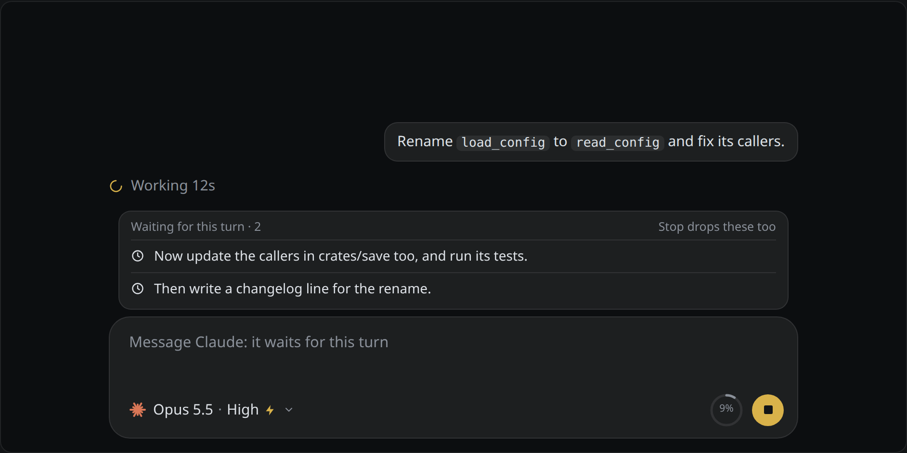

**Required, all of it**, but for favourites, which are the app's. The
composer is inside the chat, and a user moving between CAF apps should find
it the same in each.

## Its parts

One rounded box. The message is on top and the controls run along the
bottom. Nothing sits above the text inside the box.

| Part | Where | What it is |
| --- | --- | --- |
| The message | The top of the box | Plain text, as many lines as the user writes. |
| The settings control | Bottom left | The agent's mark and one control for all its settings: *Opus 5.5 · High*, with a bolt when fast mode is on. It opens the settings menu. |
| The context ring | Bottom right | How full the agent's context is, as a ring and a percent. It opens the usage popover. |
| The round button | Bottom right, after the ring | **Send**, or **Stop** while a turn runs or the chat opens, and the box is empty. |
| The tray | Above the box | Messages waiting to be sent, why a message couldn't be sent, or that the chat is archived. |
| What's attached | Between the tray and the box, joined to the box | A question waiting on the user, or the agent banner. Only one at a time. |

From the top, then: the tray, then what's attached, then the box.

**One thing attaches at a time.** If a question and the agent banner both
apply, the question attaches, and the banner returns once it's answered. If
several questions wait, the oldest attaches, and the next takes its place
when it's answered.

The accent colour marks what to press and what's chosen, as the
[colour roles](~caf/standard-interface/overview#colour-roles) say: in the
composer, the lit round button, the caret, the effort slider, the lit fast
mode switch, the chosen row in the menu and its filter's mark, favourites'
stars, the search box's underline, and the edge of a question from the
agent. The agent banner's edge takes the banner's own tone, and a question
CAF asks itself, such as whether to keep waiting for a chat to open, is
calm.

## Writing

**Empty.** The chat is idle and the box is empty. The box says
*Message Claude*, with the agent's name, and Send is unlit: pressing it does
nothing.

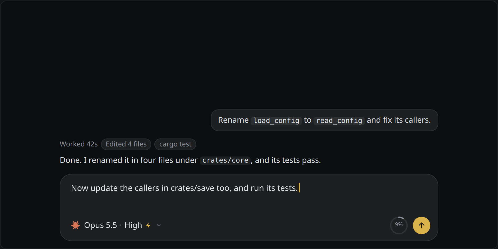

**Typing.** As soon as there's text, Send lights up in the accent.

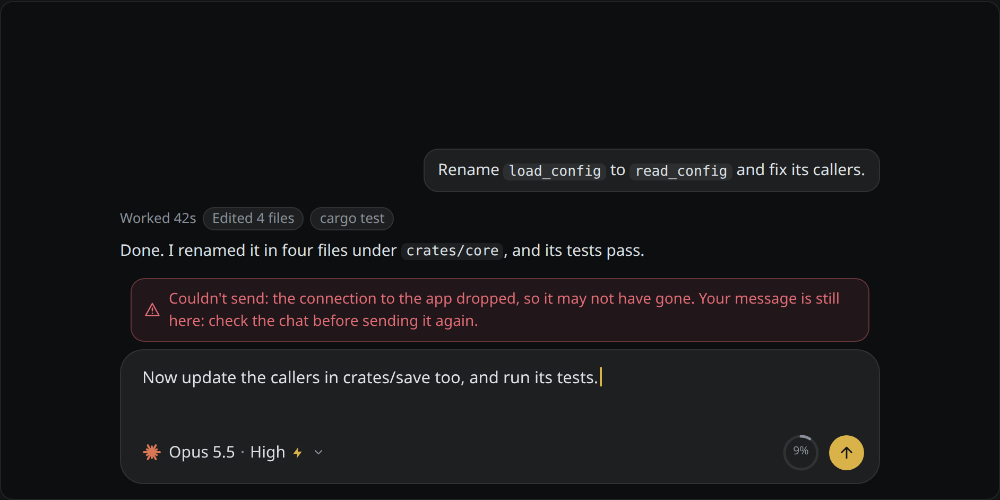

**Couldn't send.** When a message can't be sent, its text goes back in the
box, untouched, and the tray says why, in the warning colour. The user's
words are never lost. The words, by what happened:

| What happened | The tray says |
| --- | --- |
| The link to the app dropped before CAF answered | *Couldn't send: the connection to the app dropped, so it may not have gone. Your message is still here: check the chat before sending it again.* |
| Too many messages are waiting (`Refused::QueueFull`; the app sets how many may, eight by default) | *Couldn't send: 8 messages are already waiting. Send this once one has gone.*, with the number that waits |
| The agent can't take the message (`Refused::Unsupported`) | *Couldn't send: Claude can't take this message.* |
| The chat isn't open any more (`Refused::NoSuchChat`) | *Couldn't send: this chat isn't open any more.* |

A chat whose agent is gone or can't be run (`Refused::NoSuchAgent`,
`Refused::OwnTools`) shows [Can't write](#what-the-chat-allows) instead, so
the user isn't invited to send at all. An archived chat isn't one: a
message to it is sent, and brings it back, as
[Archived](#what-the-chat-allows) says.

## Messages that wait

A message sent while the agent can't take it yet waits, and goes as soon as
it can (CAF queues it). Waiting messages sit on the tray, each with a clock,
under a heading that says what they wait for and how many there are. Send
stays available: more can wait.

| While | The tray's heading | The box says |
| --- | --- | --- |
| A turn runs | *Waiting for this turn · 2* | *Message Claude: it waits for this turn* |
| The chat is opening | *Waiting for Claude to open · 1* | *Message Claude: it waits for Claude to open* |
| The chat waits for its agent | As [Agents](~caf/standard-interface/agents) says | *Message Claude: it waits until Claude is ready* |

At the heading's other end, the tray says what drops them: *Stop drops these
too*, or *Stop drops it too* for one, while a turn runs or the chat opens.
While the chat waits for its agent, the round button stays **Send**, and the
agent banner's **Not now** drops what waits, as
[Agents](~caf/standard-interface/agents) says.

### While a turn runs

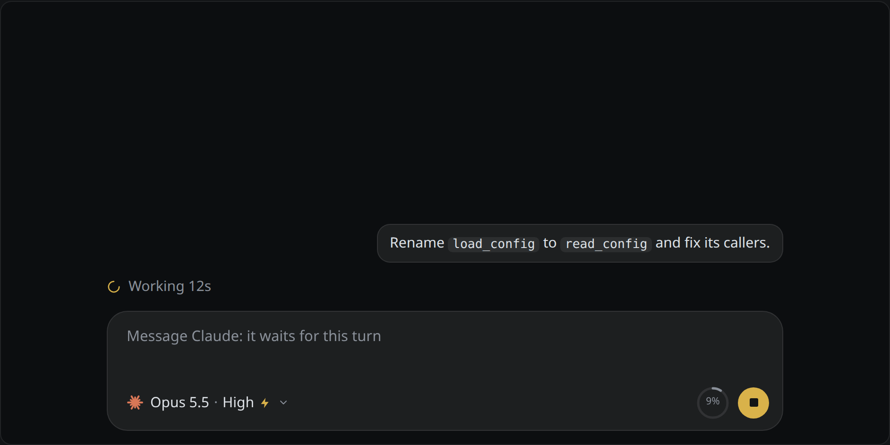

**Running.** While the agent works and the box is empty, the round button is
**Stop**, lit.

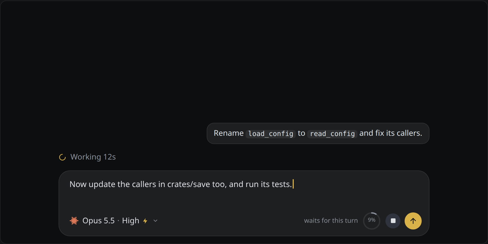

**Running, and typing.** Typing during a turn turns the round button back
into **Send**, because the message will wait. Stop moves to a smaller button
beside it, so it's still one click away. A note by the buttons says
*waits for this turn*.

**Messages waiting.** The picture at the top of this page: two messages wait
for the turn. Stop ends the turn and drops them too: they become turns that
were stopped before they were sent, as
[the transcript](~caf/standard-interface/transcript) shows.

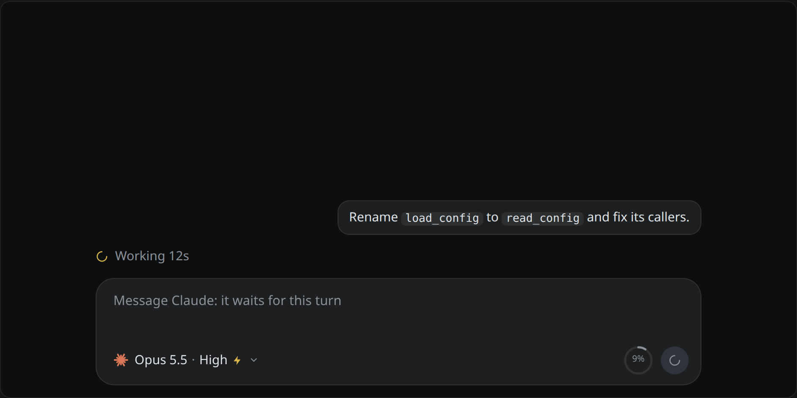

**Stopping.** Once Stop is pressed, and until the agent confirms the turn has
stopped, the round button spins and can't be pressed again. Its tooltip says
*Stopping…*.

### While the chat opens

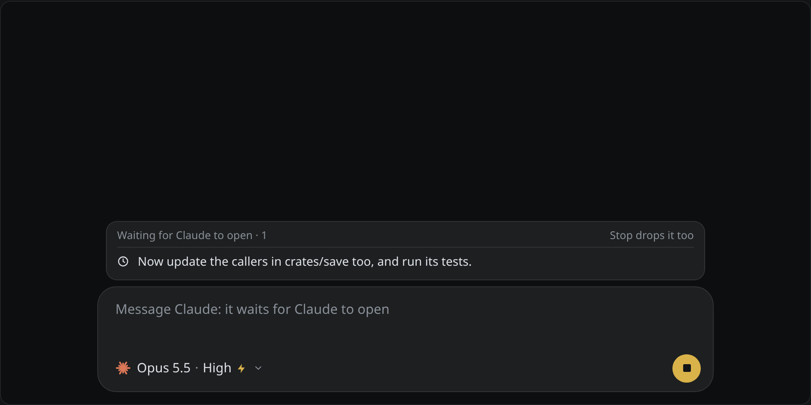

**Waiting to open.** A message sent while the chat is still opening waits
for it. There's no turn yet, so the tray says *Waiting for Claude to open*.
The round button is **Stop**, as during a turn: it gives up opening, and
drops the message (`Core::stop`).

## Settings

The settings control shows what the agent uses now: the model, the effort,
and a bolt when fast mode is on. It opens one menu that holds them all.

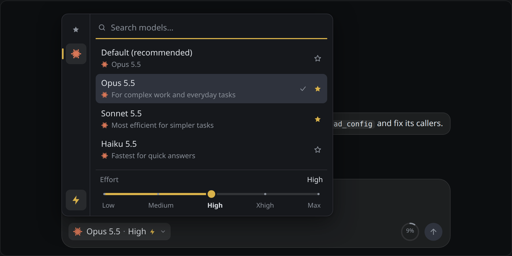

**The menu.** It's drawn as clackatoo's model menu:

- **A rail down the left** filters the list: favourites first, then the
  chat's agent. Fast mode is at its foot, lit in the accent when on, and gone
  when the model doesn't offer it. Its tooltip says
  *Fast mode on: faster answers, may cost more*, or *off*.
- **Search**, at the top: *Search models…*.
- **The models**, as the agent names and orders them, each with its
  description. A choice that stands for whatever the agent would pick, such
  as Claude's *Default (recommended)*, is listed as the agent names it. The
  one in use has a tick. Each has a star, to make it a favourite.
- **Effort, as a slider**, under the list, from the agent's lowest level to
  its highest, each level named.

Each setting appears only if the agent offers it. CAF says what the agent
offers in `Setting.form`: a list of `Choices` (models, effort levels) or a
`Switch` (fast mode). The menu is built from that, never from a list the app
keeps itself. See [Choosing the model](~caf/getting-started/choosing-the-model).

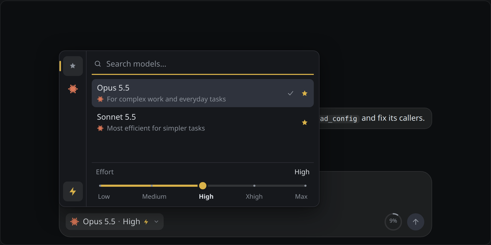

**Favourites. Up to the app.** The star filter shows only starred models.
Favourites belong to the app, which keeps them as it likes; CAF knows
nothing of them. An app without favourites leaves out the stars and the
filter.

### A change not applied yet

A setting changed during a turn doesn't apply to it. CAF holds the change
and sends it as the turn ends, so it applies from the next message. A change
made while the chat opens, or while the agent hasn't answered it yet, waits
the same way.

CAF tells the app: a chat's `settings.chosen` differs from what the agent
says is `current` until the change applies. A part is drawn as not applied
yet, in the caution colour with a clock, when the chat's `settings.offered`
holds that setting, its `current` is known, and the choice differs from it.
While a setting's `current` isn't known (the agent doesn't say), or the chat
has no `offered` yet, the control shows what's chosen, plainly. The tooltip
says *From the next turn* while a turn runs, and *Not applied yet*
otherwise.

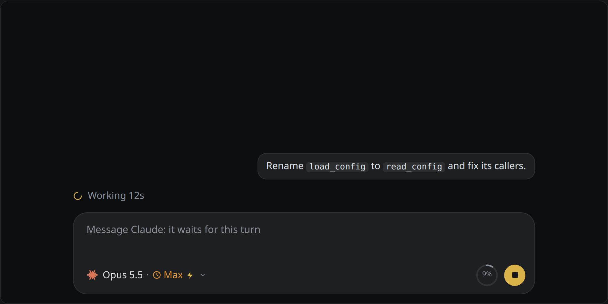

**Effort held.** The control shows what will apply, *Max*, with the clock.

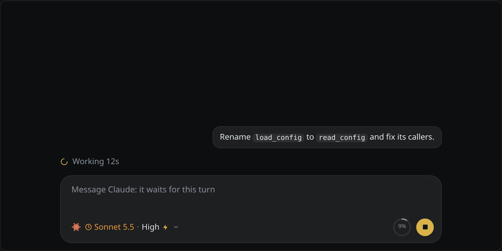

**Model held.** The same: the new model is in the caution colour with a
clock until it applies. Effort and fast mode stay as they are, because what
the new model offers isn't known until it applies.

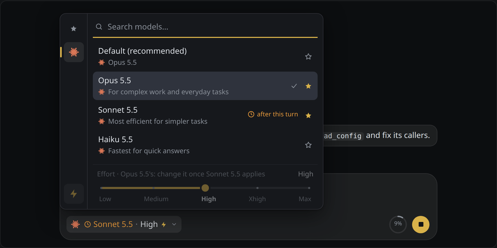

**The menu, while a model change is held.** The current model keeps its
tick, and the one picked says *after this turn*, or *not applied yet*, with a
clock. Picking the current model again cancels the change. **Effort and fast
mode can't be changed until the new model applies**: they're dimmed, and
effort is headed *Effort · Opus 5.5's: change it once Sonnet 5.5 applies*.
CAF checks a choice against what's offered now, so an effort level only the
new model has can't be chosen before it applies.

### After the model changes

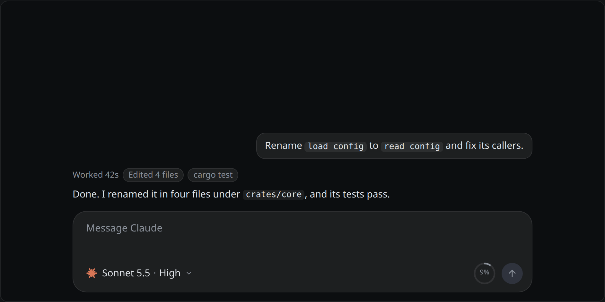

**The model changed.** Once the turn ends, the new model applies. The agent
then says what that model offers, and the control follows: here, the new
model has no fast mode, so the bolt goes.

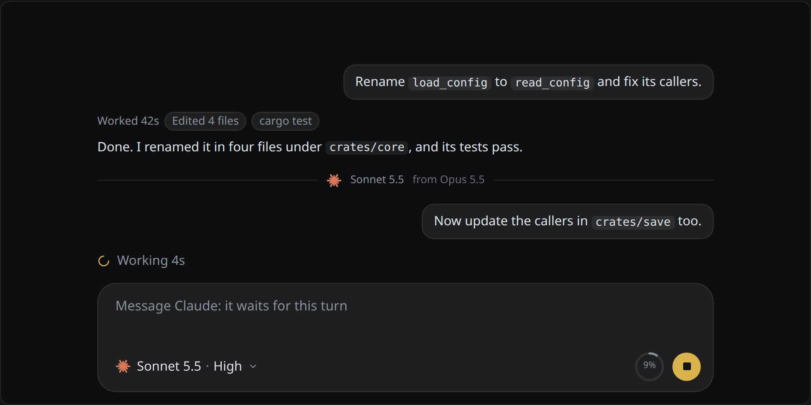

**A divider in the transcript** marks where the model changed: the agent's
mark, the new model, and *from* the old one, muted. The app draws it wherever
a turn's model (`Turn.model`) differs from the turn before, so it needs
nothing more from CAF, appears in restored chats too, and sits exactly where
answers start coming from the new model.

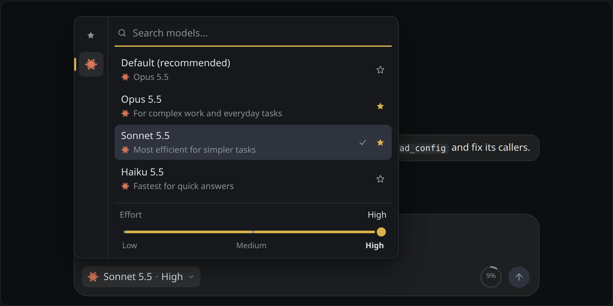

**The menu after the change** shows the new model's effort levels, and the
fast mode switch is gone if the model doesn't offer it. If something the user
chose isn't offered any more, CAF falls back to what is, and puts a note in
the transcript (`Note::NotOffered`).

### Before CAF knows the settings

While a chat's `settings.offered` is empty, as it is until a chat first
opens, its settings are what CAF knows of the agent's:
`AgentStatus.settings`, which is `Unknown`, `Learning`, `Known` or
`Failed`. A new chat with an agent whose settings are `Known` shows the menu
as above, from those.

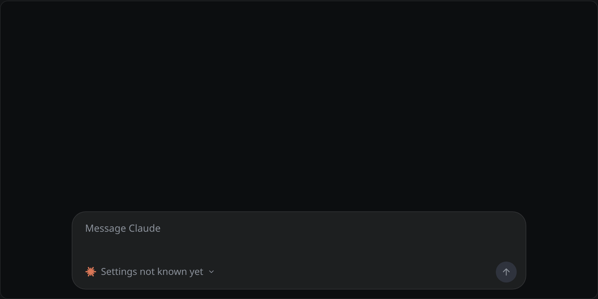

**Not known yet** (`Unknown`). The control says *Settings not known yet*, or
*Settings* where it's narrow, and nothing more.

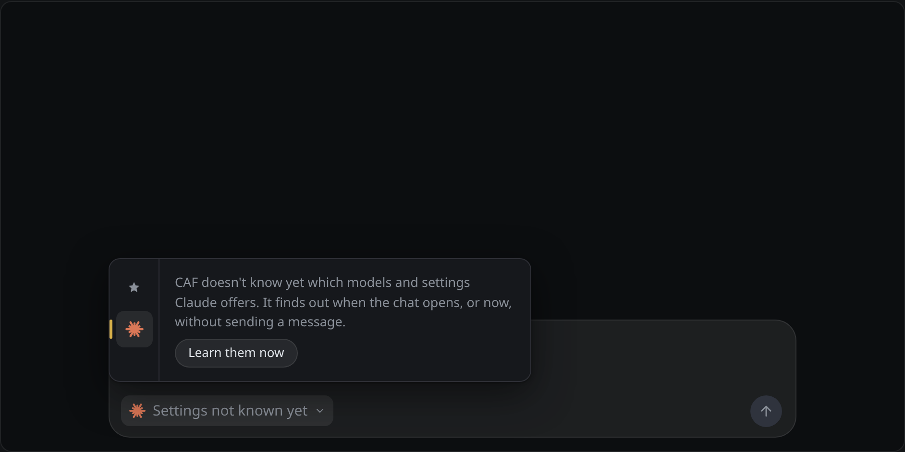

Its menu says *CAF doesn't know yet which models and settings Claude offers.
It finds out when the chat opens, or now, without sending a message.*, and
offers a **Learn them now** button, which has CAF find out
(`Core::learn_settings`). Only a viewer with the `agents` right sees the
button; for any other, the menu leaves out *, or now, without sending a
message*.

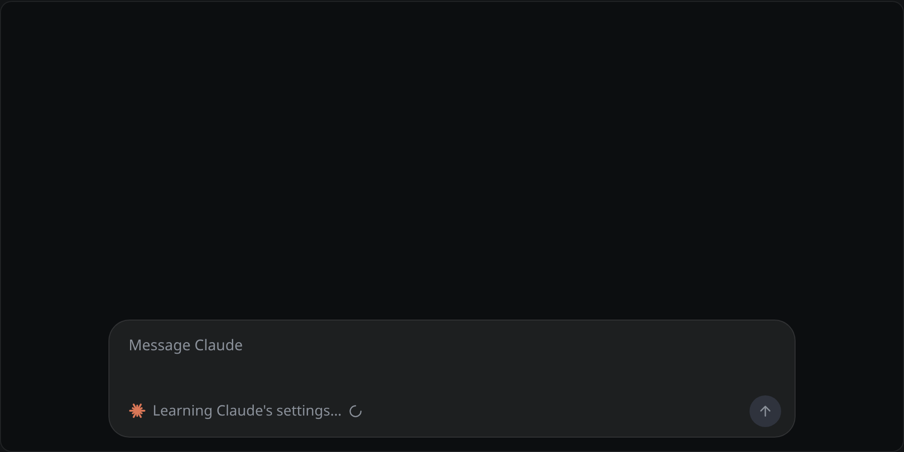

**Learning** (`Learning`). The control says *Learning Claude's settings…*
with a spinner, and can't be opened.

**Couldn't learn them** (`Failed`). The control says
*Couldn't learn Claude's settings*, or *Settings* where it's narrow.

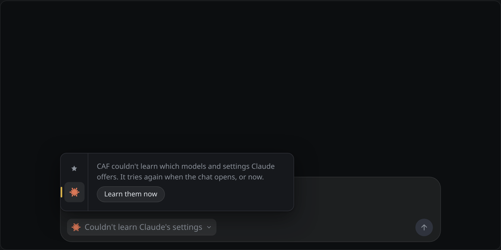

Its menu says *CAF couldn't learn which models and settings Claude offers.*,
then why, in bold, then *It tries again when the chat opens, or now.*, with
the same **Learn them now** button, and the same rule for a viewer without
the `agents` right. CAF says why as a `LearnFailure`, and the words are the
app's, with the agent's name in place of *Claude*:

| Why (`LearnFailure`) | The menu says | Learn them now |
| --- | --- | --- |
| `NotInstalled` | *Claude isn't installed.* | Yes |
| `NotLookedYet` | *CAF hadn't checked yet whether Claude is installed.* | Yes |
| `SigningIn` | *Claude was being signed in to.* | Yes |
| `SignInNeeded` | *Claude wants you to sign in first.* | Yes |
| `CouldNotStart` | *Claude couldn't be started.*, then what the system said | Yes |
| `Refused` | *Claude refused to open a chat.*, then what Claude said | Yes |
| `StartTimedOut` | *Claude didn't start in time.* | Yes |
| `OpenTimedOut` | *Claude didn't open a chat in time.* | Yes |
| `Unreadable` | *Claude's answer made no sense.* | Yes |
| `Restarted` | *Claude was restarted meanwhile.* | Yes |
| `Stopped` | *Claude stopped.* | Yes |
| `ShutDown` | *The app was closing.* | No |
| `Incompatible` | *This version of Claude can't talk to this app.* | No |
| `OwnTools` | *Claude can't be used: its own tools can't be turned off.* | No |

They're the transcript's words for a chat that lost its agent the same
way, so the user meets one sentence for one cause. A reason newer than the
app knows has no sentence: the menu says the rest, with the button.

**Where trying again can't help**, the menu ends with why, and has no
button and no *It tries again…*: the app is closing (`ShutDown`), or CAF
can't use the agent at all (`Incompatible`, `OwnTools`), which nothing
the user does from the menu changes.

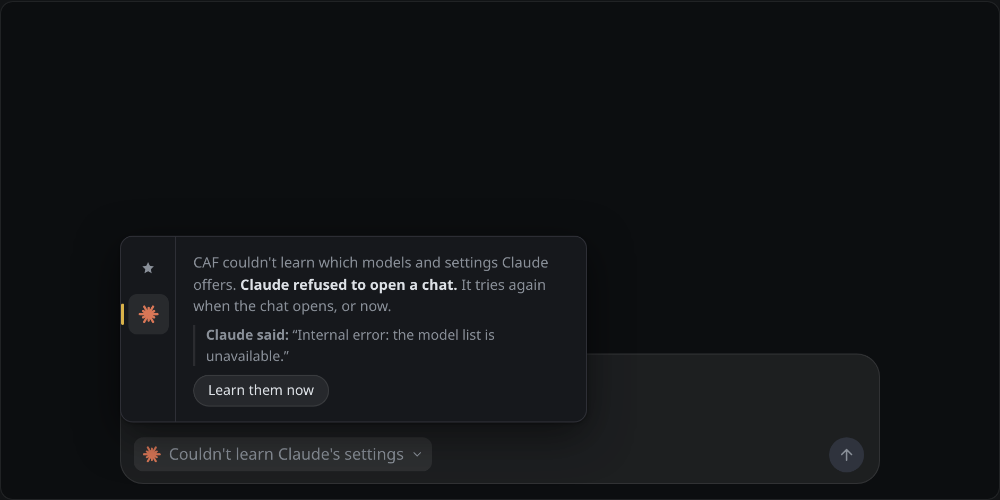

**What the system or the agent said.** CAF keeps their words apart from
why: what the system said when the agent couldn't be started
(`CouldNotStart.error`), and what the agent said refusing
(`Refused.message`), each cleaned and capped. The menu shows them under
why, as theirs, and never as CAF's: the system's in a monospace font,
muted, as a chat that can't be restored shows the store's; the agent's
introduced as *Claude said:*, in quotation marks, muted, with a rule down
its left, as a failed turn quotes it. They often say what to do, such as
that a file is missing, which no sentence of the app's could. Either may be
empty, and is then left out.

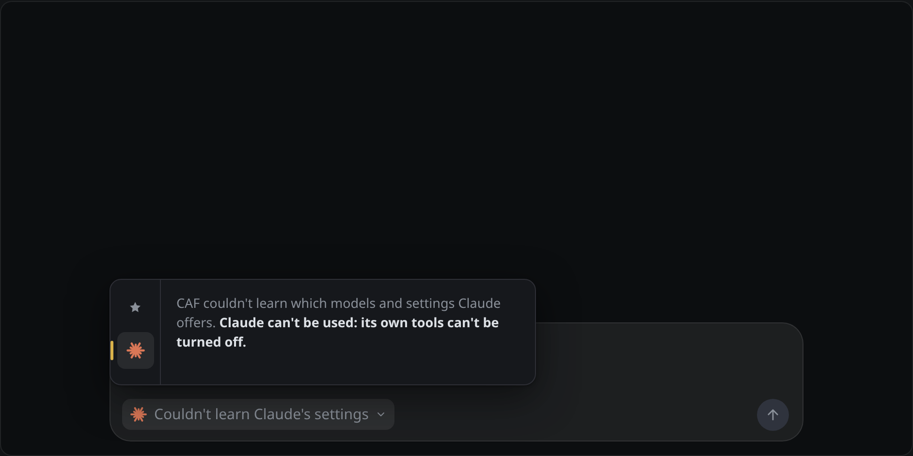

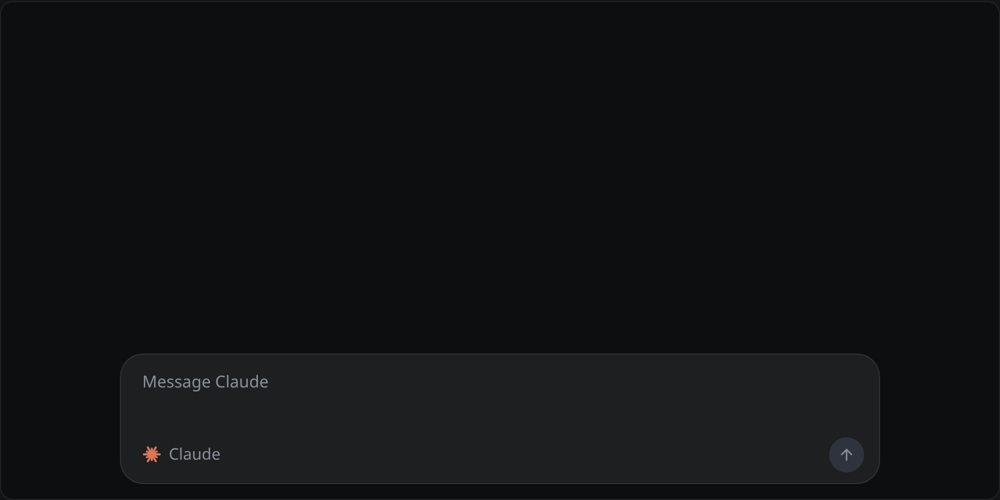

**None offered.** An agent that offers no settings shows only its mark and
name, with nothing to open.

## What the chat allows

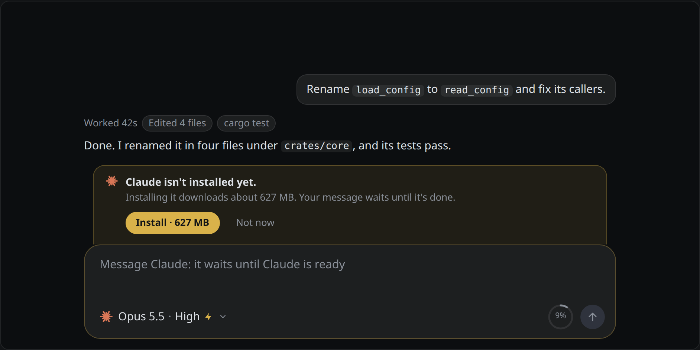

**The agent isn't ready.** While the chat's agent isn't installed, is being
signed in to, or is signed out and can be signed in, the agent banner
attaches to the box, as a question does, joined to it in the banner's own
tone. Messages wait only while the chat waits for its agent
(`ChatState::WaitingForAgent`): then the box says
*Message Claude: it waits until Claude is ready*, and the user can still
write. An agent that's only signed out holds nothing back: the banner offers
to sign in, and the box is as usual. [Agents](~caf/standard-interface/agents)
says when the banner shows, and its words.

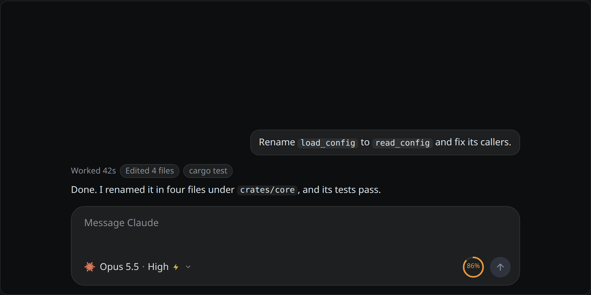

**The context ring.** The ring shows how much of the agent's context is
used, `Usage.used` of `Usage.size`, as a whole percent. Above 80% it turns to
the caution colour, and above 95% to the warning colour: strictly above,
so 80% is still calm. Its tooltip says *Context: 86% used*. A new chat,
before the agent has said, has no ring. Clicking the ring opens the usage
popover, and a dot on the ring warns of an account limit running low: see
[Usage](~caf/standard-interface/usage).

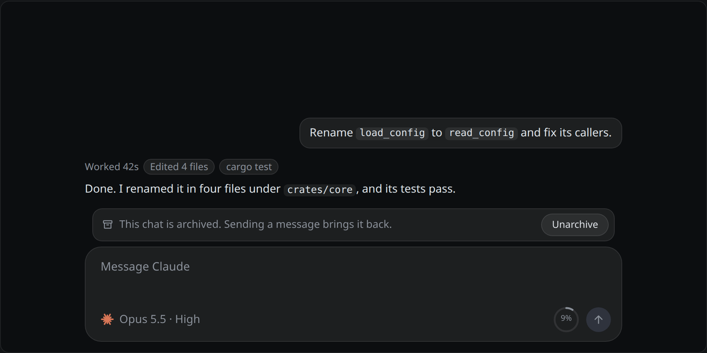

**Archived.** A chat stays archived (`Chat.archived`), restored or not,
until it's brought back. Sending a message brings it back: CAF unarchives
it and sends the message as to any other (`Core::send`). So the box stays
as usual, and the user can write and send. The tray says, calm, with an
archive box, *This chat is archived. Sending a message brings it back.*,
and offers **Unarchive**, plain, at its other end, which brings it back
without sending (`Core::unarchive`; a viewer's `Unarchive`, with the `act`
right). Either way the note goes at once, and the chat is an ordinary one,
its agent started when a message is sent, as for a restored chat.

While it's archived, only its settings can't be chosen, as CAF refuses to
change them (`Refused::Closed`): the control shows the model and effort,
without the bolt or the chevron, and can't be opened, as when the user
can't write. They can be chosen again once it's back. A viewer without the
`act` right sees the note without Unarchive, and the box as
[Can't write](#what-the-chat-allows) says.

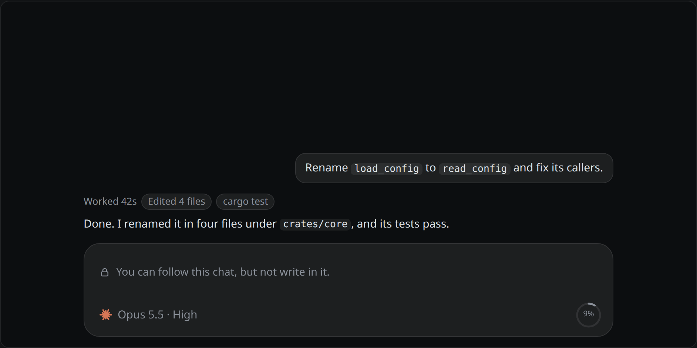

**Can't write.** The box stays where it is, with a lock, and says why, by
the first of these that holds:

| Why | The box says |
| --- | --- |
| The viewer has no `act` right | *You can follow this chat, but not write in it.* |
| Its agent is gone, or CAF won't run it | As [A chat's identity and lifecycle](~caf/standard-interface/chats) says |
| Its agent can never be installed on this machine | As [Agents](~caf/standard-interface/agents) says |

It has no Send, Stop or settings menu. The control shows the model and
effort, without the bolt or the chevron, and can't be opened; the ring stays.
A question or the agent banner still shows, so the user knows the chat is
waiting. A question's answers show disabled for a viewer without the `act`
right. The banner's buttons follow their own rights, as
[Agents](~caf/standard-interface/agents) says: a viewer is offered nothing
it can't do. For the others, the banner keeps **Not now** while a message
already waits, so the user can drop it.

## Narrow

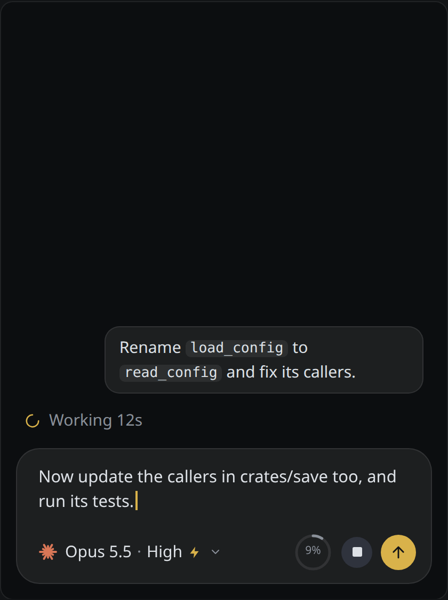

In a narrow pane the composer keeps every part. The placeholder keeps only
its first clause (*Message Claude*), the settings control may shorten
(*Settings*), and the *waits for this turn* note by the buttons is left out.

## Keys

**Enter** sends. **Shift+Enter** starts a new line. While an input method is
composing, Enter does nothing, so a user typing in Japanese, say, never sends
half a word.

## What CAF tells the app

| What the composer shows | Where it comes from |
| --- | --- |
| What can be sent | Text only, `Part::Text`: there are no attachments yet. |
| A message waiting | A message sent during a turn, or while the chat opens or waits for its agent, is queued by CAF (`TurnLife::Waiting`), and goes when it can. `Core::stop` drops it. |
| Why a message couldn't be sent | The `Refused` CAF answers with, or the link to the app dropping. |
| The settings menu | `Setting.form` for each setting the agent offers: `Choices` or a `Switch`. Before a chat opens, `AgentStatus.settings`. |
| A change not applied yet | `settings.chosen` differing from `current`, when `offered` holds the setting and its `current` is known. |
| The model divider | `Turn.model` differing from the turn before. |
| The context ring | `Usage.used` and `Usage.size`. |
| Whether the user may write | The viewer's `act` right, and the chat's state. |
| Archived | `Chat.archived`, by `Change::Archived`; `Refused::Closed` for a setting chosen meanwhile. |
| **Unarchive** | `Core::unarchive`, or a viewer's `Unarchive`, with the `act` right: `Chat.archived` goes back to none. `Core::send` unarchives a chat too, then sends. |
| Why the settings couldn't be learned | `AgentStatus.settings`'s `Failed`, a `LearnFailure`; the system's words in `CouldNotStart.error`, the agent's in `Refused.message`. |
| **Learn them now** | The viewer's `agents` right; `Core::learn_settings`. |
| The agent banner | The agent's status, as [Agents](~caf/standard-interface/agents) describes. |
