The transcript is the chat itself: everything the user sent and everything
the agent did, in order, above the composer. It's built from CAF's record
of the chat, a list of turns, each a list of items (see
[Chats, turns, and items](~caf/concepts/chats-turns-and-items)).

[See the transcript live](~attachments/caf-si-transcript), every state, in
dark and light.

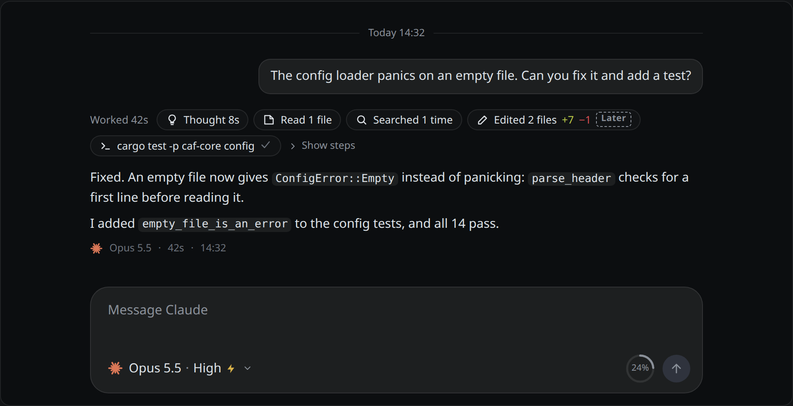

**Required, all of it**, but for the time dividers, which are the app's, and
what's marked **Later**. The transcript is inside the chat, and a user
moving between CAF apps should find it the same in each.

## Its parts

A turn is drawn top to bottom, in one column:

| Part | Where | What it is |
| --- | --- | --- |
| The message | Right, in a bubble | What the user sent. A turn the agent started by itself has none (see below). |
| The summary line | Under the message | What the work was, as a line of chips, led by how long it took. Clicking it opens the timeline. A turn with no steps has none. |
| The timeline | In place of the summary's chips, once opened | Every step in order, on a rail. |
| The answer | Under the summary | The agent's last words, in full. |
| What went wrong | Under the answer | A failure, in CAF's words, with its remedy. |
| The turn's line | At the foot of the turn | The model, how long the agent worked, when the message was sent, and how the turn ended if not finished. All muted. |

Between turns sit dividers (the time, a new model, history from the agent's
own record) and what CAF says about the chat. Anything waiting on the user
attaches to the top of the composer, not to the transcript.

Markdown in the agent's words is drawn as Markdown. A step's title and a
question's are shown as plain text, as given.

**Times.** The time on a turn's line is when the user sent the message
(the start of `Turn.window`), so a message that waited for the turn before
it shows when it was sent. How long the agent worked counts from the start
of its first item from the agent (its words, thinking or a tool, never one
of CAF's notes) to the turn's end, so the wait isn't counted as work. A turn
with no items from the agent shows no time taken. Where the app doesn't keep
thinking (`Host.shows.thinking`), the time the agent spent thinking before
its first words or tool isn't counted.

## Turns

**A finished turn** is its message, one summary line and the answer, as in
the picture at the top. The summary line is led by *Worked 42s*, then one
chip for each kind of step, counted:

- *Thought 8s* for thinking. Each stretch of thinking is listed, not
  summed: *Thought 8s + 2s*.
- *Read 1 file*, *Searched 1 time*, *Edited 2 files +7 −1*, *Fetched 1 page*,
  *Deleted 1 file*, *Moved 1 file*, by the tool's kind, with the plural as it
  should be. The edit chip adds up its edits' diffs: *+7* lines added and
  *−1* removed. A refused edit's diff never happened, so it isn't counted. A tool of kind `Think` or `Other` is counted as *Used 1 tool*.
- A single command is named by its title, here
  *cargo test -p caf-core config*, with a tick, or a cross in the warning
  colour if it failed. Two or more are counted: *Ran 2 commands*.
- *? 1 item this app can't show*, if the turn has any.
- Then *Show steps*, muted, with a chevron.

A chip with a step that failed or was refused is in the warning colour, so
it's seen without opening the turn. A cancelled step isn't a failure: its
chip stays calm. In history, where the times aren't known, the line
is led by *Work* alone.

The answer is the turn's last words from the agent (`ItemKind::Words`),
once the turn has finished, if nothing but CAF's notes comes after them.
Anything else the agent said along the way is a step.

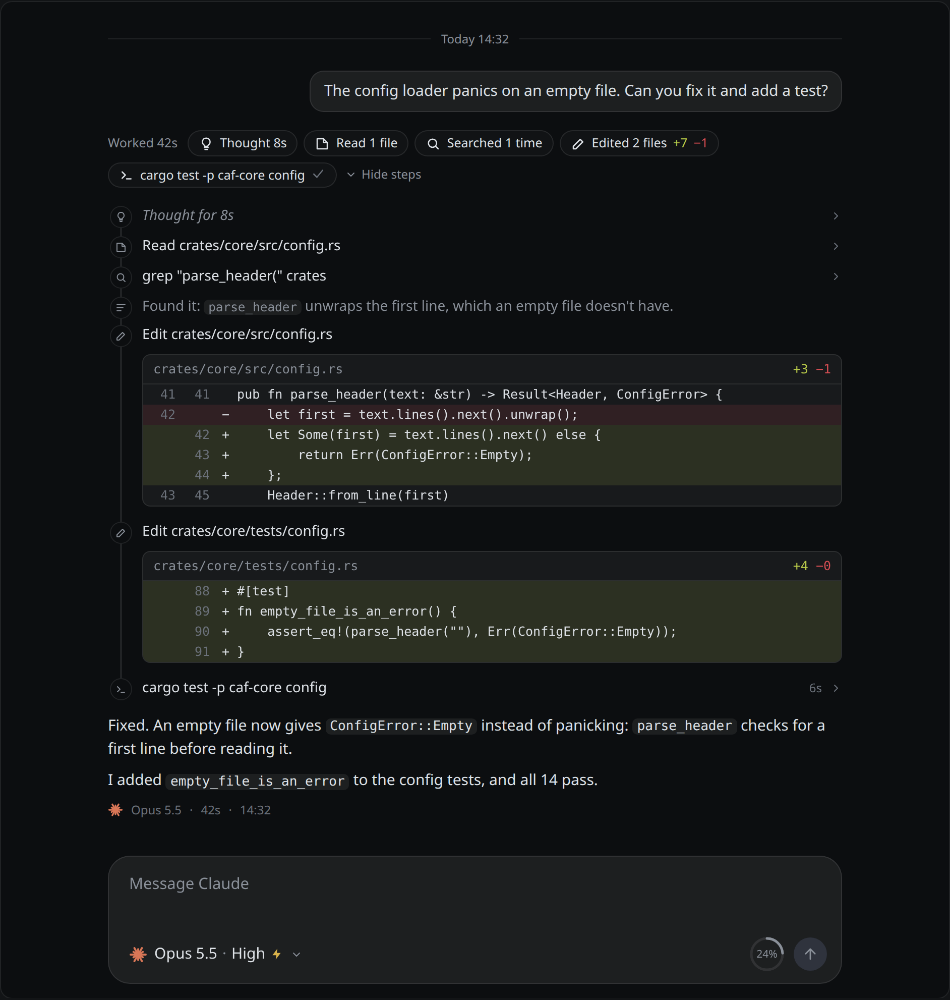

**Opened.** Clicking anywhere on the summary line opens the timeline in its
place, and the line's last words become *Hide steps*. Clicking again folds
it. Each step is one line on a rail, with its kind's icon:

- Thinking: *Thought for 8s*, muted and in italics. It opens to the
  thinking itself.
- A tool call: its title, exactly as given, such as
  *Read crates/core/src/config.rs* or *cargo test -p caf-core config*, with
  how long it ran on the right. CAF writes the title for its own tools, and
  the agent writes it for the rest; either way, the app draws the call's
  title and never rewords it. Only the icon comes from its kind. It opens to
  what the tool gave back (see [A tool call, opened](#a-tool-call-opened)).
- What the agent said along the way, muted, in full.

An edit is open already, to its diff: an edit is what the user most often
wants to check. Every other step opens when clicked.

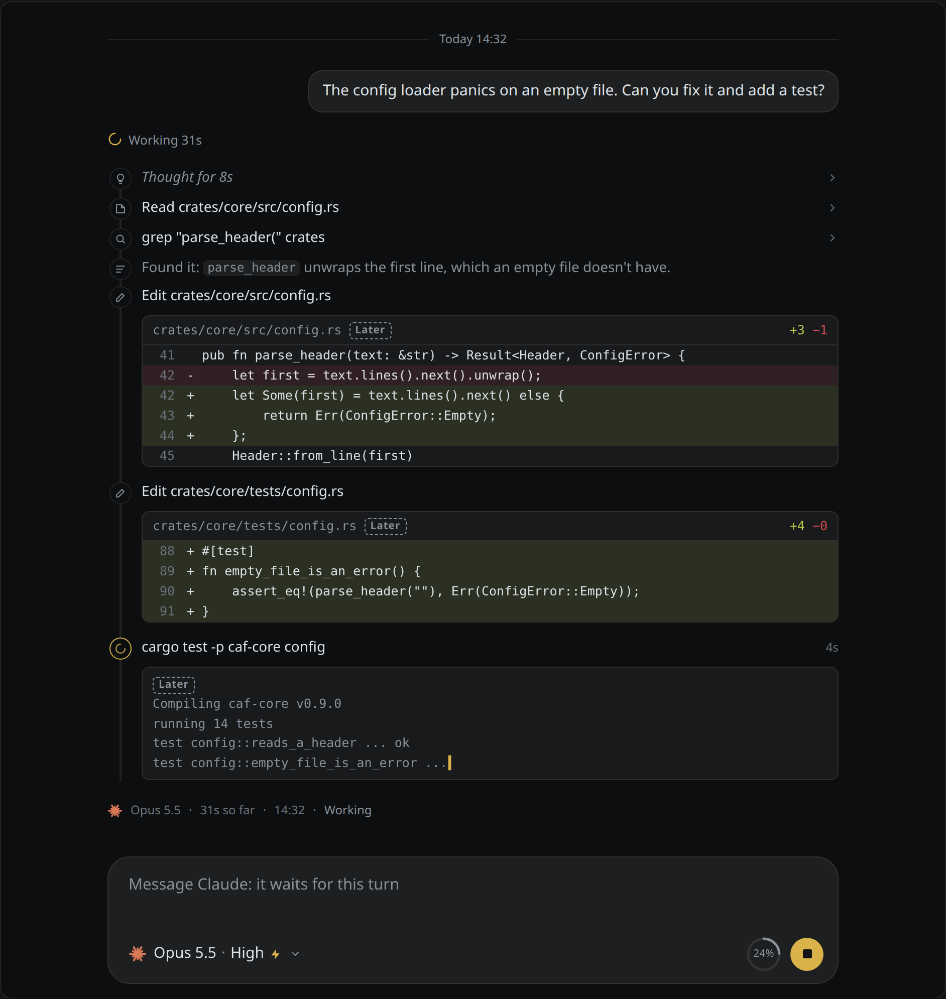

**Running.** A running turn's timeline is always open, and can't be folded,
so the user can always see what the agent is doing. The summary line says
*Working 31s*, with a spinner in the accent, and has no chips; before the
agent's first item it says *Working*, with no time. The step running now has a
spinning dot in the accent. The turn's line says
*Opus 5.5 · 31s so far · 14:32 · Working*. The composer's round button is
Stop (see [The composer](~caf/standard-interface/composer)).

A running command is open, and shows its output as it comes, with a caret
in the accent at its end, so the user can watch a build or a test run
without opening anything. Other steps show what they've given back so far,
which for many tools is nothing until they end.

Once Stop is pressed, and until the agent confirms, the summary says
*Stopping…* in place of *Working* (not pictured).

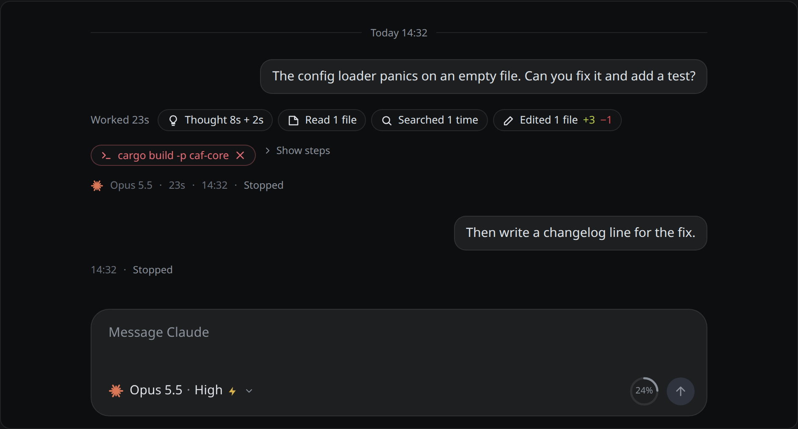

**Stopped.** A turn the user stopped folds like a finished one, and its line
ends *Stopped*, muted. A step that failed makes its chip red: here,
*cargo build -p caf-core* with a cross. Opened, a failed step shows its
output. A step still waiting or running when the user stopped the turn is
*Cancelled*, muted; one a turn ended under any other way, such as a failure
or the app closing, is *Failed*.

**A message that never went.** Stop also stops the messages waiting for the
turn, and a message that waited for an agent that wasn't installed is
stopped too. Each stays in the transcript as a turn of its own: its message,
no summary line, and a line of *14:32 · Stopped*. CAF doesn't say whether a
stopped turn reached the agent, so the app doesn't either.

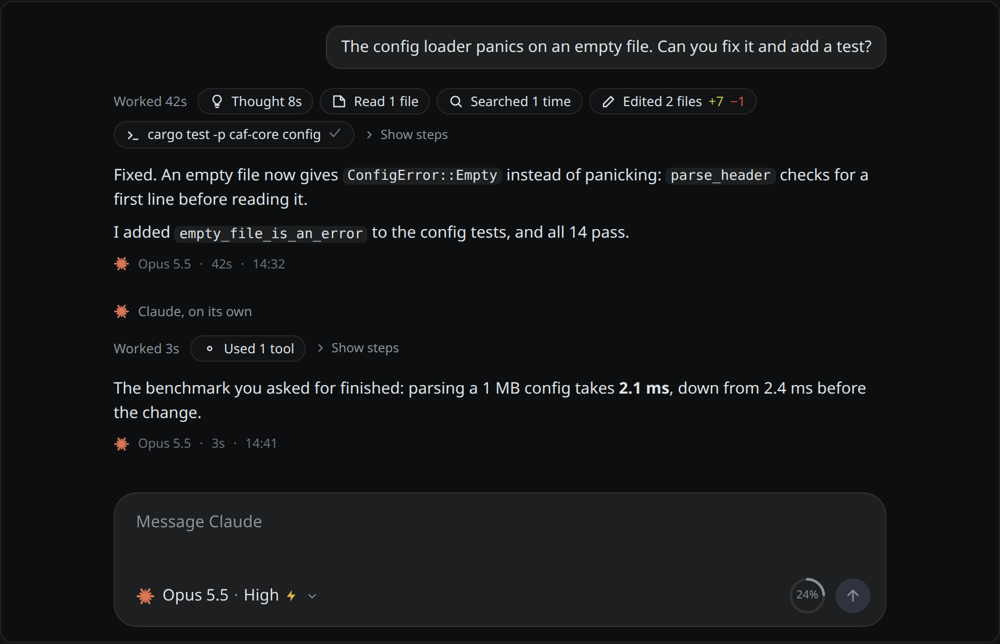

**The agent, on its own.** An agent can start a turn by itself, such as when
a command it left running finishes. It has no message: in its place is the
agent's mark and *Claude, on its own*, muted. The rest is drawn as any turn.
CAF doesn't say why the agent started it, so neither does the app. (A
command left running by CAF's own Bash is different: CAF tells the agent
when it ends, in a turn of CAF's own, as
[Background jobs](#background-jobs) says.) Such a
turn never fails, so it never has a remedy: it ends finished, stopped, or
cut off.

**Cut off.** A turn that ended before it finished, without failing or being
stopped, ends *Cut off before it finished*, muted (see the last picture on
this page). That happens when the app shuts down during it, when the chat is
put away during it (`Core::put_away`), or when the app stopped unexpectedly
and the chat was restored.

A message waiting to be sent (CAF queues it while a turn runs or the chat
opens) isn't drawn in the transcript: it sits on the composer's tray until it
goes. A turn CAF starts with a notice, such as of a background job's end,
is drawn as the [Background jobs](#background-jobs) section says; one the
app starts with its own notice (`Core::notify`) is headed *A notice from
the app*, muted, with its words. **Later:** a turn sent by another chat's
agent.

## Tool calls

A tool call is a step on the timeline (see
[Tool calls](~caf/concepts/tool-calls) for what CAF records of one). Its
line is its kind's icon, its title, and on the right how long it ran or
where it is.

**Its title** is drawn as given, never made up by the app. For CAF's own
tools (see [CAF's own tools](~caf/concepts/cafs-own-tools)) CAF writes it,
the same for every agent, with a path inside the chat's folder relative to
it, and any other in full:

| Tool | Its title |
| --- | --- |
| Read | *Read src/config.rs* |
| Edit | *Edit src/config.rs* |
| Write | *Write docs/notes.md* |
| Bash | The command's first line, as the agent wrote it: *cargo test -p caf-core*, with *…* after it if it has more |
| TaskStop | *Stop task 2*, its icon a square |

For one of the app's own tools (see
[Your own tools](~caf/concepts/your-own-tools)), the app's code writes it,
from the call's input: *Trim clip 3*. A call whose input doesn't fit, or
whose title the app left empty, has the tool's own title: *Trim a clip*.
Its icon is its kind's, as the tool says, and opened, it says first,
muted, whose tool it is: *The app's own tool trim_clip*.

**The app's own item on a call.** A call to one of the app's tools may
leave an item of the app's on its record (`ToolCall::app`), such as the
edit a trim made. The app draws it in the opened step, as it likes, under
what the call gave back. Another app, or a viewer that doesn't know the
app, draws nothing in its place: what the call gave back says what it did.

Where it is, by its status:

| Status | Its dot | On the right | Role |
| --- | --- | --- | --- |
| `Pending` | Its kind's icon | *Waiting to start* | Calm |
| `Asking` | Its kind's icon, in the accent | *Waiting for you ↓* | Accent |
| `Running` | A spinner, in the accent | How long so far | Accent |
| `Done` | Its kind's icon, muted | How long it ran | Muted |
| `Failed` | A cross, in the warning colour | How long it ran | Warning |
| `Refused` | A cross, in the warning colour | *Refused* | Warning |
| `Cancelled` | Its kind's icon, muted | *Cancelled* | Muted |

*Cancelled* is muted, not a warning: the user stopped it, or the agent
did, so nothing went wrong. *Refused* is a warning, as a failure is: the
agent wanted to do it and couldn't, which the user should see without
looking for it, even when it was their own answer.

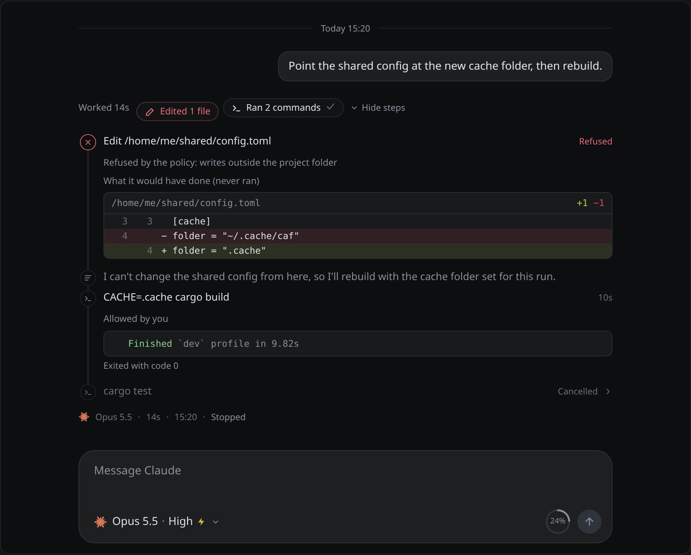

**Who decided.** A call that needed permission says, first thing when
opened, who allowed or refused it, muted, in one line:

| `Decision` | It says |
| --- | --- |
| `Allowed(User)` | *Allowed by you* |
| `Allowed(Policy)` | *Allowed by the policy: reads inside the project are fine*, with the policy's reason, or *Allowed by the policy* if it gave none |
| `Refused(User)` | *Refused by you* |
| `Refused(Policy)` | *Refused by the policy: writes outside the project folder*, or *Refused by the policy* |
| `NotAsked`, `Undecided`, `NotRecorded` | Nothing |

*You* is whoever answered the question in this app. A refused call never
ran: under that line is only what it would have done, such as the diff of
an edit CAF worked out before asking, and why, if the agent said. It's
headed *What it would have done (never ran)*, muted, in place of nothing,
so it's never read as something that happened.

### A tool call, opened

A call opens to what it gave back, in order, each piece drawn by its kind.
Everything an agent sends is drawn as text: never as markup, never run.

- **Text**, such as a file read, in a monospace font. If CAF kept only its
  start, under it, muted: *Kept 64 KB of 1.2 MB*.
- **A diff**: the file's path, *New file* if there was none before, and
  *+3 −1* on the right, the lines added and removed. Then its hunks, as
  CAF worked them out, each line with its numbers before and after, added
  lines marked *+* on a green tint and removed ones *−* on a red one, and
  a gap between hunks. If CAF kept only some hunks, after them, muted:
  *and 2 more hunks*. The app draws the hunks as they are, and never
  compares texts itself.
- **A command's output**: its lines in a monospace font, in the colours
  the command gave them. Only its colours (text and background) and
  bold, dim, italic, underline, strikethrough and inverse are drawn; any
  other code a terminal would act on shows as it is, such as `^[[2K`,
  never acted on. Text whose background is its own colour keeps the
  app's background, so it can't hide itself. If CAF kept only the last lines, above them,
  muted: *120 earlier lines not kept*. While it runs, a caret in the
  accent ends it, and lines come and change as CAF sends them. Once it
  ends, under it: *Exited with code 0*, muted, or *Exited with code 101*,
  *Killed by signal 9*, in the warning colour; *Ended, without saying
  how* if the agent didn't say, muted. **Suggested:** an output of
  thousands of lines draws only its last 2,000, with *Show 500 earlier
  lines* above them, so the page keeps up as it grows.
- **An image**, drawn, as wide as the column at most. One too big for CAF
  to keep says *An image too big to keep (3.4 MB)*, muted, in its place.
  Only an image is drawn as one: anything else claiming to be, such as a
  page, is named by its type and never shown. One whose data can't be read
  as a picture says *An image this app couldn't read*.
- **A link**: a web address (`http` or `https`) is a link, in the Link
  colour, by its name, which opens in a new tab, and beside it, muted,
  the address it goes to, as the browser reads it, so a name can't say
  one place and go to another. A host spelled in another script is shown
  as the browser goes to it (`xn--pple-43d.com`). A link with no name,
  or a name of only spaces, is shown by its address. Any other address,
  such as a file's, is shown as text, its name and then the address, and
  never followed. Nothing an agent sends ever becomes a `javascript:`
  link.
- **A piece CAF couldn't read**, a dashed box:
  *Something Claude sent that this app can't show*. If CAF kept only the
  start of it, that says so, muted: *Kept 64 KB of 90 KB*.

**Suggested:** under what it gave back, the files the call is about, as
*src/main.rs:42*, each opening the file where the app can; and what the
call was given (its input), folded away. When CAF kept only the start of
the input, it says *Kept 64 KB of 200 KB* under it.

### Background jobs

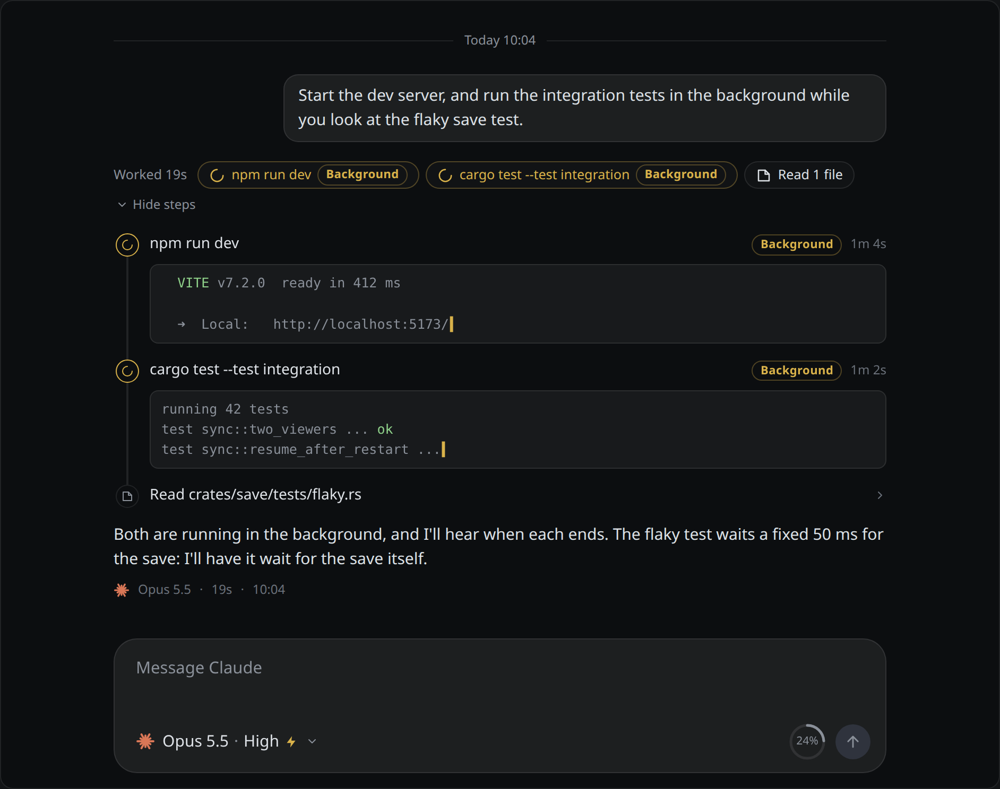

A call to one of CAF's tools can go on after the agent was answered: a
command the agent ran in the background, or one that ran past its
timeout. CAF calls it a **job**, and numbers it in the chat: task 1,
task 2. The agent got its answer, so the turn goes on, and may finish,
while the job runs.

- **Running, it's marked *Background*:** a small chip in the accent after
  its title, as it's happening now. Its dot is a spinner and its output
  comes in, as any running step's. Its turn can be finished, stopped or
  far up the transcript: the step stays running there until the job ends,
  so the app never draws it as done because its turn is.
- **Folded,** its turn's summary line gives each job still running a chip
  of its own, in the accent: a spinner, its title and *Background*. A job
  that has ended is counted with the turn's other steps, as any is.
- **Stop doesn't stop it.** The user's Stop stops the turn, not the work
  it left in the background, as in Claude Code. A job ends by itself, or
  when the agent stops it with TaskStop, or when the chat is closed or
  deleted (*Cancelled*), or put away, or the app shuts down (*Failed*: a
  restored chat has no jobs).
- **When it ends,** it's drawn as any step that ended: *Done*, *Failed*
  or *Cancelled*, its output ended with its exit. The chip goes. Opened,
  the step may say, muted, that it ran in the background as task 2.

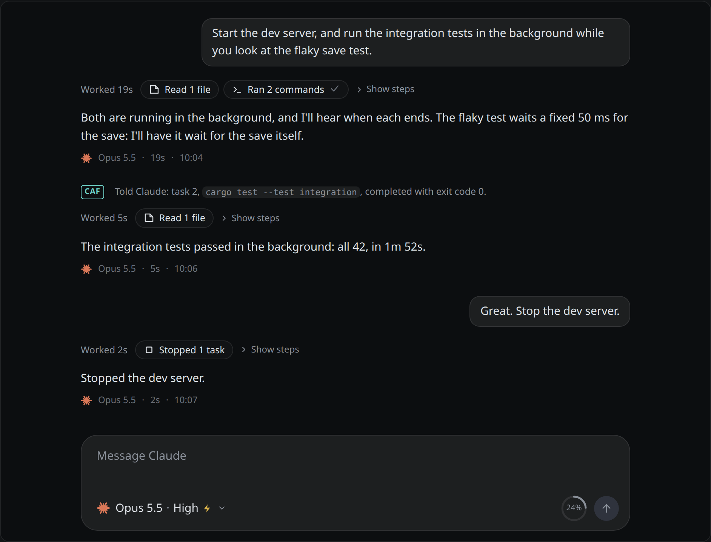

**CAF tells the agent when a job ends,** in a turn of its own, sent as a
message is: at once if nothing runs, or else once the running turn ends.
After the user's Stop, CAF holds them: none comes right after a Stop, and
each held one appears, as a turn of its own, just before the user's next
message (see [Serving tools](~caf/concepts/serving-tools#background-jobs)).
In place of a message, the turn starts with the CAF badge and what CAF
told the agent, in words: the notice's own summary, *Told Claude:
Background command "cargo test --test integration" completed (exit code
0)* (or *failed*), with `&amp;`, `&lt;` and `&gt;`
read back as `&`, `<` and `>`. It's CAF's voice, not the agent's nor the user's, so it never
looks like something the user sent. The rest of the turn is the agent's
answer, drawn as any. The agent was given the path of a file holding the
job's whole output too; the app needn't show it.

**TaskStop is a step.** When the agent stops one of its jobs, its call is a
step like any other, titled *Stop task 1*, and the job's own step, wherever
it is, ends *Cancelled*. TaskStop never asks: it can only stop a job its own
chat started. Folded, it's counted as *Stopped 1 task*.

## Asking

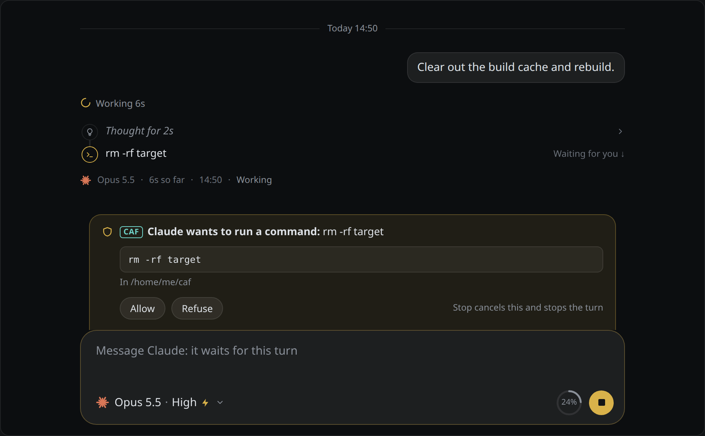

**Asking permission.** When the agent wants to do something that needs the
user's say, the question attaches to the top of the composer, joined to it
with an edge in the accent: the turn can't go on until it's answered.

Whose question it is depends on whose tool the call is:

- **One of CAF's own tools** (`Origin::Caf`: Read, Edit, Write, Bash). CAF
  asks, in its own voice, with the CAF badge. It says what the agent wants
  to do in CAF's words, from what the call does (its `Action`), then what
  it's about, as plain text, from the title CAF wrote for the call: for a
  file, the title without its *Read*, *Edit* or *Write* (the path, from
  the chat's folder when it's inside it); for a command, the title as it
  is (its first line, with *…* after it if it has more, capped). Never the
  whole title, whose verb would say it twice:
  *Claude wants to run a command: rm -rf target*,
  *Claude wants to change a file: src/config.rs*, *Claude wants to read a
  file: /etc/hosts*, *Claude wants to write a file: notes.md*. Its answers are CAF's
  own two, *Allow* and *Refuse*. Its edge stays in the accent, unlike CAF's
  question about a chat slow to open: like any permission question, it
  holds up the turn.
- **One of the app's own tools** (`Origin::App`). CAF asks too, in its own
  voice, with the CAF badge, naming the tool, then the call's title, as
  plain text: *Claude wants to use the app's trim_clip: Trim clip 3*. What
  it previewed, if it previews, is under that, each piece drawn as an
  opened step draws it. Its answers are CAF's own two.
- **Any other tool.** The agent asks: *Claude asks permission:* and then
  the agent's own title for what it wants to do, as plain text, with the
  agent's own answers.

Once CAF has seen the call it's about (`Permission.tool`), the question
shows what the user is being asked to allow, under its title: the command
it would run, in a monospace font, with the folder it runs in under it,
muted; or the change it would make, as a diff, drawn as an opened step
draws one. A question asked before CAF has seen its call shows its title
alone, and gains the rest when the call arrives (CAF's own questions always
have their call). Under that are the answers, labelled as their asker
labels them, *Allow* and *Refuse* for CAF's, or for the agent's, such as
*Allow*, *Always allow* and *Reject*, all alike: none is chosen or focused
beforehand, and Enter answers nothing. On the right, muted: *Stop cancels this and stops the turn*.

The step it's about stays in the timeline, its dot in the accent, and says
*Waiting for you ↓* on the right (`ToolStatus::Asking`). The agent may ask
before CAF has seen the step, so the question never depends on it.

Answering it carries on the turn. Stop answers it as cancelled, and stops
the turn.

**Only one thing attaches to the composer at a time.** If several questions
wait, the oldest attaches, and the next takes its place once it's answered.
A question comes before the agent banner: when both apply, the question
attaches, and the banner returns once it's answered. Messages waiting on the
tray sit above whatever is attached.

## Failing

A failed turn folds like any other, and under it is what went wrong, in a
box in the warning colour: the CAF badge and CAF's sentence; what the agent
said about it, if anything, quoted apart; and the remedy, if there is one.
The turn's line ends *Failed*, in the warning colour.

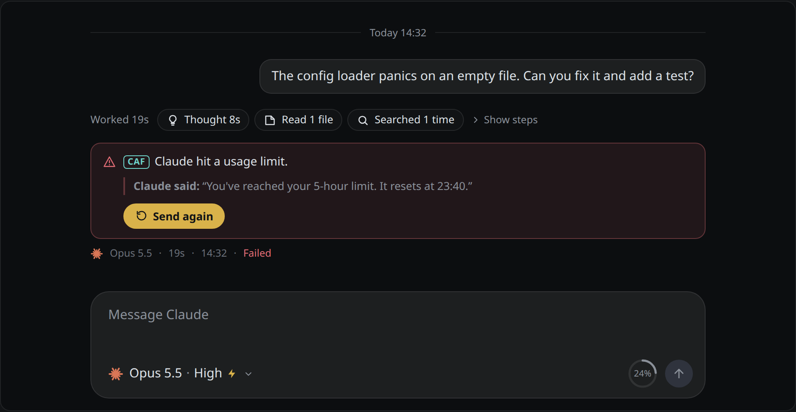

**What the agent said** is introduced as *Claude said:*, in quotation marks,
muted, with a rule down its left. It's the agent's words, never CAF's
advice, and never presented as CAF's.

**Send again** (`Remedy::SendAgain`) is the accent button, with a circling
arrow. It sends the same message again, as a new turn.

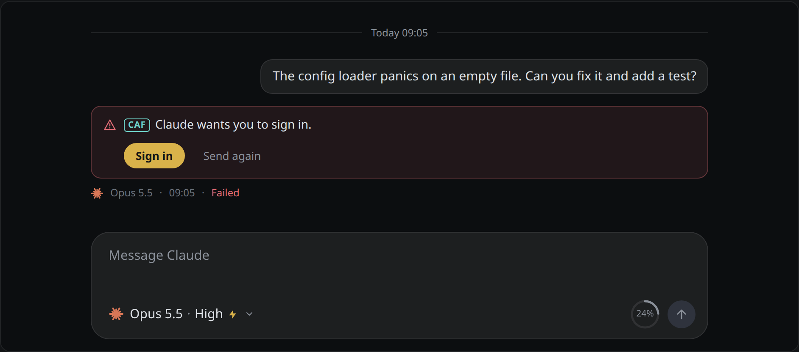

**Sign in** (`Remedy::SignIn`) is the accent button. It signs in with CAF's
own command for the agent, never one the agent suggested, and doesn't send
the message again. So, as the one exception to offering only CAF's remedy,
**Send again** sits beside it, quiet, for once the user has signed in: CAF
never sends it again by itself.

CAF gives `SignIn` only where it can sign in to the agent now. When the
reason is `SignInNeeded` but the remedy isn't `SignIn`, the box says
*Sign in to Claude, then send again.* in place of the button, with any
remedy CAF gave instead.

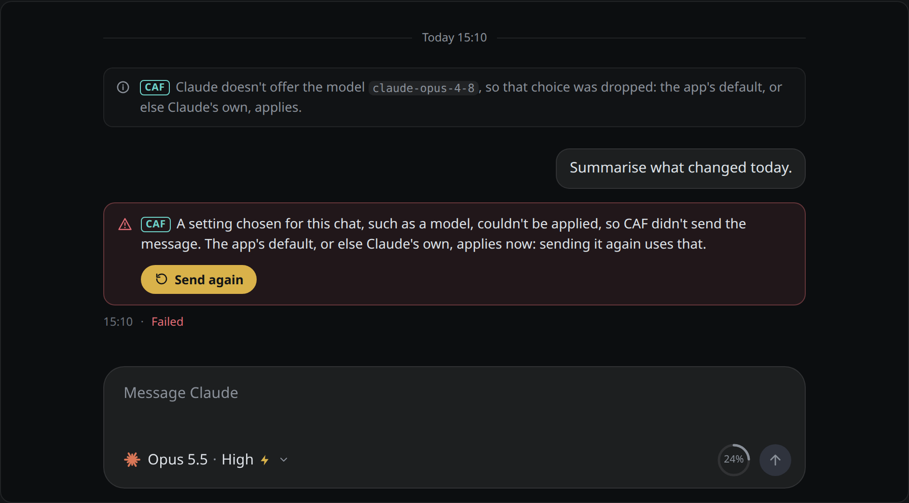

**A setting not applied.** When a setting chosen for the chat can't be
applied before a message goes, such as a model the agent no longer offers,
CAF doesn't send the message. CAF's note above it says which choice was
dropped, and the failure says the message wasn't sent, and that sending it
again uses what applies now. Such a turn never reached the agent, so its
line has no model and no time taken.

What CAF says for each reason, with the agent's name in place of *Claude*:

| Reason | CAF says |
| --- | --- |
| `TooLong` | The answer hit the model's length limit. |
| `TooManySteps` | Claude hit its limit of steps for one turn. |
| `Refused` | The model refused. The message and everything after it are gone from Claude's memory. |
| `SignInNeeded` | Claude wants you to sign in. |
| `AccessDenied` | The account or its credentials can't be used: signing in again doesn't fix it. |
| `BadRequest` | Claude's provider refused the request as it stood. Sending it again won't help. |
| `UsageLimit` | Claude hit a usage limit. |
| `ProviderError` | Claude's provider was overloaded or failed. |
| `AgentStopped` | Claude stopped while working on it. |
| `DidNotStop` | Claude didn't stop when asked, so CAF ended the turn and reconnected to Claude. |
| `BadAnswer` | Claude's answer made no sense. |
| `SettingNotApplied` | A setting chosen for this chat, such as a model, couldn't be applied, so CAF didn't send the message. The app's default, or else Claude's own, applies now: sending it again uses that. |
| `Other` | Claude reported an error. |

A reason the app doesn't know yet (a later CAF may add one) is shown as
*It failed, for a reason this app doesn't know.* Apart from Send again
beside Sign in, an app offers only the remedy CAF gives, never one of its
own. **Later:** *Start a new chat*, for `Remedy::NewChat`.

## Who may act

A person watching a chat may not have every right (see
[Viewers](~caf/concepts/viewers)). What they can't do is never offered
only to be refused:

- Without the `act` right: no Send again, and a question still attaches, so
  they can see what's waiting, but its answers are disabled, as are
  *Keep waiting*, *Try again* and *Stop* when a chat is slow to open.
- Without the `agents` right: no Sign in. The box says
  *Sign in to Claude, then send again.* in its place, and Send again stays,
  given `act`.

## CAF and the chat

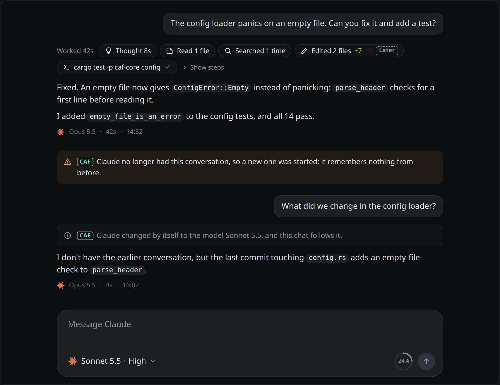

**CAF's notes.** CAF speaks in its own voice, never as the agent's: a box
with the CAF badge. Between turns, it says what happened to the chat; inside
a turn, what happened during it. A note is never folded away: inside a
folded turn it shows under the summary line, and in an opened one, in its
place on the timeline.

A note that the agent remembers nothing from before is in the caution colour,
with a warning sign, because the user's context is gone and they'll need to
give it again. The others are calm, with an *i*, muted. The words, with the
agent's name in place of *Claude*:

| Note | Tone | CAF says |
| --- | --- | --- |
| `SessionGone` | Caution | Claude no longer had this conversation, so a new one was started: it remembers nothing from before. |
| `CannotContinue` | Caution | Claude can't carry on earlier conversations, so a new one was started: it remembers nothing from before. |
| `SessionStuck` | Caution | Claude's conversation was stuck and couldn't be closed, so a new one was started: it remembers nothing from before. |
| `NotInstalled` | Calm | Claude isn't installed, so the message that waited for it was stopped. |
| `InstallFailed` | Calm | Claude's install failed, so the message that waited for it was stopped. |
| `SignedIn` | Calm | You signed in to Claude: send the message again to try it now. |
| `AgentChanged` | Calm | Claude changed by itself to the model Sonnet 5.5, and this chat follows it. |
| `NotOffered` | Calm | Claude doesn't offer the model `claude-opus-4-8`, so that choice was dropped: the app's default, or else Claude's own, applies. |
| `NotApplied` | Calm | Claude refused the model Opus 4.8, so that choice was dropped: the app's default, or else Claude's own, applies. |

A note about a setting names the choice by the agent's name for it, as the
agent last said it, which CAF keeps with the note (its `name`): *the model
Sonnet 5.5*. A choice the agent never named, such as a model it never
offered, has none, and is named by the agent's own id, in a monospace font,
as CAF keeps it: *the model `claude-opus-4-8`*. The name is kept with the
note, so it reads the same when the agent no longer offers the choice, and
in a restored chat. A switch that's on or off is named *fast mode on* or
*fast mode off*; one the agent doesn't offer is named *fast mode* alone:
*Claude doesn't offer fast mode, so that choice was dropped…*

When the agent changes a setting by itself, the composer follows it: after
the note here, it shows *Sonnet 5.5*. The turn's line still shows the model
it was sent on.

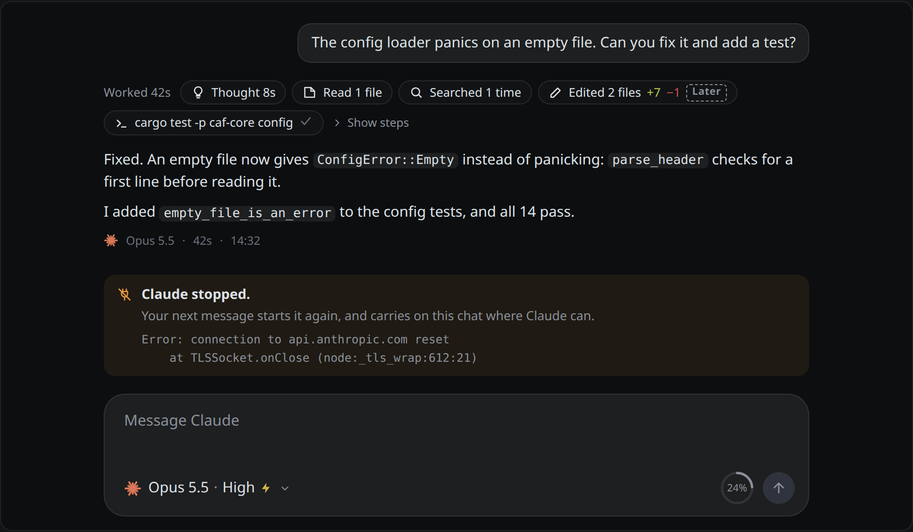

**Lost.** Whenever a chat loses its agent, between turns or during one (the
turn then fails, and the chat is lost), a box in the caution colour at the
foot of the transcript says why, in bold, and under it, muted, what the
user's next message will do. Where the agent left its last lines of error
output, they're under that, in a monospace font. The box goes once a message
starts opening the chat again. It's the app's own frame for the chat's
state, not something CAF says, so it has no CAF badge.

While the agent banner shows, it stands in for this box, which isn't drawn:
a chat lost after the user chose *Not now* in the banner
(`Lost { reason: Stopped }`) has what to do next in the banner, and why in
CAF's note (see [Agents](~caf/standard-interface/agents)).

| Why | It says | Under it |
| --- | --- | --- |
| `CouldNotStart` | Claude couldn't be started. | Your next message tries to start it again. And what the system said. |
| `AgentStopped` | Claude stopped. | Your next message starts it again, and carries on this chat where Claude can. And its last lines. |
| `Restarted` | Claude was restarted. | Your next message carries on this chat where Claude can. |
| `SignInNeeded` | Claude wants you to sign in first. | Sign in, then send a message to carry on. |
| `Refused` | Claude refused to open this chat. | Your next message tries again. And what Claude said, quoted apart. |
| `Stopped` | You stopped it opening. | Your next message tries again. |
| `InUse` | Another chat already has this conversation open. | Your next message tries again. |
| `Incompatible` | One of the sentences below. | Nothing, but for `BadAnswer`. |
| `ShutDown` | The app closed while this chat was open. | Nothing. |

When Claude can't do what the chat needs (`Lost::Incompatible`), the box says
why:

| `Incompatible` | It says | Under it |
| --- | --- | --- |
| `Protocol` | This version of Claude can't talk to this app. | Nothing. |
| `HttpMcp` | Claude can't reach one of this chat's tools the way it's connected, so this chat can't run. | Nothing. |
| `BadAnswer` | Claude's answer made no sense. | Your next message tries again. |
| `OwnTools` | This isn't the Claude this app knows, so the app can't control its tools, and won't run it. | Nothing. |

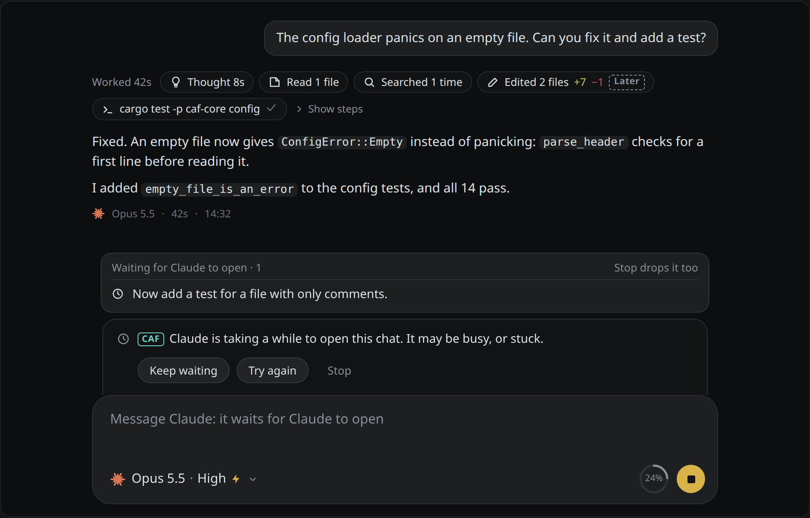

**While a chat opens,** the transcript shows nothing new: the message
waits on the composer's tray, and the round button is Stop.

**Slow to open.** If a chat takes long to open, CAF asks the user whether to
keep waiting. It's CAF's own question, never framed as the agent's, so it
attaches to the composer calm, with the CAF badge, not in the accent:
*Claude is taking a while to open this chat. It may be busy, or stuck.* If
the agent hasn't answered at all, it says
*Claude is taking a while to start: it hasn't answered at all yet.* The
answers are **Keep waiting** and **Try again**, as buttons, then **Stop**,
quiet. Escape keeps waiting, as dismissing it does. Stop gives up, and the
waiting message ends as stopped. The message waiting for the chat to open
sits on the tray above it, headed *Waiting for Claude to open · 1* and
*Stop drops it too*; the box says *Message Claude: it waits for Claude to
open*, and the round button is Stop, as
[the composer](~caf/standard-interface/composer) draws it.

## History and dividers

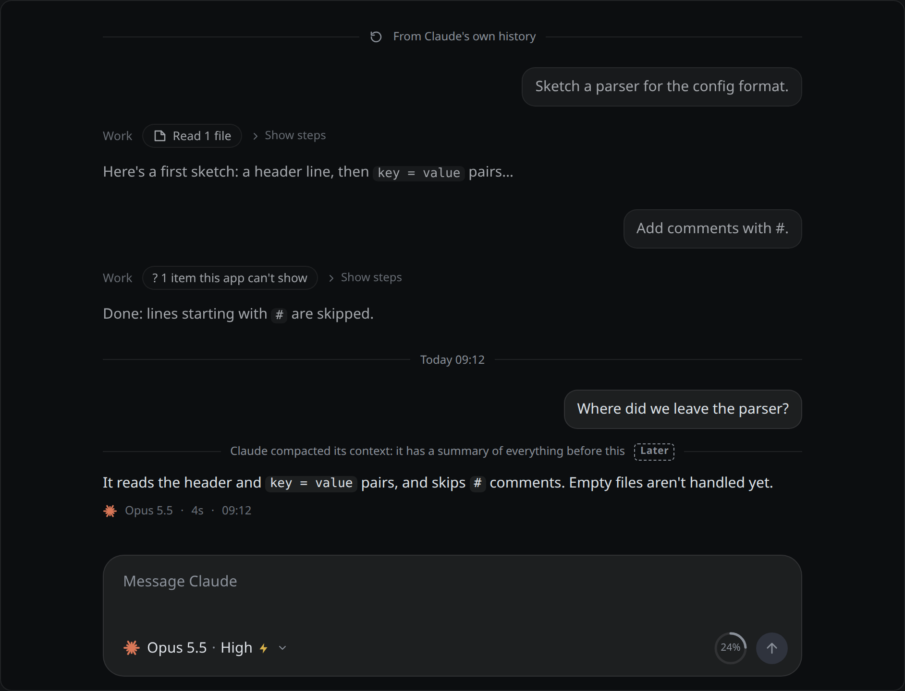

**The agent's own history.** A chat can carry on a conversation the agent
already had, such as one started in the agent's own app. What the agent
replays of it comes in as history CAF didn't see happen. It's headed by a
muted divider, *From Claude's own history*, with a circling arrow, and its
turns are muted too, with no times, no turn line and no model, since CAF
doesn't know them. They fold and open as any turn. A chat CAF restores from
its own save has its whole record already, and shows none of this.

**What the app can't show.** An item the agent sent that CAF couldn't read
is kept as it came, and drawn as a dashed box:
*Something Claude sent that this app can't show.* One of the app's own items
that this version of the app can't read shows the summary it had, if any,
or *An item of the app's that this version can't read*. The app draws its
own items (`ItemKind::App`) as it likes, in their place.

**Later: compaction.** Where the agent summarised its context to make room,
a muted line inside the turn says *Claude compacted its context: it has a
summary of everything before this*. CAF doesn't record compaction yet.

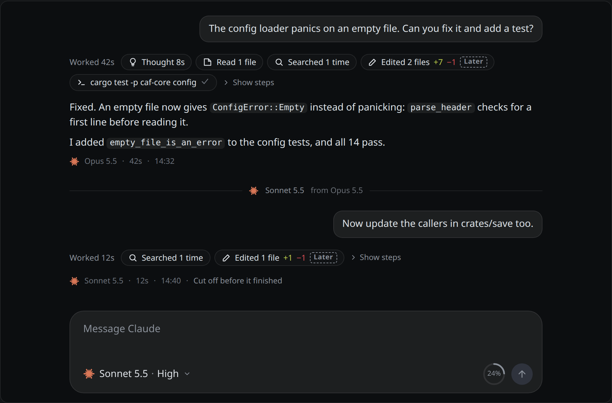

**A new model.** A divider marks where the model changed: the agent's mark,
the new model, and *from* the old one, muted, as on the composer page. The
app draws it wherever a turn's model differs from the turn before's.

**Time. Up to the app.** A divider with the time, such as *Today 14:32*,
where a while has passed between turns. When, and how it's worded, is the
app's.

## Colour

- **Accent:** what's happening now (the *Working* spinner, the running
  step's dot, the caret of a command's output as it runs, a job's
  *Background* chip), the edge of a
  question waiting on the user and the dot of the step it's about, and the
  remedy button.
- **Warning:** a failure's box, a failed or refused step's dot and chip,
  *Failed* on the turn's line, and a command that exited with an error or
  was killed.
- **Caution:** a lost chat, and a note that the agent remembers nothing.
- **CAF's voice:** the CAF badge, on notes, failures, CAF's own
  questions, permission questions about its own tools included, and its
  notice of a job's end.
- **Link:** a web link a call gave back.
- **Muted:** times, counts, thinking, what the agent said along the way,
  steps done or cancelled, who allowed a step, what was cut, the turn's
  line, the dividers, the icons of calm notes, and the agent's own history.

A step waiting to start is calm. A diff's added and removed lines are
tinted green and red, and its counts drawn in those colours: they say what
changed, not that anything went right or wrong, so they're no role's.

Everything else is calm.

## What CAF tells the app

| What the transcript shows | Where it comes from |
| --- | --- |
| The turns, in order | `Chat.turns`, each a `Turn`, in the order of the list. History and CAF's notes can be inserted before a waiting turn (`Change::TurnInserted`). |
| The message | `Turn.starter`: `Starter::User` holds the `UserMessage`. `Starter::Agent` is a turn the agent started by itself, and `Starter::Caf` one of CAF's notes. `Starter::Notice` holds a notice's text: CAF's own of a job's end is `<task-notification>…</task-notification>`, whose `
` is what's shown; the app's is anything else. |
| How the turn ended | `Turn.life`: `TurnLife::Running`, `Stopping`, `Finished`, `Stopped`, `Failed` or `CutOff`. A `Waiting` one is on the composer's tray. |
| When it was sent | The start of `Turn.window`. |
| How long the agent worked | From the start of the first `Words`, `Thinking` or `Tool` item's `Item.window` to the end of `Turn.window`. |
| The turn's model | `Turn.model`, as the agent said when it was sent. |
| The steps | `Turn.items`: `ItemKind::Words`, `Thinking`, `Tool`, `Note`, `App` and `Unknown`. Thinking is kept only if the app asks for it (`Host.shows.thinking`). |
| A tool's line | `ToolCall.title`, as given; its `kind` (`ToolKind`) for the icon and the chip; its `status` (`ToolStatus::Pending`, `Asking`, `Running`, `Done`, `Failed`, `Refused` or `Cancelled`); and its `Item.window`. |
| Background | `ToolCall.job`, the job's number (`JobId`), set once the call went on after the agent was answered (`ToolEvent::Detached`). It's *Background* while `status` is `Running`. A TaskStop's `action` is `Action::Stop`, with the `job`. |
| Who decided | `ToolCall.decision`: `Decision::Allowed` or `Refused`, each with its `DecidedBy` (`User`, or `Policy` with its `reason`). |
| A tool, opened | `ToolCall.result`, a list of `Piece`s: `Text` (its `cut`, a `Cut`), `Diff`, `Output`, `Image`, `Link` and `Unknown` (its `cut`: if CAF kept only the start of its data, `raw` is the start of its JSON, as a string). Then `ToolCall.locations` (and `locations_cut`), and `ToolCall.input` (and `input_cut`). |
| An edit's diff and counts | A `Piece::Diff`: its `path`, `new_file`, `added`, `removed`, its `hunks`, each a list of `DiffLine`s (`change`, `old`, `new`, `text`), and `more`, the hunks not kept. |
| A command's output | A `Piece::Output`: its `lines`, with their SGR codes; `dropped`, the lines before them not kept; and its `ending` (`Ending::Exited`, with an `Exit`, or `Unknown`), `None` while it runs. |
| A command's output as it runs | `Change::OutputChanged`: the lines from `from` on replaced by `lines`, then `dropped` more gone from the top. |
| Compaction | **Later:** `ItemKind::Compacted`. |
| A question | `Chat.questions`, oldest first: `QuestionKind::Permission` (its `title`, `options` and the `tool` it's about, the `Item` whose `ToolCall` it shows, once there is one; CAF's own question when that call's `origin` is `Origin::Caf`) or `SlowToOpen` (`adapter_answered`). Answered with `Core::answer`, or a viewer's `FromViewer::Answer`. |
| Stop | `Core::stop`, or `FromViewer::Stop`: it answers the agent's questions as cancelled, and stops the waiting messages. |
| A failure | `TurnLife::Failed(Failure)`: its `reason` (`FailureReason`), `agent_said`, and `remedy` (`Remedy::SendAgain` or `SignIn`). |
| Send again | Sending the turn's message again: `Core::send`, or `FromViewer::Send`. |
| Sign in | `Core::sign_in`, or a viewer's `FromViewer::Agent` with `AgentAction::SignIn`. |
| Who may act | The viewer's `Rights`: `act` to send, stop and answer; `agents` to sign in. |
| A note | `ItemKind::Note`, a `Note`. A setting's (`AgentChanged`, `NotOffered`, `NotApplied`) holds the `choice`, and the agent's `name` for it, if it said one. |
| A lost chat | `ChatState::Lost`, with its `Lost` reason, and `Incompatible`'s. |
| History | `Turn.imported`, from a chat opened with `SessionChoice::Continue`. |
| The model divider | `Turn.model` differing from the turn before's. |
