Before a chat can go on, its agent may need installing, or signing in to.
The agent banner says so, in the chat, and offers what to do. The agents
panel shows every agent at once, and is where the user signs out.

An agent's install and sign-in are the agent's, not a chat's: every chat
with Claude shares one install and one sign-in. So every chat with Claude
shows the same banner, and it changes in all of them at once.

[See the agents live](~attachments/caf-si-agents), every state, in dark and
light.

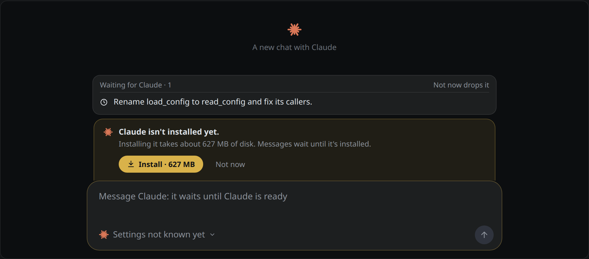

**Required:** the banner, when it shows, its states, its words and its
actions, since they're inside the chat; and what each row of the agents
panel says and offers. **Up to the app:** where the agents panel is, and
how it's opened.

## Its parts

The banner attaches to the top of the composer, as a question does, and the
box is joined to it in the banner's tone. Whatever needs the user is then
in one place, just above where they write. See
[the composer](~caf/standard-interface/composer#what-the-chat-allows).

| Part | Where | What it is |
| --- | --- | --- |
| The mark | Left of the first line | The agent's mark; a spinner, in the accent, while CAF finds something out (whether it's installed, the sign-in's link); a tick once it's signed in. |
| What's needed | The first line | What stands in the way, in one sentence. Its subject is bold: all of it when it's short (*Claude isn't installed yet.*), or the part before the colon (***Couldn't install Claude:*** *the disk is full.*). |
| What happens | Under it, muted | What it costs, whether messages wait, and what to do next. |
| What CAF said | Under that, small and muted, in a monospace font | Only where CAF passes on words not its own, such as the installer's. |
| Progress | Under that, while installing | A bar in the accent, and how much is done. |
| The steps | Under that, while signing in | Numbered: the page to open, a code to type or paste, and that it ends by itself. |
| The actions | At the foot | In this order: at most one primary button, in the accent; **Stop**, plain; **Not now**, quiet. |

**Its tone** follows the state, and the box takes the same edge:

- **Accent** while it waits on the user: the agent isn't installed, it's
  signed out, or a sign-in waits for them.
- **Calm**, with no role colour, while CAF does the work (checking,
  installing, starting a sign-in), once it's done, and for a viewer that
  can do nothing about it.
- **Warning** when it went wrong, or can't go on: a failed install, or a
  machine that can't install the agent.

## When it shows

The banner follows the agent's status, not the chat's state. It shows in
every chat with the agent but an archived one (CAF's `Closed`), whether
the chat is open, idle or lost, while the first of these holds:

1. **The agent isn't installed.** It's one CAF installs, and its install
   (`AgentStatus.install`) is anything but `Installed`. (An agent the app
   starts itself is `Host`, and never needs installing.)
2. **A sign-in to it is under way** (`SignInState::SigningIn`).
3. **It's signed out** (`SignInState::SignedOut`), and CAF can sign in to it
   now (`can_sign_in`).

Once none holds, it goes, but for a moment after a sign-in, as
[Signed in](#signing-in) says.

**A question comes first.** When a question waits on the user as well, the
question attaches to the composer instead, and the banner comes back once
it's answered. Only one thing attaches at a time.

**Whether messages wait** is the chat's, not the agent's: they wait while
the chat is `ChatState::WaitingForAgent`. CAF makes a chat wait for an
agent it installs until it's installed, and, while a sign-in that started
when the agent was signed out is under way, a chat that isn't running its
agent yet waits too. A chat in any other state sends as usual.

While the chat waits, the composer says
*Message Claude: it waits until Claude is ready*, and a message sent waits
on the composer's tray, headed *Waiting for Claude · 1*, with
*Not now drops it*.

**Not now** is in the banner while the chat is `ChatState::WaitingForAgent`
with a message waiting, and the viewer may act. No turn can be running then,
so it drops this chat's waiting messages, and nothing else (`Core::stop`).
In any other state, such as a chat mid-turn while a sign-in to its agent is
under way, there's no Not now: a message queued behind the turn stays on
the tray as usual, with *Stop drops it too*. **Stop** stops the install or
the sign-in, for every chat with the agent.

The signed-out banner's Not now is the one exception: nothing waits there,
and it only hides the banner, as [Signing in](#signing-in) says.

## Installing

These are for an agent CAF installs (`AgentSpec::installed`). Sizes are in
MB of 1,000,000 bytes, rounded, or GB with one decimal from 1,000 MB, as
`627 MB`.

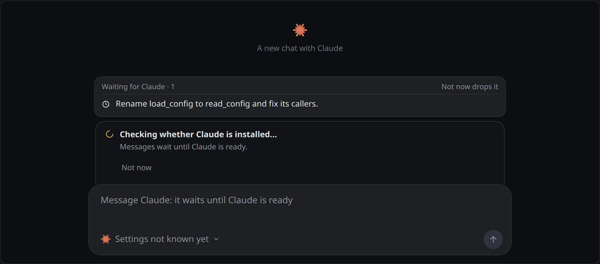

**Checking.** Until CAF has looked at what's installed
(`InstallState::Unknown`), as just after the app starts, the banner is calm,
with a spinner: *Checking whether Claude is installed…*, and under it,
*Messages wait until Claude is ready.*

If CAF can't look, it stays `Unknown`, and nothing says so but CAF's log.
So after 10 seconds of checking, the banner adds **Install**, with no size (CAF
accepts it while it hasn't looked, and `Unknown` carries no size), and the
app calls `Core::check_agents` again, then every 30 seconds while it's
still `Unknown`.

**Not installed.** The main picture above. CAF has looked, and the agent
isn't installed (`InstallState::Missing`). The banner says
*Claude isn't installed yet.*, then
*Installing it takes about 627 MB of disk. Messages wait until it's installed.*
The size is what the install takes on disk (`Missing.size`, the recipe's
`size`): installing is the user's choice, so they're told what it costs
before they agree. The action is **Install · 627 MB**, with a download
arrow.

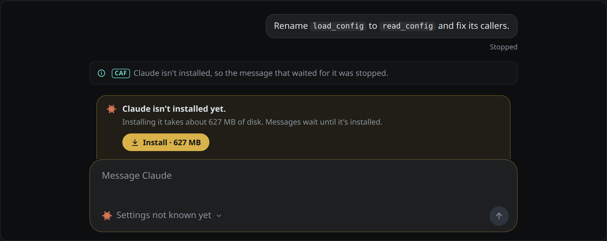

**After Not now.** Not now dropped the message. The chat shows it as
stopped, and CAF says why, in its own voice:
*Claude isn't installed, so the message that waited for it was stopped.*
The agent still isn't installed, so the banner stays, with Install.

CAF adds that note only while the agent isn't installed (`Missing`,
`Installing` or `Cannot`). Not now pressed while it's checking, or while a
sign-in holds the chat, stops the message silently: it shows as stopped,
with no note.

The chat is now lost, as one stopped while opening is
(`Lost { reason: Stopped }`). While the agent banner shows, it stands in
for the transcript's box for a lost chat, which isn't drawn: what to do
next is in the banner, and why in CAF's note. The next message sent waits
again.

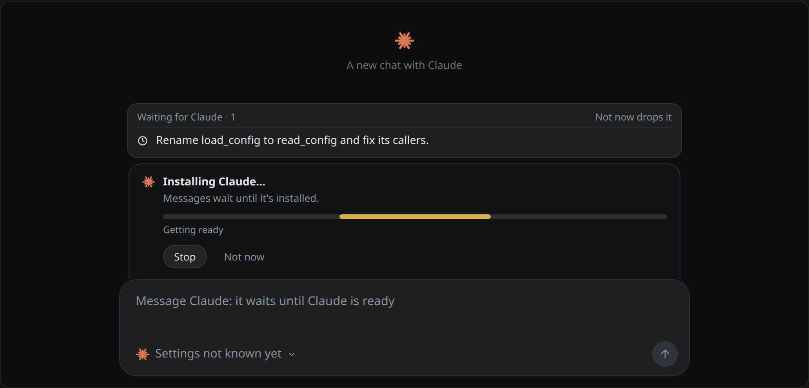

**Getting ready.** Once Install is pressed, the banner is calm:
*Installing Claude…*, *Messages wait until it's installed.* Until any of it
is done (`Installing.done` is 0), the bar moves without filling, and says
*Getting ready*. The action is **Stop**.

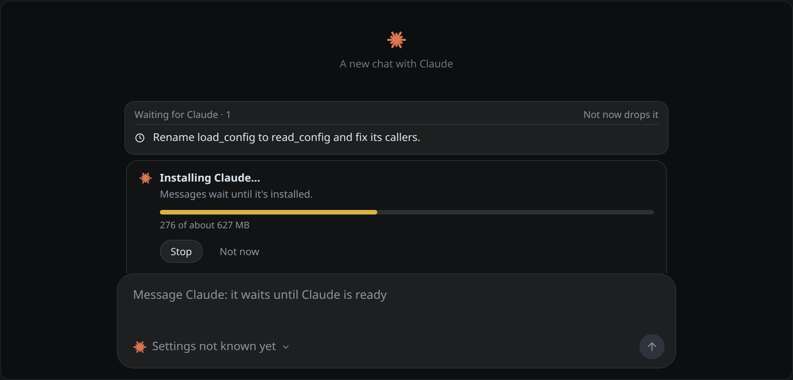

**Installing.** As it goes, the bar fills, and says how much is done, of
about how much: *276 of about 627 MB* (`Installing.done` and `size`). The
size is CAF's estimate, so `done` may pass it: the bar then stays full, and
says *640 MB so far*. Don't guess how long is left.

When it's done, every chat waiting for the agent starts, its waiting
messages go, and the banner goes.

**Installs nobody pressed for.** A later CAF may patch the version
installed again. It makes the new install from the one that's there,
without asking, as nothing is downloaded, and the agent shows
**Installing** by itself, in every chat with it. If that fails, it reads
as not installed, and installing it asks, as usual.

**Install pressed before CAF has looked.** For an agent CAF installs
patched, as it does Claude, the install waits for CAF to look, showing
*Getting ready*. It then goes on, or, if the machine can't install the
agent at all, stops every message waiting for it, with the note
*Claude's install failed, so the message that waited for it was stopped.*,
and shows why, as below. For any other agent, it downloads at once.

### When an install fails

An install that fails stops every message waiting for it, in every chat
with the agent, and each chat that had one says so in CAF's voice:
*Claude's install failed, so the message that waited for it was stopped.*
The banner takes the warning colour, says why, and offers **Try again**,
which installs it afresh. It says nothing of messages, since CAF's note
already does, where one was stopped. A message sent afterwards waits
again, with Not now.

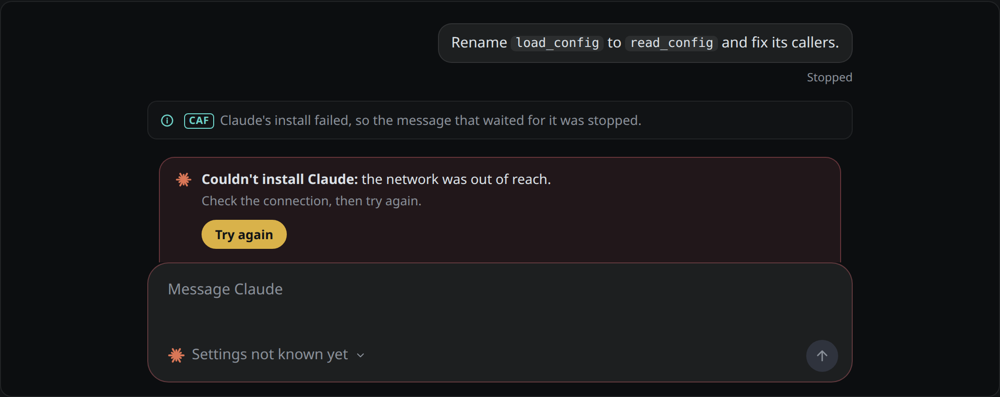

**Offline** (`InstallFailure::Offline`):
*Couldn't install Claude: the network was out of reach.*, then
*Check the connection, then try again.*

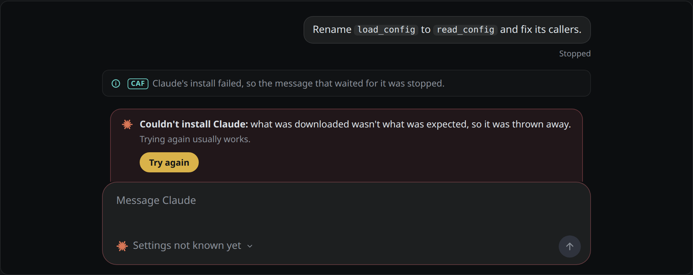

**A damaged download** (`InstallFailure::Corrupt`): a download didn't match
its checksum, so CAF threw it away.
*Couldn't install Claude: what was downloaded wasn't what was expected, so it was thrown away.*,
then *Trying again usually works.*

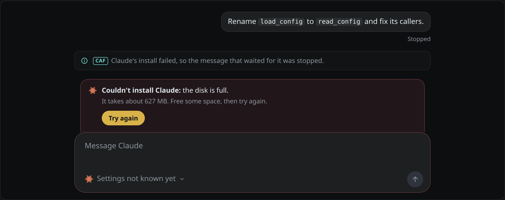

**The disk is full** (`InstallFailure::NoSpace`):
*Couldn't install Claude: the disk is full.*, then
*It takes about 627 MB. Free some space, then try again.*

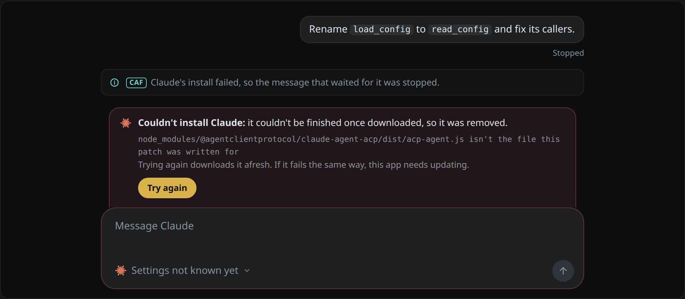

**Not finished** (`InstallFailure::Patch`): CAF installs some agents
patched, and the patch didn't fit, so CAF removed the install rather than
run it half-patched.
*Couldn't install Claude: it couldn't be finished once downloaded, so it was removed.*
Under it is what CAF said: which file, and which check stopped it. Then
*Trying again downloads it afresh. If it fails the same way, this app needs updating.*
Only a newer CAF fixes a patch that doesn't fit what was downloaded.

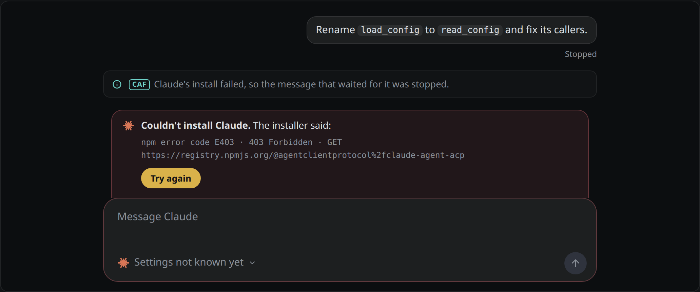

**Anything else** (`InstallFailure::Other`):
*Couldn't install Claude. The installer said:*, then what it said, as CAF
gives it (cleaned, and cut to 300 bytes).

**Stopped** (`InstallFailure::Stopped`): the installer reported it was
stopped, though CAF didn't stop it. (An install CAF stops, by the user's
Stop or as the app shuts down, just reads as not installed.)
*Couldn't install Claude: the last try was stopped.*, with Try again.

### When it can't be installed

Some machines can't install an agent at all (`InstallState::Cannot`).
Trying again would fail the same way, and CAF refuses it
(`Refused::NotInstallable`), so there's no Try again. The banner takes the
warning colour.

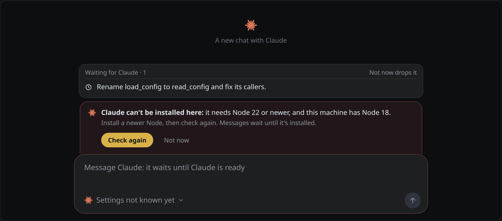

**Node** (`CannotInstall::Node`):
*Claude can't be installed here: it needs Node 22 or newer, and this machine has Node 18.*,
or *…and this machine has no Node.* when it has none. Then
*Install a newer Node, then check again. Messages wait until it's installed.*
**Check again** has CAF look again (`Core::check_agents`); if the machine
now has what's needed, the banner turns to Install. CAF never installs Node
itself. Only the app can ask CAF to look again: a viewer has no way to, so
a UI that's a viewer leaves Check again out, and the app looks again
itself, such as when its window comes to the front.

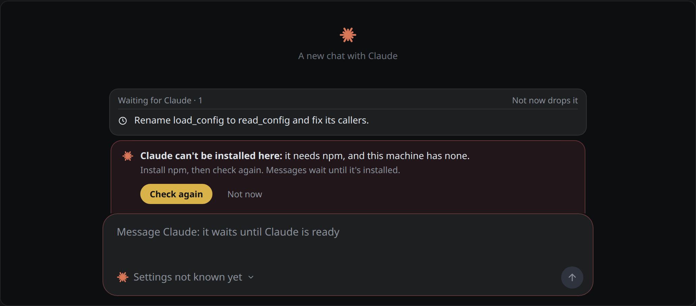

**npm** (`CannotInstall::Npm`):
*Claude can't be installed here: it needs npm, and this machine has none.*,
then *Install npm, then check again. Messages wait until it's installed.*,
with Check again.

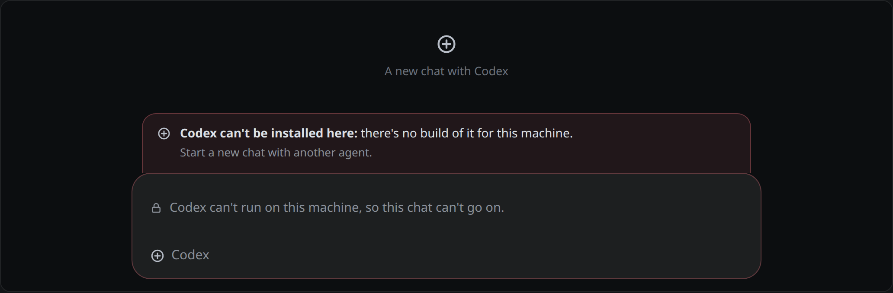

**No build** (`CannotInstall::Platform`). **Later.** Only an agent CAF
downloads can lack a build for the machine. Today Claude is CAF's only
built-in agent, and it comes from npm, so no app can show this yet. It's
here for a future agent CAF downloads; the example is Codex.
*Codex can't be installed here: there's no build of it for this machine.*,
then *Start a new chat with another agent.* Nothing on this machine will
change that, so no message could ever go: the composer is locked, as when
the user can't write, and says
*Codex can't run on this machine, so this chat can't go on.* CAF would
still take a message, and hold it for ever, so the app doesn't offer to
send one. A message already waiting keeps Not now.

**No recipe** (`CannotInstall::NoRecipe`): CAF doesn't know how to install
this agent. Every built-in profile has a recipe, so this happens only when
the app offers an agent CAF installs with the cautious profile. That
profile can't turn off the agent's own tools either, so CAF won't run it
(`Refused::OwnTools`), and what
[A chat's identity and lifecycle](~caf/standard-interface/chats) says of an
agent CAF won't run wins: its lock and words, not a lock of this page's.
The banner says only *my-agent can't be installed by this app.*, with no
actions.

## Signing in

CAF signs in with the agent's own sign-in, never one the agent suggests,
and never sees a password. For Claude, that's a page on Claude's site,
opened in the user's browser.

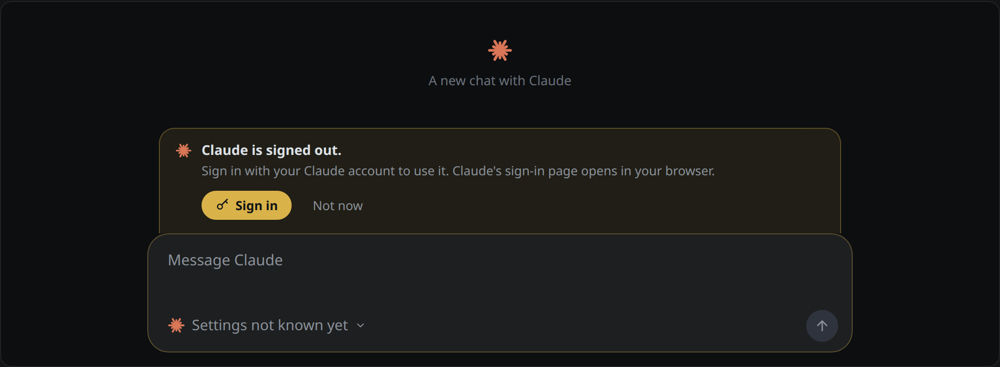

**Signed out.** When the agent is known to be signed out, and CAF can sign
in to it now (`can_sign_in`), the banner says *Claude is signed out.*, then
*Sign in with your Claude account to use it. Claude's sign-in page opens in your browser.*
The actions are **Sign in**, with a key, and **Not now**.

Nothing waits here: CAF doesn't hold a chat back because its agent is
signed out, so the box says only *Message Claude*. A message sent now goes,
and fails asking for a sign-in, with **Sign in** as its remedy
(`Remedy::SignIn`), as [the transcript](~caf/standard-interface/transcript)
shows. Here, Not now only hides the banner in this chat, until the agent's
state changes; CAF isn't asked anything.

While `can_sign_in` is false there's no Sign in, and no signed-out banner.
For an agent CAF installs, it's false until it's installed. For one the app
starts itself, it's false until it has started once in this run, and for
ever if its sign-in needs a file only CAF's own install has, or the private
folder CAF gives only its own installs.

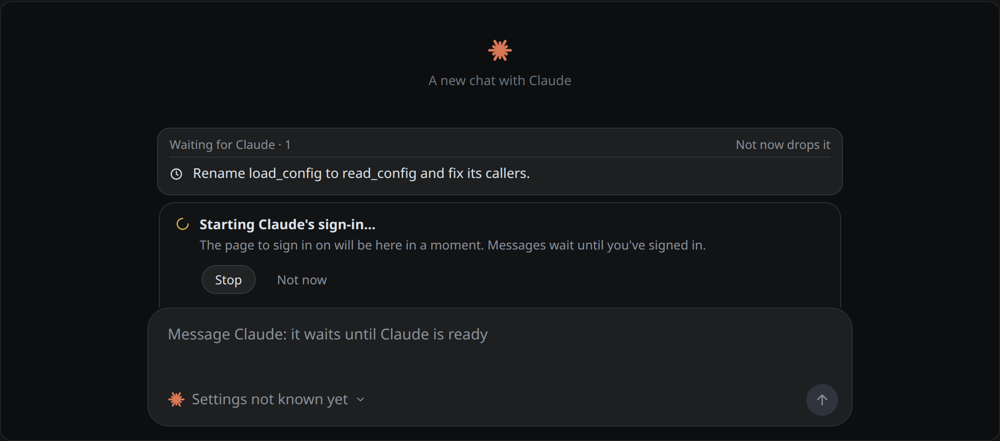

**The link coming.** Once Sign in is pressed, here, on a failed turn or in
the panel, the agent's sign-in starts. Until it gives its link
(`SignInLink.url` is `None`), the banner is calm, with a spinner:
*Starting Claude's sign-in…*, then
*The page to sign in on will be here in a moment.*, and, where the chat
waits, *Messages wait until you've signed in.* The action is **Stop**.

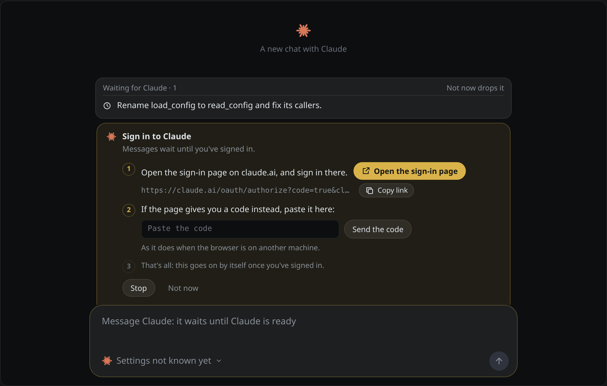

**Signing in.** The banner says *Sign in to Claude*, in the accent, then,
where the chat waits, *Messages wait until you've signed in.* It numbers
the steps:

1. *Open the sign-in page on claude.ai, and sign in there.*, naming the
   link's own site, with **Open the sign-in page**. Under it is the link
   itself, muted and cut short, with a **Copy link** button, for a browser
   elsewhere.
2. When the sign-in takes a code pasted back (`SignInLink.paste`, as
   Claude's does): *If the page gives you a code instead, paste it here:*,
   a box and **Send the code**, then
   *As it does when the browser is on another machine.*
3. Muted: *That's all: this goes on by itself once you've signed in.*

Open the link in a new browser tab or window, cut off from the app, and only
if it's `https`. CAF has already checked it goes to a site the agent's
profile names, and stops a sign-in whose link goes anywhere else; that's the
app's own check besides.

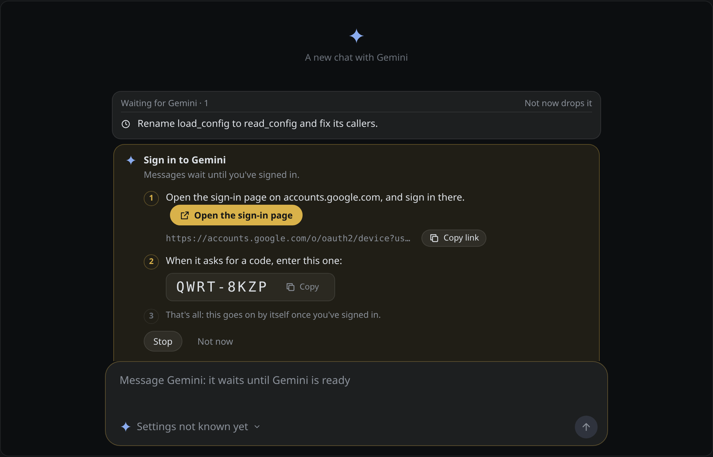

**A code to type.** **Later.** Some agents' sign-ins show a code to type on
the site (`SignInLink.code`). Claude's doesn't, and it's CAF's only
built-in agent today, so this is for a future one; Gemini is here only as
an example.
Step 2 is then *When it asks for a code, enter this one:*, with the code,
large and spaced, and **Copy**. A sign-in may have both a code and a box to
paste into; each is a step of its own, in that order.

**Stop** stops the sign-in (`Core::stop_sign_in`), and the agent goes back
to how it was, as it does when a sign-in nobody finishes is stopped, after
10 minutes (`Timers::sign_in`), and when a sign-in fails: it ends badly, its
command can't run, or its link goes to a site the profile doesn't name. CAF
gives no reason for a failure, as it could be what the command printed, so
the banner just goes back to how it was, and the chats that waited go
ahead: their messages go, and fail asking for a sign-in if the agent is
still signed out. Don't show a countdown: CAF doesn't tell a viewer when it
will stop a sign-in.

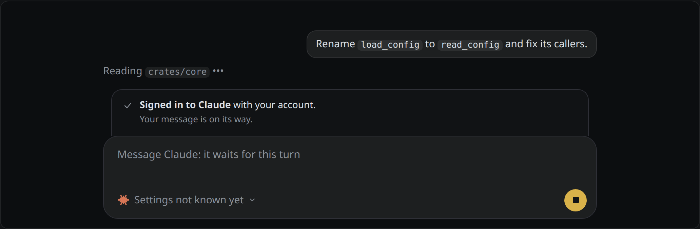

**Signed in.** When the agent turns from `SigningIn` to `SignedIn`, every
chat that was showing the sign-in keeps its banner for 4 seconds more,
calm, with a tick, saying how, as the current `SignedInAs` has it:
*Signed in to Claude with your account.*, *…with an API key.*,
*…through a gateway.*, or *Signed in to Claude.* while it's `Unknown`. CAF
first says `SignedIn(Unknown)`, and learns how a moment later, so the
banner may begin *Signed in to Claude.* and then say how. Under it, where a message waited,
*Your message is on its way.* CAF has no state for this: the app holds it.

A chat whose last message failed for want of signing in also gets a note
from CAF, saying the user signed in, and that the message can be sent
again (`Note::SignedIn`). CAF never sends it again by itself.

Agents CAF installs from one profile share one sign-in: signing in to one
signs in to all of them, in every chat. Each agent the app starts itself
has its own.

## What the actions do

| Action | What it does |
| --- | --- |
| **Install · 627 MB** | Installs the agent (`Core::install`). Pressing it while it's already installing does nothing more. |
| **Try again** | The same, after a failed install. It downloads afresh. |
| **Stop** (installing) | Stops the install, for every chat (`Core::stop_install`). The agent reads as not installed. Messages waiting for it are stopped, with the note *Claude isn't installed, so the message that waited for it was stopped.* |
| **Check again** | Has CAF look again at what's installed and what the machine has (`Core::check_agents`). Only the app can. |
| **Not now** | Drops this chat's waiting messages, as the composer's Stop would (`Core::stop`). Where nothing waits, on a signed-out agent, it only hides the banner. |
| **Sign in** | Starts the agent's sign-in (`Core::sign_in`). Pressed while one is under way, it does nothing more. |
| **Send the code** | Passes what was pasted to the sign-in (`Core::paste`), trimmed. Unlit while the box is empty. |
| **Stop** (signing in) | Stops the sign-in, for every chat (`Core::stop_sign_in`). |
| **Sign out** | Signs out with the agent's own command (`Core::sign_out`), stopping any sign-in first. Only in the agents panel. |

### When CAF refuses

If CAF refuses an action, the banner, or the panel's row, says why under its
actions, in the warning colour, and stays as it was:

| CAF refuses | It says |
| --- | --- |
| `NotInstallable` | *Claude can't be installed here.* |
| `AlreadyInstalled` | *Claude is installed already.* |
| `CannotSignIn`, signing in | *Claude can't be signed in to from here now.* |
| `CannotSignIn`, signing out | *Claude can't be signed out of from here.* |
| `NotSigningIn` | *Claude isn't being signed in to any more.* |
| `NothingToStop` | *There's nothing to stop now.* |
| `Unsupported`, pasting | *That can't be sent as a code: paste one line, of at most 4 KB.* CAF refuses a paste of more than one line, or longer than 4 KiB. |
| `NoSuchAgent` | *This app doesn't offer Claude any more.* |
| `NoSuchChat`, on Not now | *This chat isn't open any more.* |
| `Outcome::Gone`, to a viewer | *The app has closed, so nothing was done.* |
| `Outcome::NotAllowed`, to a viewer | *You can't install agents or sign in to them here.* |

## A viewer without the agents right

Installing agents and signing in to them is a right of its own
(`Rights.agents`). In `caf-driver-tokio` it's given by
`ViewerRules::agents`, which is off by default. Whoever opens the sign-in
link and approves it chooses whose account the agent signs in to, so a
viewer that may only watch never sees the link or the code: CAF doesn't send
them. Such a viewer is told what's happening, and offered nothing it can't
do. Its banner is calm, as what the agent needs is nothing this user can
act on. A viewer with the `act` right still gets Not now, quiet, as for
anyone: it drops only their own chat's message, so it doesn't make the
banner the user's to act on.

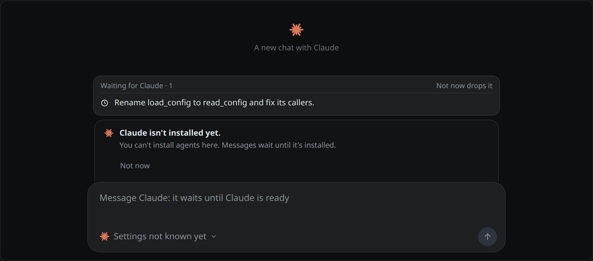

**Not installed.** *Claude isn't installed yet.*, then
*You can't install agents here. Messages wait until it's installed.* There's
no Install.

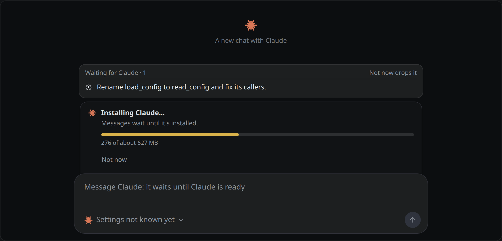

**Installing.** As for anyone, but with no Stop.

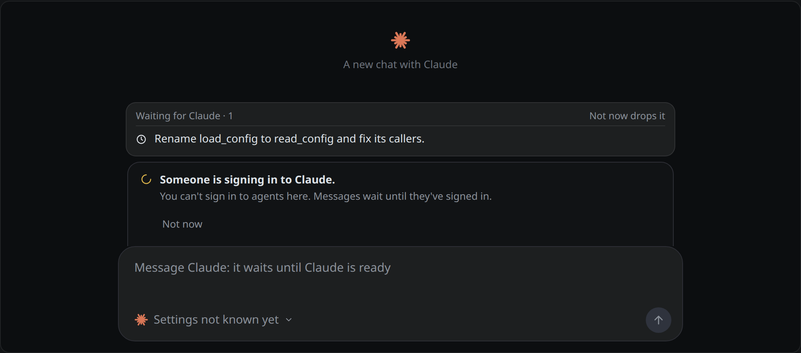

**Signing in.** CAF sends the state, but no link or code, so the viewer
can't tell whether the link has come. The banner has a spinner:
*Someone is signing in to Claude.*, then
*You can't sign in to agents here.*, and, where the chat waits,
*Messages wait until they've signed in.*

**Not now** needs only the right to act (`Rights.act`), as it drops the
viewer's own chat's messages, so this viewer keeps it wherever a message
waits. A viewer without `act` can't write, so has no Not now, and its tray
has no note. The failure states show their words with no Try again, and
the signed-out banner isn't shown at all.

## The agents panel

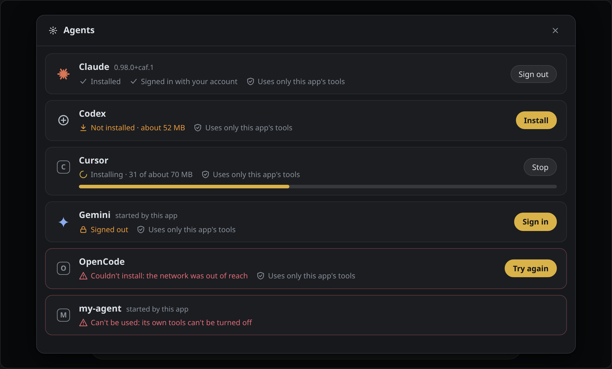

**Later**, in part: today Claude is the only agent CAF installs, so the
Codex, Cursor and OpenCode rows, which CAF would install, stand for future
agents. An agent the app starts itself, as Gemini and my-agent are here,
can sit beside Claude now.

The agents panel lists every agent the app offers, in the app's order
(`Core::agents`), one row each:

- **Its mark and name**, as in a chat, and its version as CAF installed it:
  *0.98.0+caf.1* (`Installed.version`). An agent the app starts itself says
  *started by this app* instead. An agent the app has no mark for shows its
  initial, in a muted square.
- **Its install**: *Installed*; *Not installed · about 52 MB*, in the
  caution colour; *Installing · 31 of about 70 MB*, with a spinner in the
  accent and a bar under the row; *Couldn't install:* or
  *Can't be installed:* and why, as the banner says it, in the warning
  colour. *Checking…* until CAF has looked.
- **Its sign-in**, once it's installed or started by the app:
  *Signed in with your account* (*with an API key*, *through a gateway*,
  or just *Signed in*), *Signed out* in the caution colour, *Signing in*,
  or nothing while CAF doesn't know.
- **Its tools**: *Uses only this app's tools*, when CAF can turn the agent's
  own tools off (`own_tools_off`), whether it's installed or not. When it
  can't, CAF won't run it, and the row says so, in the warning colour:
  *Can't be used: its own tools can't be turned off*. Chats with it are
  refused (`Refused::OwnTools`).
- **Its action**, on the right. One at most, the first of these that
  applies:

| The agent | The action |
| --- | --- |
| Not installed (`Missing`) | **Install**, primary |
| Not known yet (`Unknown`), after 10 seconds | **Install**, primary, with no size |
| Installing | **Stop** |
| Its last install failed (`Cannot(Failed)`) | **Try again**, primary |
| Can't be installed otherwise (`Cannot`) | None: why is in the row |
| Being signed in to | **Stop**, with the steps under the row |
| Signed out or not known, and `can_sign_in` | **Sign in**, primary |
| Signed in | **Sign out**. CAF can refuse it, as for an agent whose profile has no way to sign out; the row then says *Claude can't be signed out of from here.* |

A sign-in shows its steps in the panel's row, as the banner draws them,
unless a chat with that agent is shown beside the panel, which shows them
already. CAF has no update action: a newer version of an agent comes with a
newer CAF, which asks to install it when it's next used, or makes it
without asking when it's only patched again, as above.

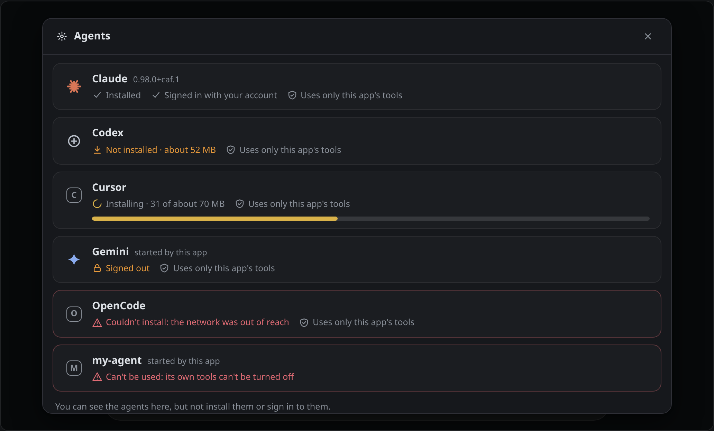

For a viewer without the `agents` right, the panel has no actions, and
says at its foot
*You can see the agents here, but not install them or sign in to them.*

## What CAF tells the app

| What the banner or panel shows | Where it comes from |
| --- | --- |
| Whether the banner shows | The agent's status: `install` neither `Installed` nor `Host`; `SignInState::SigningIn`; or `SignInState::SignedOut` with `can_sign_in`. In any chat but a `Closed` one. |
| Whether messages wait | The chat's `ChatState::WaitingForAgent`. |
| Every agent's status | `Core::agents`, and a viewer's `ToViewer::Agents`, again each time any of it changes. |
| The install states | `AgentStatus.install`: `Host`, `Unknown`, `Missing { size }`, `Installing { done, size }`, `Installed { version }`, `Cannot(why)`. |
| Why it can't be installed | `CannotInstall`: `Node { needs, has }`, `Npm`, `Platform`, `NoRecipe`, or `Failed(InstallFailure)`: `Offline`, `Corrupt`, `NoSpace`, `Stopped`, `Patch(what)`, `Other(what)`. |
| The sign-in states | `AgentStatus.sign_in`: `Unknown`, `SignedOut`, `SigningIn(SignInLink)`, `SignedIn(SignedInAs)`. |
| The sign-in's steps | `SignInLink`: `url` (checked against the profile's sites), `code`, `paste`. |
| Whether Sign in is offered | `AgentStatus.can_sign_in`. |
| *Uses only this app's tools* | `AgentStatus.own_tools_off`. |
| The notes in the chat | `Note::NotInstalled`, `Note::InstallFailed`, `Note::SignedIn`. |
| A refusal | `Refused`, or a viewer's `Outcome::NotAllowed`, as the table above gives them. |
| Who may do what | The viewer's `agents` right for installing and signing in, and its `act` right for Not now. |

See [Installing and signing in](~caf/getting-started/installing-and-signing-in)
for the calls, and [Agents and profiles](~caf/concepts/agents-and-profiles)
for what CAF does underneath.
