A chat appears in more places than its own pane: in a sidebar, on a tab, in
a menu, on a workspace's badge. Wherever it appears, one component says which
chat it is and whether it needs the user. And over its life a chat is
restored, put out of sight, archived, deleted and started, which the chat
itself shows the same way in every CAF app.

[See it live](~attachments/caf-si-chats): the identity at every size, and
every state, in dark and light.

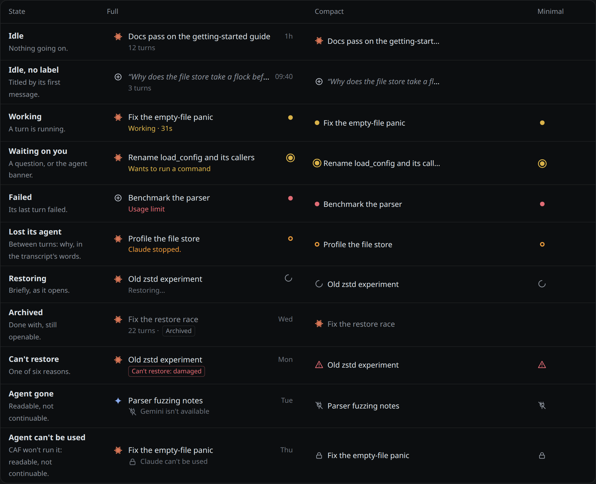

| Part | How firm |
| --- | --- |
| The identity component: its states, sizes and how each looks | **Required** |
| The lifecycle: every state below, its words, and what its actions do | **Required** |
| Where chats are listed, and where the component sits | **Up to the app** |
| Where actions live: buttons, context menus, keys | **Up to the app**. Only what they say and do is fixed. |
| Search, sorting, grouping, and empty states | **Up to the app** |
| Projects and workspaces (CAF's shelves) | **Up to the app**. They follow the app's own: there's no shelf picker. |

## The identity

One component says which chat this is and whether it needs the user. It has
three sizes; use whichever fits where the app shows chats:

| Size | For | What it shows |
| --- | --- | --- |
| **Full** | List rows | The agent's mark, the title, and on the right when it last changed or a dot. Under the title, a reason line: what's going on, or the number of turns. |
| **Compact** | Tabs and menus | One mark and the title. The mark is the agent's, or the state's dot or sign when there is one. |
| **Minimal** | Where there's room only for a mark, such as a pane header or a workspace's badge | The state's dot or sign alone, with the title as its tooltip. Nothing at all while the chat is idle or archived. |

### The title

**The app's label for the chat**, if it has one (`AppData::label`). Without
one, **the first line of the first message the user sent, in quotes and
italics**: *"Why does the file store take a flock before the rename?"*. A
chat with neither, a new one before anything is sent, is *New chat*. **Never its id.** A title too long for its
place ends in an ellipsis.

### The states

| State | Full | Compact and minimal | When |
| --- | --- | --- | --- |
| **Idle** | Agent's mark; when it last changed; *12 turns* | Agent's mark; minimal shows nothing | Nothing is going on. |
| **Working** | A pulsing dot in the accent; *Working · 31s*, in the accent | The pulsing dot | A turn is running, or stopping; the chat is starting its agent with a message waiting; or it waits for its agent while CAF does the work, such as installing it. |
| **Waiting on you** | A dot in the accent with a ring around it; what's waiting, such as *Wants to run a command*, in the accent | The ringed dot | A question is waiting, or the chat waits for its agent and the agent banner waits on the user, such as to install it or sign in. |
| **Failed** | A dot in the warning colour; why, such as *Usage limit*, in the warning colour | The dot in the warning colour | Its last turn failed. |
| **Lost its agent** | A hollow dot, a ring in the caution colour; why, such as *Claude stopped.*, in the caution colour | The hollow dot | The chat lost its agent between turns. What the next message does depends on why, as the transcript's box for it says: for most reasons it tries again, but after `Incompatible` or `ShutDown`, nothing can help. |
| **Restoring** | A spinner; *Restoring…* | The spinner | Briefly, as a saved chat opens. |
| **Archived** | Title muted; on the right, when it was archived; *22 turns ·* and an *Archived* badge | Muted; minimal shows nothing | The user archived it. It can still be opened, and stays archived, open or not, until it's unarchived. |
| **Can't restore** | A badge in the warning colour: *Can't restore: damaged*, naming the reason | A warning sign in the warning colour | Its last restore failed. |
| **Agent gone** | A crossed-out plug and *Gemini isn't available*, muted | The crossed-out plug | The app no longer offers its agent. It can be read but not carried on. |
| **Agent can't be used** | A lock and *Claude can't be used*, muted | The lock | CAF won't run its agent, as it can't turn off the agent's own tools. It can be read but not carried on. The lock is the composer's, as [An agent that's gone](#an-agent-that-s-gone) shows. |

The states and how each looks are fixed. Working's dot pulses, Waiting on
you's is ringed, and Lost's is hollow, so they differ by shape at every
size, not only by colour or movement. The reason line uses CAF's
words for what's going on: the transcript's for a failure and for a lost
agent, and the question's for what waits on the user.

Working counts from when its message was sent, so it includes any time the
message waited. While Stop is under way, its reason line says *Stopping…*;
while the chat starts its agent, *Starting Claude…*.

**A chat waiting for its agent** follows the
[agent banner](~caf/standard-interface/agents#its-parts), and the reason
line is the bold part of the banner's first line, without its full stop:

| The banner's tone | State | Reason line, for example |
| --- | --- | --- |
| Accent: it waits on the user | Waiting on you | *Claude isn't installed yet* |
| Calm, as CAF does the work: checking, installing, or a sign-in's link on its way | Working, with no time | *Installing Claude…*, *Checking whether Claude is installed…* |
| Calm, only because this viewer can't act on it | No dot: the agent's mark, and the reason line muted | *Claude isn't installed yet* |
| Warning: it went wrong, or can't go on | Failed | *Couldn't install Claude* |

A viewer that can't act on the agent gets no dot: Waiting on you would ask
it for something it can't do, and Working would say something is under way
when nothing is. The muted line still says why the chat isn't going on.

That holds while the chat is `WaitingForAgent`, and while it's
`Lost { reason: Stopped }` with the banner showing, as after Not now: the
banner stands in for the lost chat's box then, so the identity follows the
banner, not the loss.

**Which state.** A chat is in the first of these that holds:

1. **Restoring** or **Can't restore**, from how the chat is saved, while it
   isn't open; then **Archived**, while the chat is archived, open or not,
   saved or not.
2. **Agent gone**, when the app no longer offers its agent, or **Agent
   can't be used**, when CAF won't run it.
3. **Waiting on you**, while a question waits.
4. **The agent banner's state**, as above, while the chat is
   `WaitingForAgent`, or `Lost { reason: Stopped }` with the banner showing.
5. **Working**, while its last turn is running or stopping, or the chat is
   `Opening` with a message waiting.
6. **Failed**, when its last turn failed.
7. **Lost its agent**, while the chat is `Lost`.
8. **Idle**: anything else. That covers a chat whose last turn finished,
   was stopped or was cut off, and one `Opening` with no message waiting.

Its **last turn** is the last one the user or the agent started. A turn of
CAF's own, which only carries CAF's notes, such as the one saying the user
signed in, never counts: a chat that failed for want of signing in stays
Failed until the next turn.

### Hosting it

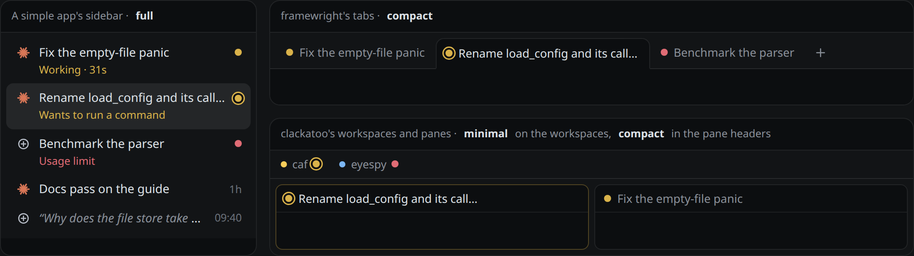

**Up to the app.** Three apps, three ways of listing chats, the same
component: full in a simple app's sidebar, compact on framewright's tabs,
minimal on clackatoo's workspaces with compact in its pane headers. They show
it fitting in; they're not layouts to copy. Put chats wherever the app
already puts its things.

## The rules

**Required.**

1. **No CAF words.** Users never see *shelf*, *loaded*, *put away*,
   *session* or *adapter*. A shelf takes the app's own word, such as project
   or workspace, or none.
2. **Opening a chat just opens it.** If it was saved, CAF restores it, and
   that shows only as a brief *Restoring*. Users never manage what's in
   memory, so there's no "open" against "saved".
3. **Closing a tab or a pane never archives a chat.** A saved chat is put
   away; one that isn't saved stays open, out of sight.
   [Closing a tab](#closing-a-tab) says what happens to each.
4. **Archive is CAF's close**: "I'm done with this one". It's a deliberate
   action, never a side effect of closing a tab or a pane. **Archiving
   sticks**: an archived chat stays archived, opened or not, until the user
   unarchives it or sends to it.
5. **Delete can't be undone,** so it always asks first, naming the chat.
   Only a saved chat can be deleted.
6. **A new chat is an empty chat.** There's no form: the agent is chosen in
   the composer's own settings menu, and sending starts the chat.
7. **When a chat can't be restored,** say which of the six reasons it is, in
   the words below, with only the actions that can help.

## Restoring

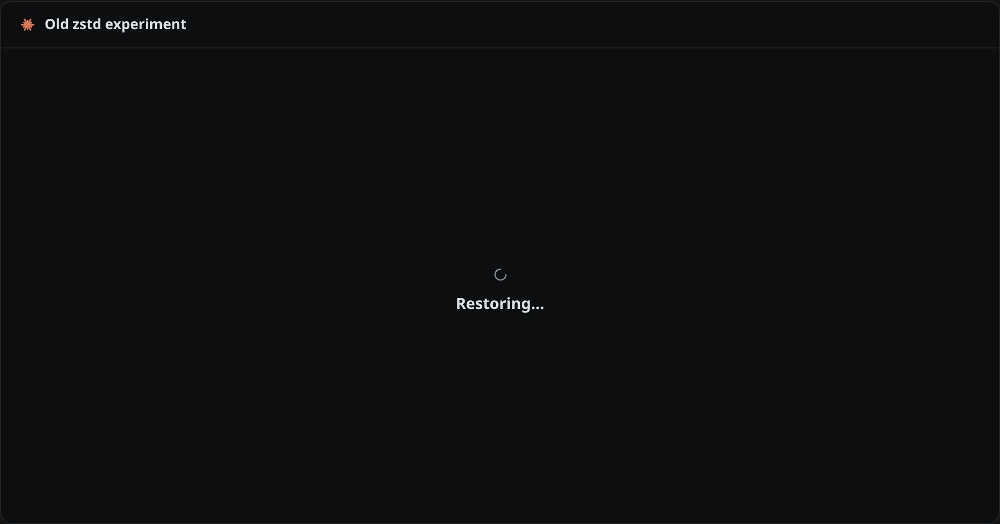

**Restoring.** Opening a saved chat restores it: CAF reads it back, and it
carries on as it was. Meanwhile the chat shows a spinner and *Restoring…*, and
its title in the header. This is the only sign it was saved.

A restored chat starts no agent until a message is sent. What was under way
when it was saved is tidied: a turn that was running is cut off, and a
message that was waiting is stopped, never sent by itself. The
[transcript](~caf/standard-interface/transcript) shows both.

### When it can't be restored

CAF gives one of six reasons, and leaves the chat's save exactly as it was,
whatever the reason. The chat shows a box in the warning colour: a heading in
bold, with a warning sign and no full stop, then a sentence or two under it.
When CAF has the store's or the system's own words, they follow in a
monospace font, muted. Under the box are only the actions that can help.

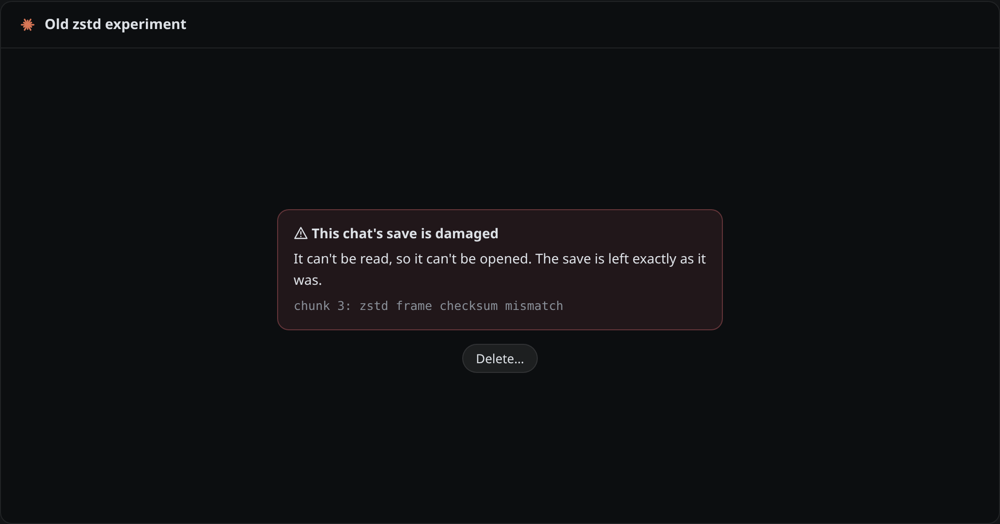

**Damaged** (`Damaged`).

- Heading: **This chat's save is damaged**
- Under it: *It can't be read, so it can't be opened. The save is left
  exactly as it was.*
- Then what the store said, such as *chunk 3: zstd frame checksum
  mismatch*.

Trying again can't help, so the one action is **Delete…**, which asks
first, as [Delete](#deleting) does.

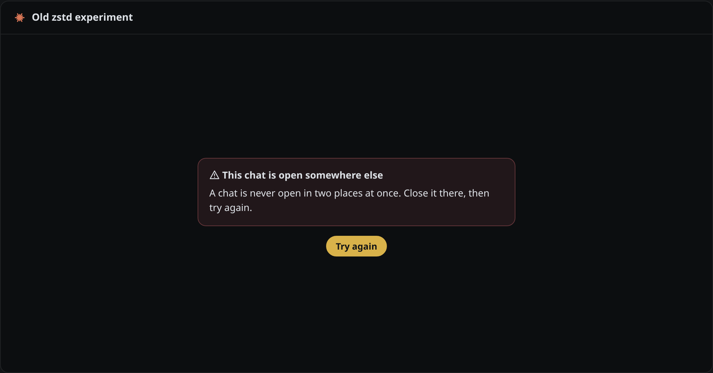

**In use** (`InUse`). Another program has it open: another app, another
window of this one, or another copy of CAF.

- Heading: **This chat is open somewhere else**
- Under it: *A chat is never open in two places at once. Close it there,
  then try again.*

**Try again** restores it again.

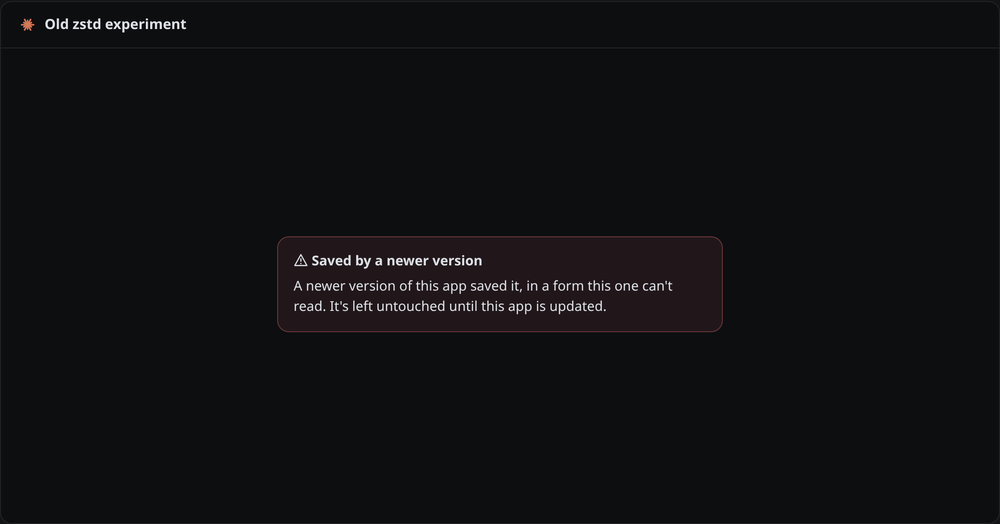

**Newer** (`Newer`).

- Heading: **Saved by a newer version**
- Under it: *A newer version of this app saved it, in a form this one can't
  read. It's left untouched until this app is updated.*

Nothing helps but updating, so there are no actions.

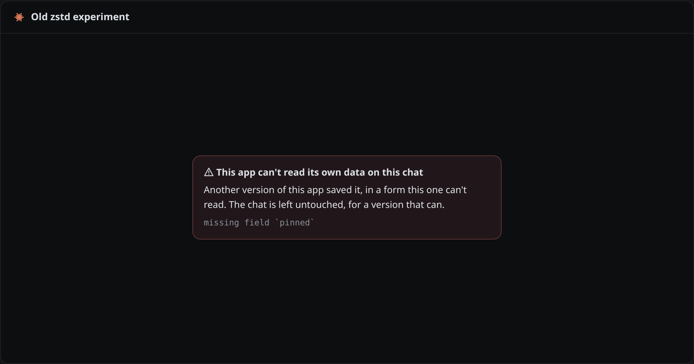

**The app's data** (`AppData`).

- Heading: **This app can't read its own data on this chat**
- Under it: *Another version of this app saved it, in a form this one can't
  read. The chat is left untouched, for a version that can.*
- Then what the app's reader said, such as *missing field `pinned`*.

There are no actions.

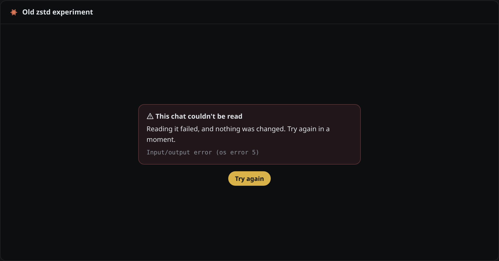

**Couldn't read** (`Store`).

- Heading: **This chat couldn't be read**
- Under it: *Reading it failed, and nothing was changed. Try again in a
  moment.*
- Then what the system said, such as *Input/output error (os error 5)*.

**Try again** restores it again.

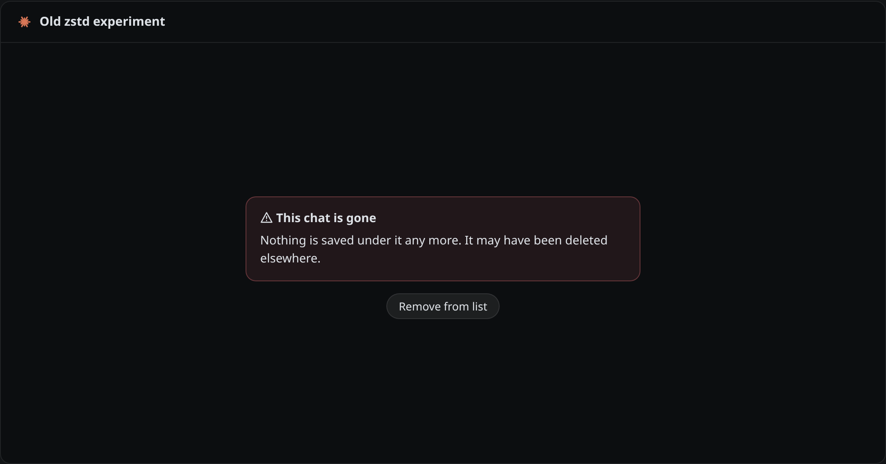

**Gone** (`NotFound`).

- Heading: **This chat is gone**
- Under it: *Nothing is saved under it any more. It may have been deleted
  elsewhere.*

**Remove from list** lists the saved chats again, and it drops out. Only
the app can list them, so a viewer shows no action.

**Try again** is offered only after *In use* and *Couldn't read*: for the
other four, trying again can't change the answer.

## Closing a tab

Closing a tab or a pane, or whatever the app uses to put a chat out of
sight, never archives it.

- **A saved chat is put away**: saved as it is, and let go of, so it takes
  nothing while it's closed. Opening it again restores it, as it was. When
  that happens depends on what the chat is doing:
  - **At once, unless** a turn runs or is stopping, a message waits behind
    one, a question waits, or the chat is `Opening` with a message waiting.
  - **In those cases, once they're done**, so closing a tab never stops the
    agent's work. A question keeps it open until it's answered, or until
    the app stops, which saves it anyway.
  - **A chat waiting for its agent is put away at once**, and its waiting
    messages are stopped, since they may wait for ever. Unlike Not now,
    this brings no note from CAF: the transcript shows them as stopped, with
    no reason. The app may warn first, such as *Closing this drops the
    message waiting for Claude.*

  Until it's put away, wherever the app lists it, it shows its state as
  usual, such as Working or Waiting on you. Opening it again before then
  just shows it: it's still open, and restoring it would be refused.
- **A chat that isn't saved stays open**, as it is, out of sight. The app
  can show it again, as it was, until the app stops; then it's gone.

## Archiving

**Archive** is CAF's close: the user is done with the chat. Its agent is let
go, and a saved chat is saved, archived, and put away. Wherever it appears,
it's muted, with an *Archived* badge, and the full identity shows on its
right when it was archived, in place of when it last changed. A chat saved
archived before CAF kept when shows when it last changed instead.

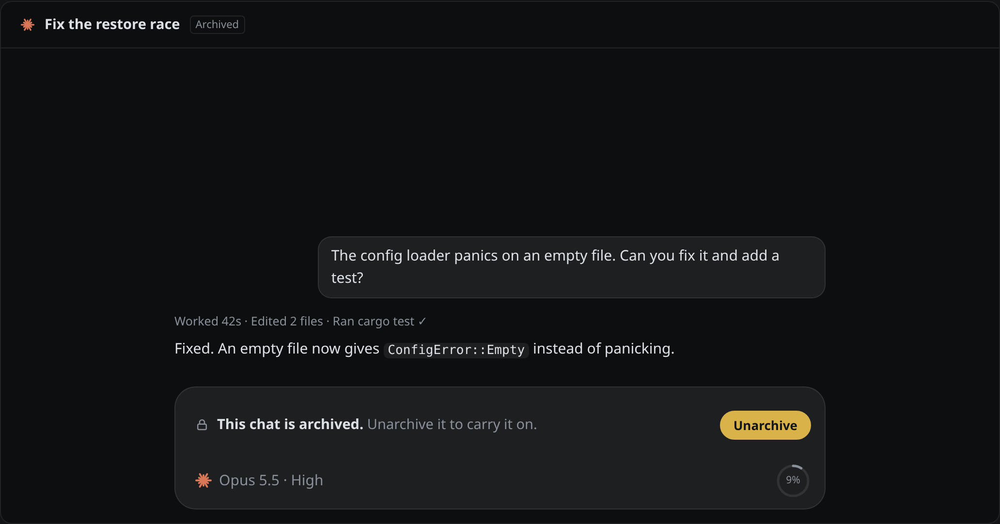

**Opening an archived chat** restores it, as any saved chat, and it's
still archived: archiving sticks. The chat shows it as anywhere else, with
its title and the *Archived* badge in the app's header for it, and its
composer is locked: *This chat is archived. Unarchive it to carry it on.*,
with **Unarchive**, as
[The composer](~caf/standard-interface/composer#what-the-chat-allows)
shows. It can be read, and its settings can't be changed.

**Unarchive** makes it an ordinary chat again, at once: the badge goes, the
composer unlocks, and nothing else happens until the user sends, which
starts its agent. **Sending to an archived chat unarchives it** too: CAF
takes a message to it as the user carrying it on. Only an app that sends
without the composer meets this, as the composer stays locked until the
user unarchives. Either way, the chat goes back to how it's shown when
it's idle.

A chat that isn't saved, once archived, stays in memory until the app
stops, archived, and is unarchived the same way.

## An agent that's gone

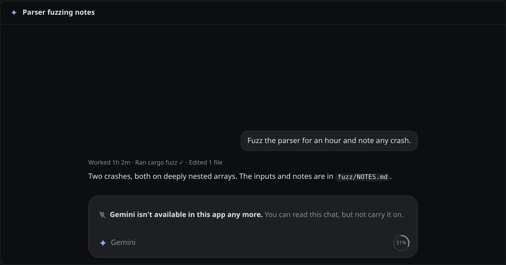

**Agent gone.** A saved chat whose agent the app no longer offers still
opens, with all it held, and can be read but not carried on. Its composer
says why instead of offering to send: *Gemini isn't available in this app
any more. You can read this chat, but not carry it on.*, with a crossed-out
plug, the agent's mark and name, and the context ring.

If the app renamed the agent, the chat isn't gone: when exactly one agent
the app offers has the old one's built-in profile, CAF finds it by that, and
the chat comes back with the agent under its new name. With none, or more
than one, the agent is gone.

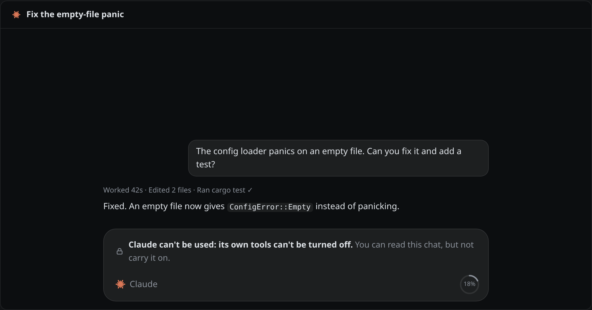

**An agent CAF won't run.** CAF never runs an agent whose own tools it can't
turn off. A saved chat with such an agent still opens, and reads as an agent
gone does, with a lock in place of the plug: *Claude can't be used: its own
tools can't be turned off. You can read this chat, but not carry it on.*
[Agents](~caf/standard-interface/agents#the-agents-panel) says the same of
the agent in its panel.

It happens in two ways, and the app knows both from the agent's status
(`own_tools_off` is false):

- **The app gave the agent the cautious profile**, which doesn't say how to
  turn its tools off. CAF refuses to send to the chat (`Refused::OwnTools`).
- **The agent isn't the one its profile is for**, as when the program
  started as Claude turns out to be another. CAF learns this only once it
  has started the agent in this run. It doesn't refuse the message, but
  the chat loses its agent each time it opens
  (`Lost { reason: Incompatible(OwnTools) }`), so no message could ever go.
  Locking the composer then is the app's rule, not CAF's refusal, so the
  user isn't asked to write what can't be sent. Until CAF has started the
  agent, the chat looks ordinary, and its first message ends with the
  transcript's box for the loss.

## Starting a chat

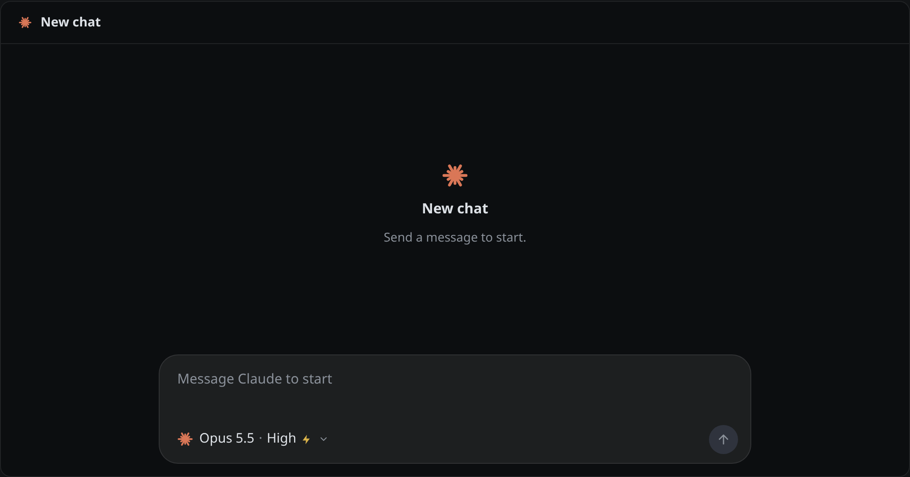

**New chat.** A new chat is an empty chat: its title is *New chat*, its body
says *New chat* and *Send a message to start.* under the agent's mark, and
its composer says *Message Claude to start*. There's no context yet, so no
ring. Sending starts it, and the message is its first.

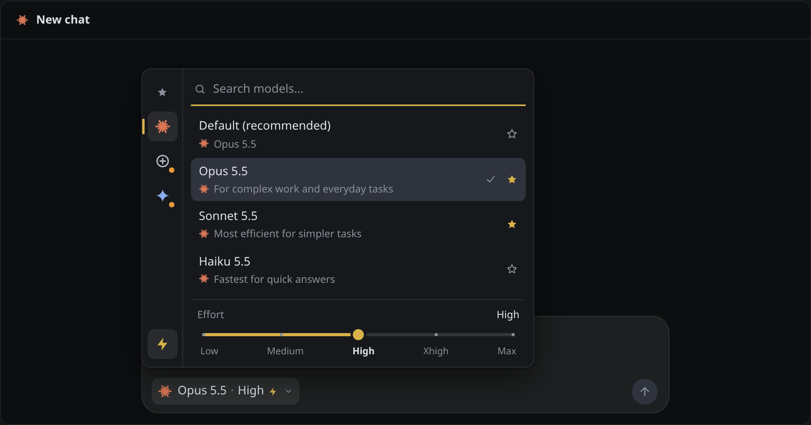

**Choosing the agent.** The agent is chosen in the composer's settings
menu, as its model is in any chat. In a new chat, the menu's rail lists every
agent the app offers, each with its models, and a dot in the caution colour
on any that still needs installing or signing in. An agent whose settings
CAF doesn't know yet shows *Not known yet* and *Learn them now*, as
[The composer](~caf/standard-interface/composer#before-caf-knows-the-settings)
shows.

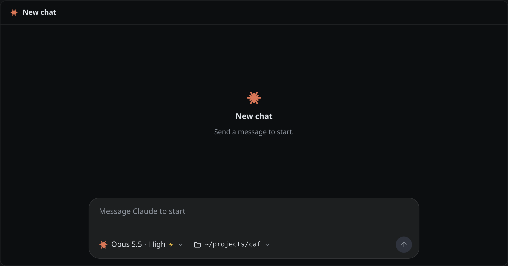

**Choosing the folder.** Only if the app lets users choose where the agent
works does the box have a second control, beside the settings: the folder,
such as *~/projects/caf*. An app that decides the folder itself has none.

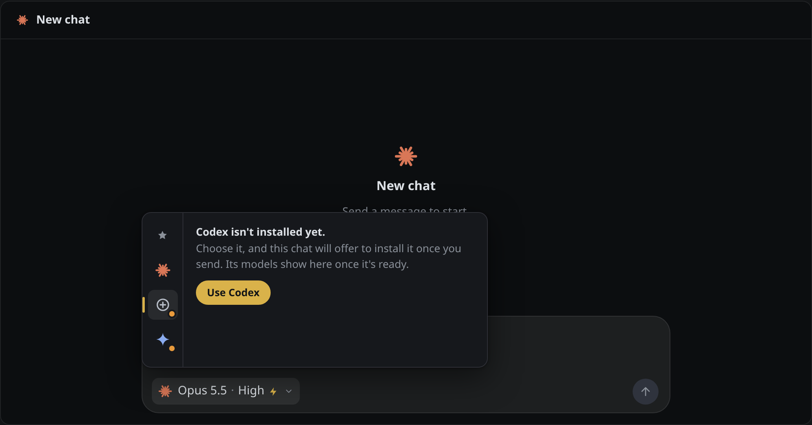

**An agent that isn't ready.** Picking one that still needs installing
shows, in place of its models, *Codex isn't installed yet. Choose it, and
this chat will offer to install it once you send. Its models show here once
it's ready.*, and **Use Codex**. One that needs signing in says
*Codex needs you to sign in.*, and that the chat will offer to sign the user
in. Once the message is sent, the chat waits for the agent, and the agent
banner takes over on the box, as [The composer](~caf/standard-interface/composer#what-the-chat-allows)
shows.

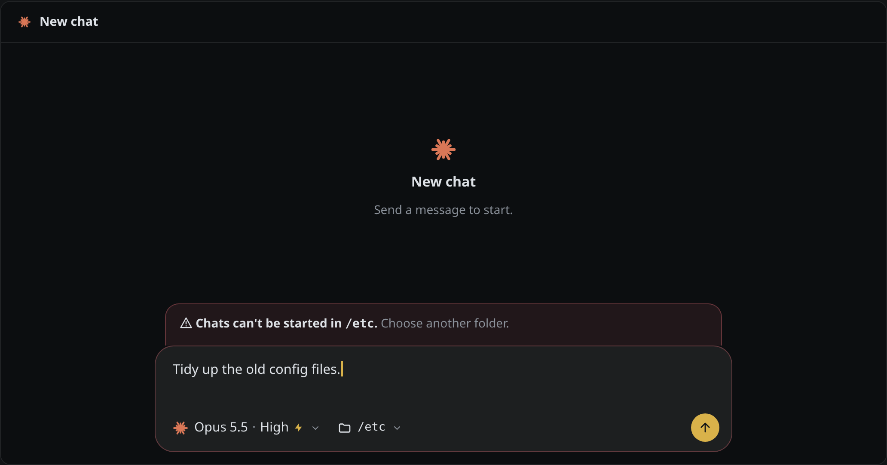

**Refused.** The app decides each new chat, and may refuse one. When it
does, the box says why, in the app's words and the warning colour, attached
to the top of the box: *Chats can't be started in /etc. Choose another
folder.* The message stays in the box.

## Deleting

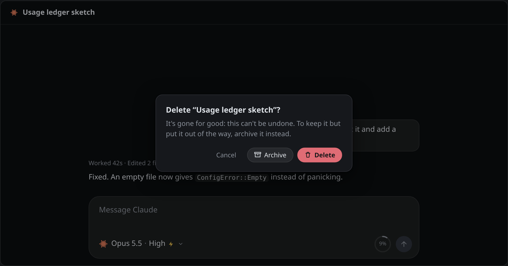

**Delete** is wherever the app puts it, and always asks first:
*Delete "Usage ledger sketch"? It's gone for good: this can't be undone. To
keep it but put it out of the way, archive it instead.* The actions are
**Cancel**, **Archive**, and **Delete**, in the warning colour. Deleting
removes the chat for good, open or not.

Only a saved chat can be deleted: one that isn't saved is gone anyway when
the app stops, and is archived instead. Only the app can delete a chat, so a
viewer offers no Delete.

## What CAF tells the app

| What the chat shows | Where it comes from |
| --- | --- |
| The title | The app's label, `AppData::label`: in an open chat's `ChatSummary.label` and a saved one's `Header.label`. Else the first line of the first message the user sent: a saved chat's `Header.first`, or the first `Starter::User` turn's text. |
| The agent's mark | `Chat.agent`, `ChatSummary.agent` or `Header.agent`. |
| When it last changed; turns | A saved chat's `Header.changed` and `Header.turns`. A chat that isn't saved: the latest time in its turns' `Turn.window`, and how many `Chat.turns` it has. |
| Its last turn | The last of `Chat.turns` whose `Turn.starter` is `User` or `Agent`, never `Caf`. |
| Working | That turn's `TurnLife::Running` or `Stopping`, counted from its `Turn.window.start`; or `ChatState::Opening` with a turn `TurnLife::Waiting`. |
| Waiting on you | A question in `Chat.questions`; or `ChatState::WaitingForAgent`, or `Lost { reason: Stopped }` with the banner showing, while the banner's tone is accent. The banner's tone comes from the agent's `AgentStatus`, as [Agents](~caf/standard-interface/agents) says. |
| Failed | That turn's `TurnLife::Failed`, with its `Failure.reason`. |
| Lost its agent | `ChatState::Lost`, with its `Lost` reason, in the transcript's words; but `Lost { reason: Stopped }` follows the banner while it shows. |
| Restoring | `SavedState::Restoring`, or `Core::restoring`. |
| Archived | `Chat.archived`, when it was archived, while it is: for a chat that's open, and kept in its save. For a saved chat that isn't open, `Header.archived`, or, for a chat saved before CAF kept when, `Header.closed`. A chat's `Change::Archived` says when it's archived or unarchived. |
| Can't restore | `SavedState::Failed`, with its `CannotRestore` reason: `NotFound`, `InUse`, `Newer`, `Damaged`, `AppData` or `Store`. Restoring answers with it too: `Error::CannotRestore`, or a viewer's `Outcome::CannotRestore`. |
| Agent gone | The chat's agent isn't among those the app offers (`Core::agents`, or a viewer's `Welcome.agents`): sending is refused with `Refused::NoSuchAgent`. A renamed agent is found by `Header.profile`. |
| Agent can't be used | Its `AgentStatus.own_tools_off` is false. With the cautious profile, sending is refused with `Refused::OwnTools`. With an agent that isn't the one its profile is for, sending isn't refused, but each open ends `Lost { reason: Incompatible(OwnTools) }`, and the lock is the app's own rule. |
| Opening a saved chat | `Core::restore`, or a viewer's `Restore`, which the app decides (`ViewerRules::restore`; by default it refuses). |
| Closing a tab | `Core::put_away` for a saved chat: at once, unless a turn is `Running` or `Stopping`, a turn is `Waiting` behind one, a question is in `Chat.questions`, or the chat is `Opening` with a turn `Waiting`; then once none is. A `WaitingForAgent` chat is put away at once, which stops its waiting turns with no `Note`. Until then it's loaded, and `Core::restore` would be refused, `Refused::Loaded`. One that isn't saved is refused, `Refused::NotSaved`, and is left open. Viewers can't put a chat away. |
| Archive | `Core::close_chat`, or a viewer's `Close`, with the `act` right: `Chat.archived` is set to now. |
| Unarchive | `Core::unarchive`, or a viewer's `Unarchive`, with the `act` right: `Chat.archived` is none again, and the chat is `Idle`. `Core::send` to an archived chat unarchives it first. While it's archived, CAF refuses to change its settings (`Refused::Closed`). |
| Remove from list | `Core::list_saved` on the chat's shelf again, which reads the store anew. Viewers can't list. |
| Delete | `Core::delete`, which takes the chat's shelf: only a saved chat. Viewers can't delete a chat. |
| A new chat | `Core::open_chat` with an `OpenChat`: the agent, the folder, and the settings chosen in the menu (`OpenChat.settings`). A viewer asks with an `OpenRequest` (an agent and a folder), and sets the settings with `Set` once it's `Opened`. |
| The new chat's menu | The agents CAF offers, each with its `AgentStatus.settings`, and whether it's installed and signed in. |
| A new chat refused | The app's own reason. A viewer gets `Outcome::NotAllowed`, or a `Refused` such as `NoSuchAgent`, `RelativeFolder` or `OwnTools`. |

Only a loaded chat's summary comes to a viewer unasked: `ChatSummary` has its
id, agent, folder, label and shelf, and when it was archived, if it is. Whether it's working, waiting on the
user or failed, and its first message, come from watching it.
