Usage is shown in two places. **In the chat**, the context ring by Send
opens a popover with what this chat has used and spent, and how much of the
agent's account limits is left; a dot on the ring says when one runs low.
**On the usage page**, the user sees how much every CAF app on the computer
has used over a period, by agent, app, model and day, and each agent's
limits in full.

[See usage live](~attachments/caf-si-usage), every state, in dark and light.

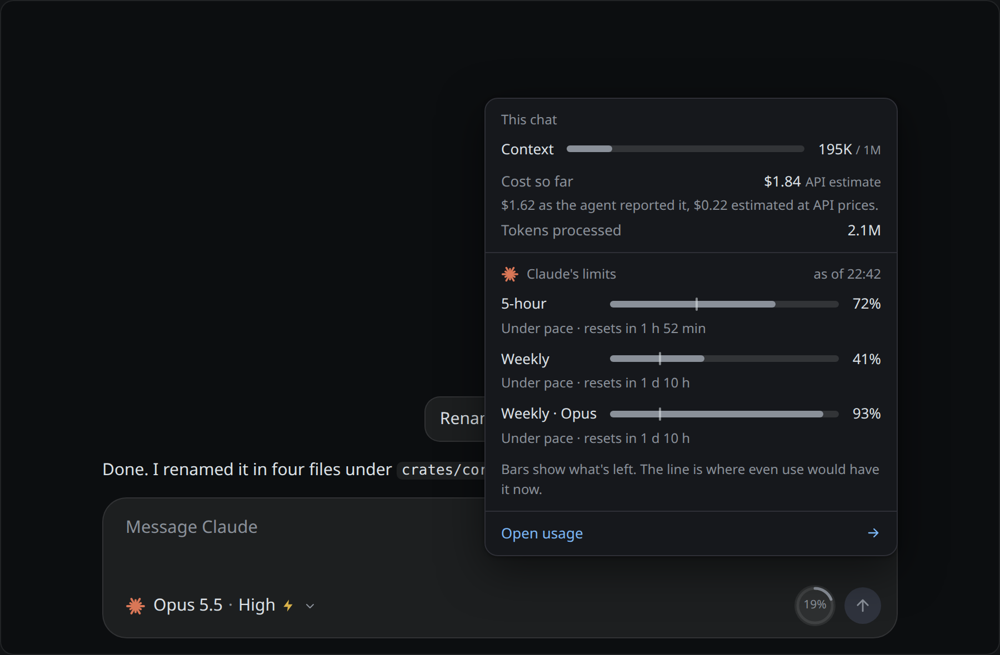

How firm each part is:

- **In the chat: Required.** The ring, its popover, the dot and their words.
  They're inside the chat, so a user moving between CAF apps finds them the
  same in each.
- **The usage page's layout: Suggested.** Its parts, what they mean, their
  words and colours are as below. Take the layout shown, or the one other
  way this page names: where there's no room for two columns, the same parts
  in one column, in the same order.
- **Where the usage page lives: Up to the app.** A panel over the window, as
  pictured, a tab, a pane: whatever the app already uses for a page of its
  own. So is any way to open it besides *Open usage*.
- **Later: only the extra agents in the pictures.** The pictures show Codex
  and Gemini beside Claude, to show a page with several agents. CAF runs only
  Claude today, and hears limits only from Claude. The layout stands as it
  is: shares, stacks and columns per agent work with one agent too.

## Where the numbers come from

Three things, and they reach a viewer in three ways:

| What | Whose | How a viewer gets it |
| --- | --- | --- |
| The context, and what the chat has spent | The chat's | With the chat, to any viewer watching it. |
| The account limits | The agent's account: every chat with the agent shares them | With the agent's status, to every viewer. |
| Usage over a period, and prices | Every CAF app on the computer, from the ledger they share | Only to a viewer with the `usage` right. |

So everything in the popover is shown to anyone who can watch the chat,
except *Open usage*, which needs the `usage` right, as the usage page does.
See [Usage](~caf/getting-started/usage) and
[Account Limits](~caf/getting-started/account-limits) for how CAF keeps them.

**The agent's name** is the one the app gives it everywhere else, *Claude*,
here as on [the composer](~caf/standard-interface/composer). In a summary,
CAF names an agent by its profile, such as `claude-agent-acp`, so that one
agent two apps name differently counts as one; the app shows that profile
by its agent's name and mark. Three cases want a rule:

- **An agent with no profile**, from another app: CAF names it by that
  app's name for it, which this app may not know. Show that name as it
  comes, with no mark.
- **Two of this app's agents with one profile** are one agent to a summary,
  as they share one account. Name it by the product the profile is for, as
  the app names that product (*Claude*), not by either agent's own name.
- **The *All agents* menu** lists the summary's agents, by profile, or by
  name for those without one. On Limits it picks the app's agents whose
  profile it names, or, without a profile, whose name it names. Agents that
  share a profile share their limits, so Limits shows them once, under the
  product's name.

## In the chat

### The ring

The context ring sits by Send, as [the composer](~caf/standard-interface/composer)
describes: how full the agent's context is, as a ring and a percent, in the
caution colour above 80% and the warning colour above 95%. Clicking it opens
the popover, and clicking it again, or anywhere else, closes it. **Escape**
closes an open popover and does nothing else: whatever else would take
Escape, such as a question waiting on the user, waits for the next press.
Focus stays on the ring throughout. A new chat, before the agent has said how full
its context is, has no ring, and so no popover.

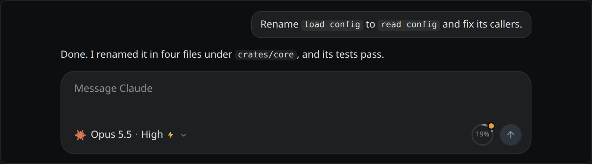

**The dot.** When one of the chat's agent's limits runs low, the ring gains a
dot, so it's noticed without opening anything:

- **caution**, when the window with least left has **20% left or less**
  (*low*);
- **warning**, when it has **10% left or less**, or the agent refuses turns
  in it (*out*);
- none otherwise.

The window that counts is the one with least left (the TypeScript SDK's `lowest`), and
how low it is is the TypeScript SDK's `lowness`, so every app puts the dot in the same
place.

**The two kinds of threshold differ, deliberately.** The ring's colours go by
how full the context is, and change only *above* 80% and 95%, as the
composer's do. A limit's go by what's left, and change *at or below* 20% and
10%, as the TypeScript SDK's `LOW_LEFT` and `OUT_LEFT` do. Each follows the one rule
every app shares for its measure, so neither is bent to match the other.

### The popover

One card, above the ring, in sections. Each measure is a row: a label, a bar
and a value. It takes no focus, and the chat goes on around it.

**This chat**, headed *This chat*:

| Row | Shows |
| --- | --- |
| **Context** | A bar of how full the context is, and *195K / 1M*: tokens used, of what it holds. The bar takes the ring's colours. |
| **Cost so far** | What the chat has cost: *$1.84*, with *API estimate* beside it if any of it was estimated. Under it, a line saying how it was come by (below). *Nothing yet* while CAF has no record of any of its turns. |
| **Tokens processed** | Every token its turns used, short: *2.1M*. |

The line under the cost, by what the chat's spend holds:

| When | The cost | The line |
| --- | --- | --- |
| All of it reported by the agent | *$1.84* | *As the agent reported it.* |
| All of it estimated | *$1.84 API estimate* | *An estimate, at API prices.* |
| Some of each | *$1.84 API estimate* | *$1.62 as the agent reported it, $0.22 estimated at API prices.* |
| No price for its models, and nothing reported | *$0.00* | *No price is known for the models it used, and the agent reported no cost.* |

And when some tokens had no price, a further line:
*1.2M tokens on models with no known price aren't in it.*

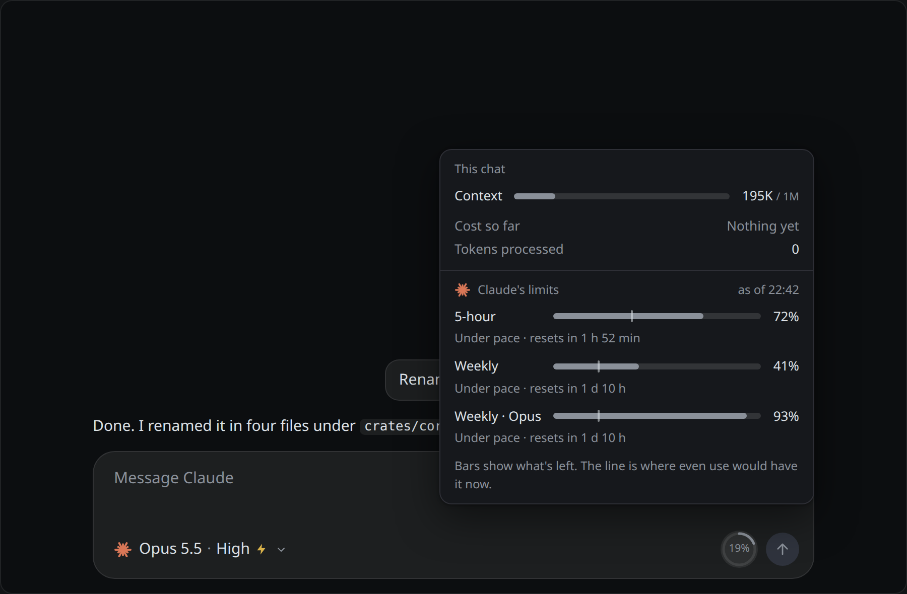

**No record yet.** A chat whose turns CAF has no record of, such as one from
before usage was recorded, or imported, shows *Nothing yet* for its cost and
*0* tokens. Its limits are still shown: they're the account's, not the
chat's. The viewer pictured also lacks the `usage` right, so there's no
*Open usage*.

**The agent's limits**, headed *Claude's limits*, with the agent's mark and
name, and *as of 22:42* at the right: when CAF heard of them. With windows
heard at different times, it's the oldest, so it never claims they're
fresher than they are. Then a row per window, in the order CAF gives them:

- **the label**, from the TypeScript SDK's `label`: *5-hour*, *Weekly*,
  *Weekly · Opus*, *Weekly · extra included*, or the agent's own name for a
  window CAF doesn't know;
- **a bar of what's left**, with a line where an even pace would have it now
  (see [Pace](#pace));
- **what's left**, as a percent: *72%*;
- **under it**, the pace, or the agent's own word for the window if it has
  one, then when it resets: *Under pace · resets in 1 h 52 min*.

Under the rows, *Bars show what's left. The line is where even use would
have it now.* An agent that hasn't said what its limits are has no limits
section.

**Open usage**, at the foot, in the link colour, goes to the usage page.
Only a viewer with the `usage` right sees it.

### A limit low or out

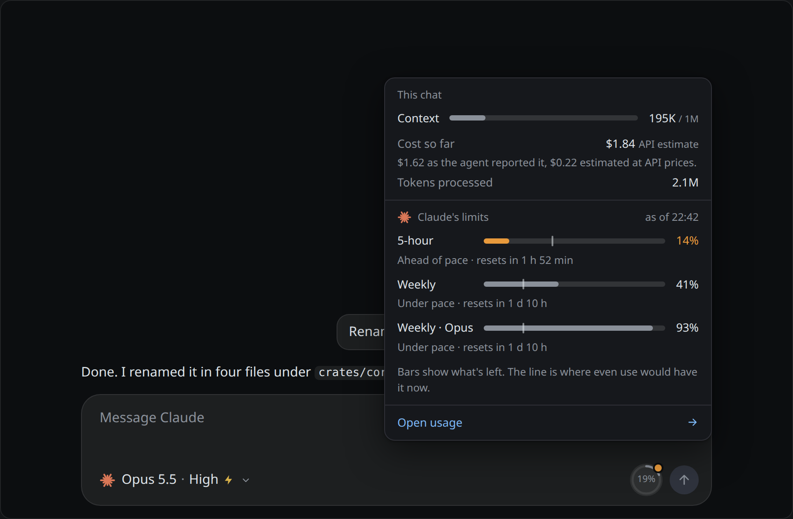

**Low.** A window with **20% left or less** is in the caution colour: its
bar, and its percent. The ring's dot is caution.

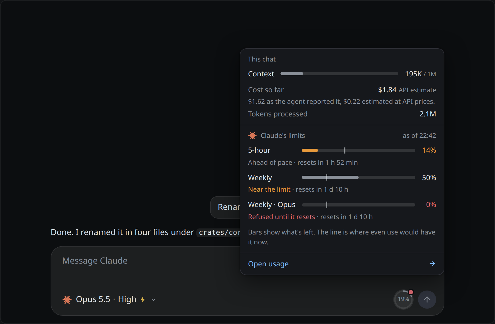

**Out.** A window with **10% left or less**, or refused, is in the warning
colour, and so is the dot.

**The agent's word.** Claude also says, of each window, whether it still
takes turns in it. That's shown in words, in place of the pace:

| The agent says | Shown as |
| --- | --- |
| It warns the window is near its end (`Warning`) | *Near the limit*, in the caution colour |
| It refuses turns until the window resets (`Refused`) | *Refused until it resets*, in the warning colour, with *0%* left |
| Nothing more (`Fine`) | The pace |

The colour of the bar and the percent comes only from what's left, never
from the agent's word: Claude may warn of a window at 50% used, as here,
and that's no reason for a dot. A refused window always has nothing left, so
it's always out.

Limits are information only. Nothing in the composer changes for them, and a
message is never held back: a turn the agent refuses for its limits fails in
the transcript as [the transcript](~caf/standard-interface/transcript) shows.

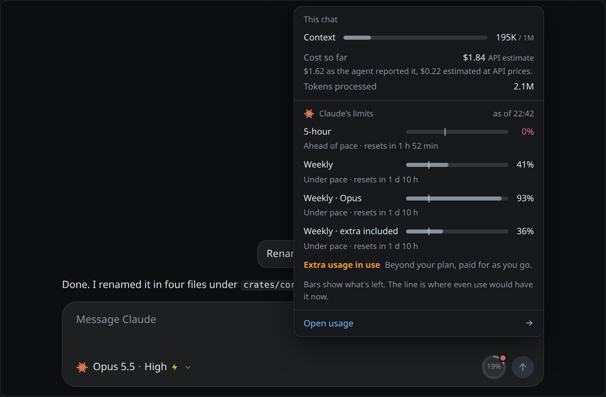

**Extra usage.** When the account goes on beyond its plan, paid for as it
goes, the limits section ends with *Extra usage in use*, in the caution
colour, and *Beyond your plan, paid for as you go.* Nothing is shown when it
isn't in use, or the agent hasn't said.

### Pace

A window's **pace** is how much of it has gone by: where its use would be if
it were used evenly from start to reset. Drawn on a bar of what's left, it's
a line at 100% less the pace.

- **Ahead of pace**: more is used than the pace. At this rate, it runs out
  before it resets.
- **Under pace**: less is used than the pace.
- **On pace**: exactly the pace.

The pace words are muted: how much is left, and its colour, carry the
warning. A window with no reset, or one CAF doesn't know the length of, has
no pace: no line, and no pace words. Pace and resets move with the clock, not
with news, so the app draws them again as time passes.

### Times

Every time in these parts is given the same way:

- **how long until**: *under a minute*, *42 min*, *1 h 52 min*, *1 h*,
  *1 d 10 h*, *4 d*;
- **a moment**, in one form: the clock alone if it's today, *23:40*; the
  day of the week and the clock if it's within a week, *Mon 09:00*; else
  the date and the clock, *14 Nov 09:00*. The clock is the user's, 24-hour;
- **when a reset is**: *resets in 1 h 52 min* in the popover, and on the
  usage page with its moment too, *Resets in 1 d 10 h, at Mon 09:00*;
- **when something was heard or fetched**: *as of 22:42*, *as of Fri 18:05*;
  *fetched at 09:14*, *fetched Fri 09:14*.

A window whose reset has come but that CAF hasn't forgotten yet, as may
happen for a few minutes after the computer wakes, says *Resetting* in place
of when it resets. Once CAF forgets it, it's gone, until the agent says
again.

### Numbers

Every number in these parts, and on the usage page, is given the same way:

- **tokens**, short: whole under a thousand, *950*; whole thousands up to a
  million, *195K*; then one decimal, *2.1M*, *1.2B*. A tooltip may give the
  count in full, *2,104,391*;
- **money**, in US dollars to the cent, *$1.84*; anything above nothing but
  under a cent, *<$0.01*, so it isn't read as none;
- **prices**, per million tokens: whole dollars bare, *$5*; otherwise as
  many decimals as they need, up to four, and at least two, *$0.50*;
- **shares**, as percents: whole from 10% up, *76%*; one decimal under 10%,
  *3.0%*, *0.9%*; and *<0.1%* for a sliver above nothing;
- **what's left of a limit**, and the pace: whole percents, as CAF gives
  them.

## The usage page

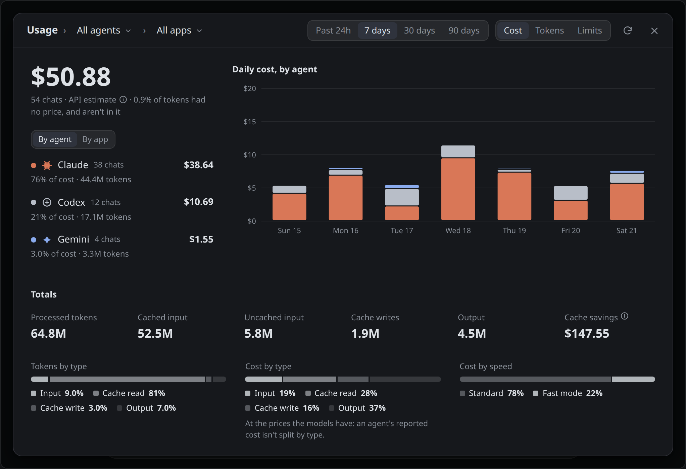

**Suggested.** One page, with a header and a body that scrolls. The header
holds, in order:

- **Usage**, the page's name, then which agents and which apps it covers:
  *All agents*, *All apps*, each a menu to pick some;
- **the period**: *Past 24h*, *7 days*, *30 days*, *90 days*, with *7 days*
  chosen when the page opens;
- **what it measures**: *Cost*, *Tokens* or *Limits*;
- **Refresh**, and **Close** if the page is shown over something.

Only a viewer with the `usage` right has the page, as it covers every CAF
app on the computer, not just this one.

**The period asked for.** Each period ends now and is made of whole days, or
whole hours for *Past 24h*, in the user's own time zone, today's (or this
hour's) included. So the query (`UsageQuery`) is:

- `zone`: the user's own time zone;
- `by`: `Hour` for *Past 24h*, `Day` for the rest;
- `since`: the start of the day (or hour) 6 before today's for *7 days*, 29
  for *30 days*, 89 for *90 days*, 23 hours before this one for *Past 24h*;
- `until`: now;
- `apps` and `agents`: those picked in the menus, or empty for all.

That gives 7 days of bars for *7 days*, today's partly done. A period of a
fixed length back from now, such as *now less 7 × 24 hours*, would cut the
first day in two, and give 8 bars.

### Cost and Tokens

The body, from the top:

1. **The total**, large: *$50.88*, or the tokens, *64.8M*. Under it, how
   many chats it covers, and for cost how it was come by:
   - *54 chats · API estimate*, with an ⓘ whose tooltip says *What agents
     reported, and for turns they reported nothing, an estimate at the
     models' API prices. On a plan, it isn't what you pay.*, if any of it was
     estimated;
   - *54 chats · as agents reported it*, if none was;
   - and *· 0.9% of tokens had no price, and aren't in it*, if any had none.
     If none had a price and none was reported, that's all it says, under
     *$0.00*: *· 100% of tokens had no price, and aren't in it*.
2. **Shares**, *By agent* or *By app*: each with its colour, mark, name and
   chats, its cost or tokens, and under it *76% of cost · 44.4M tokens*, or
   when measuring tokens, *69% of tokens · $38.64*. Biggest first.
3. **A chart**, stacked by the same: *Daily cost, by agent*, or when
   measuring tokens, *Daily processed tokens, by agent*; *Hourly* in place of
   *Daily* for the past 24 hours, and *by app* when split by app. Every day or
   hour of the period has its place, empty ones too.
4. **Totals**:

   | Label | What it is |
   | --- | --- |
   | *Processed tokens* | Every token, `total` of the summary's `Tokens` |
   | *Cached input* | `cache_read` |
   | *Uncached input* | `input` |
   | *Cache writes* | `cache_write` |
   | *Output* | `output`, thinking included |
   | *Cache savings* | The TypeScript SDK's `cacheSavings`, with an ⓘ whose tooltip says *What reading input from the cache saved, against reading the same input fresh, at the models' prices.* |

   *Cache savings* is each cached token at its model's input rate, less what
   it cost read from the cache, fast mode's multiplier included, for the
   models that have a price. It's left out when nothing priced was read from
   the cache (`cacheSavings` is null).
5. **Three bars of shares**:
   - *Tokens by type*: *Input*, *Cache read*, *Cache write*, *Output*.
   - *Cost by type*, the same kinds, from the TypeScript SDK's `costByKind`: each kind
     of token at its model's rate, fast mode's multiplier included, for the
     models that have a price, with the note *At the prices the models have:
     an agent's reported cost isn't split by type.* It's left out when no
     model has a price (`costByKind` is null).
   - *Cost by speed*: *Standard*, *Fast mode*, by the buckets' `fast`.

   Their parts are tones of one colour, never an agent's or an app's.
6. **Breakdown**: a table by *Model*, *App* or *Day* (*Hour* for the past 24
   hours). Below.

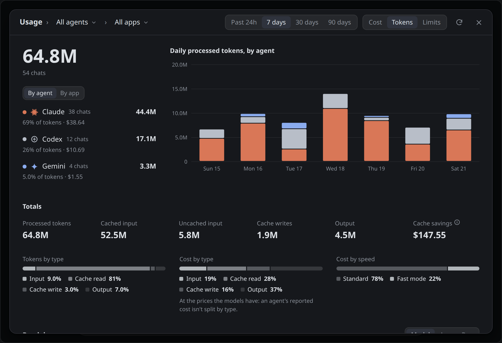

**Tokens** is the same page measured in tokens: the total, the shares, the
chart and the breakdown's order are by tokens instead of cost.

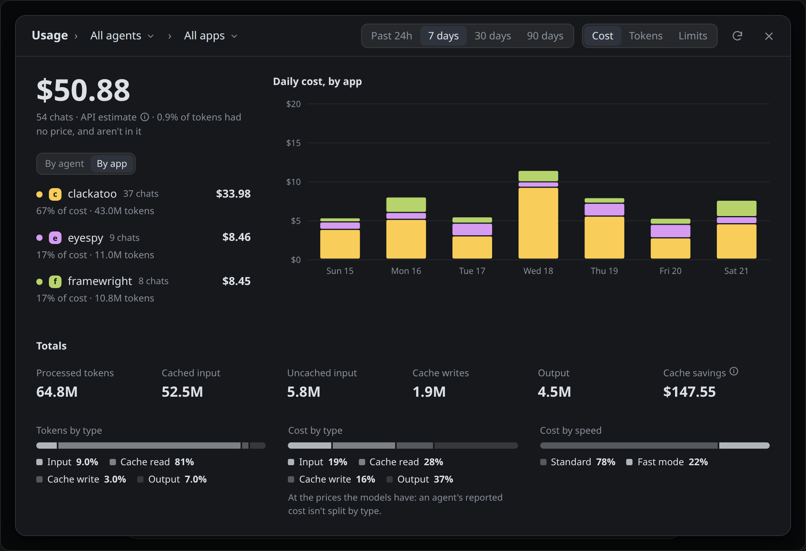

**By app** splits the shares and the chart by the app each turn came from,
from the ledger every CAF app on the computer shares.

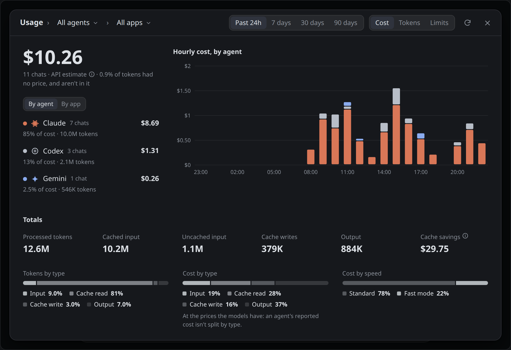

**Past 24h** goes by hour: *Hourly cost, by agent*, hours on the chart, and
*Hour* in the breakdown.

### Names and colours

**Up to the app**, within these rules. Agents are named as
[above](#where-the-numbers-come-from). An app is named by its host's name
(*clackatoo*). A model is named by its name, *Opus 5.5*, as the agent's
profile names the agent's id for it (`Summary.names`, which the TypeScript
SDK's `modelName` looks up), and by the id itself, as it comes
(*gpt-6.1-sol*), where it has none, as for an agent whose profile doesn't
name its models. Where the id matters, as a price goes by it, the id
follows the name: its tooltip in the breakdown, and in brackets where a
price names the model. Each agent and app has a colour of its own, the same
wherever it appears. It's identity, not a colour role, so, as the
[overview](~caf/standard-interface/overview) says, it appears only in marks
and to tell them apart in charts: the dot by a share, the chart's stacks, a
row's bar in the breakdown. It's never on text, controls or edges, which is
why the *All agents* and *All apps* menus carry no coloured dots.

### The breakdown

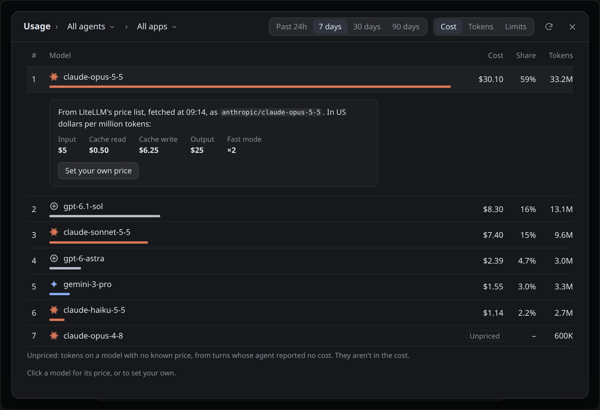

**By model**, the default: *#*, *Model*, *Cost*, *Share*, *Tokens*, biggest
first, each model by name, with its agent's mark and a bar of its share in
the agent's colour.

- A model whose tokens no price covered, and whose turns reported no cost,
  has *Unpriced* in place of its cost; one with some such tokens has its
  cost, and *1.2M unpriced* beside it. Under the table: *Unpriced: tokens on
  a model with no known price, from turns whose agent reported no cost. They
  aren't in the cost.*
- Under that: *Click a model for its price, or to set your own.*

**A model's price.** Clicking a model opens its price under its row: where it
came from, the rates *In US dollars per million tokens* (*Input*,
*Cache read*, *Cache write*, *Output*, and *Fast mode* as a multiplier, *×2*,
if it has one), and buttons. Where it came from:

| Price | It says | Buttons |
| --- | --- | --- |
| The user's own | *Your own price.* | *Change your price*, *Remove your price* |
| LiteLLM's list, as fetched | *From LiteLLM's price list, fetched at 09:14.* | *Set your own price* |
| The list that came with the app | *From the price list built into the app.* | *Set your own price* |
| None | *No price is known for Opus 4.8 (`claude-opus-4-8`), so turns on it that didn't report a cost aren't counted in the cost.* | *Set your own price* |

If the list names the model otherwise than the agent does, it says so:
*…, as `anthropic/claude-opus-5-5`.*

*Set your own price* opens a form of the four rates and the fast mode
multiplier, headed *Your own price for Opus 5.5 (`claude-opus-5-5`), in US
dollars per million tokens. The other apps on this computer that share your usage record
use it too.*, with *Cancel* and *Save*. *Remove your price* takes the user's
own away: a list's price applies again if a list has one, and otherwise the
model is unpriced. The viewer can't tell beforehand which, as a summary
holds only the price that was used.

A price set or removed applies to every figure at once, as costs are
estimated with the prices of now, and reaches the other apps within the
hour. If it isn't done, the form stays, with why under it, in the warning
colour:

| CAF answers | It says |
| --- | --- |
| `PriceNotSet`, with the system's words | *Your price couldn't be saved, and prices are as they were:* then the system's words |
| `NoLedger` | *This app keeps no record of usage, so it can't keep a price of your own.* |
| `NotAllowed` | *You may not set prices here.* |
| `Gone` | *The app has shut down, so nothing was saved.* |
| The link dropped before the answer | *The link to the app dropped before the answer came, so your price may not have been saved.* |

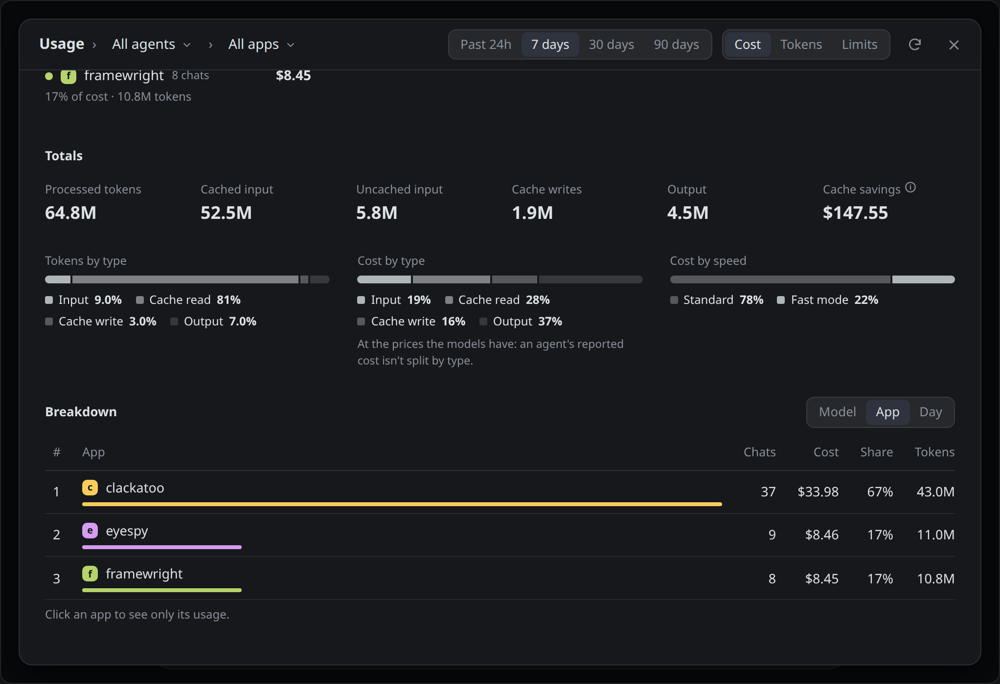

**By app**: *#*, *App*, *Chats*, *Cost*, *Share*, *Tokens*, with
*Click an app to see only its usage.* under it. Clicking an app picks it in
the *All apps* menu, which asks again with only that app (`UsageQuery.apps`).

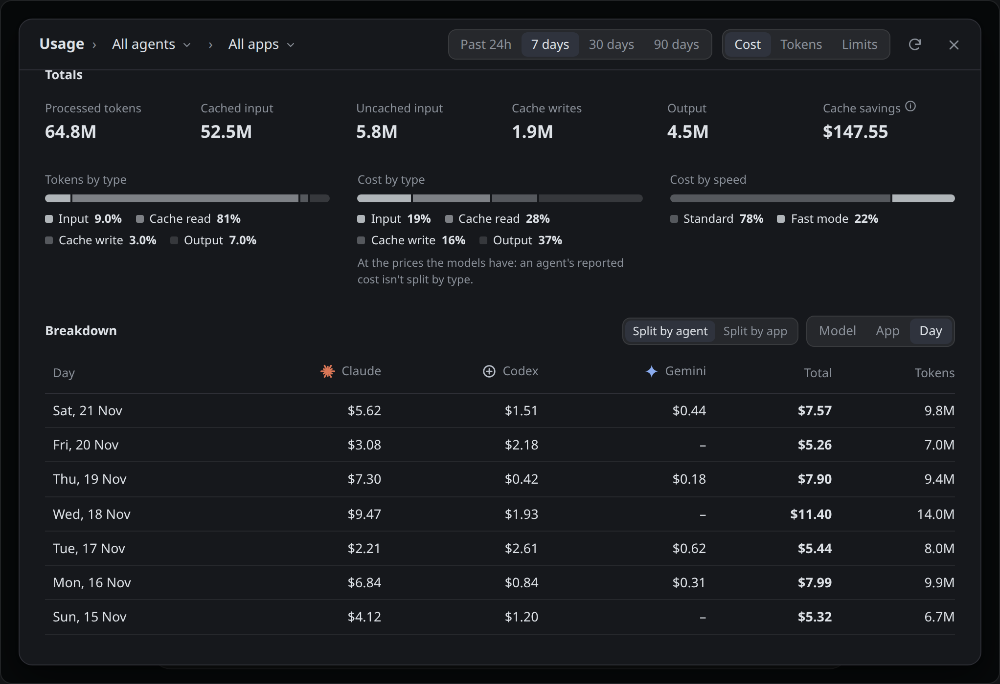

**By day**: a row per day of the period, newest first (*Sat, 21 Nov*), empty
days too, then a column per agent, *Total*, and *Tokens* (or *Cost*, when
measuring tokens). A day an agent didn't work is *–*; a day nobody worked
has *–* in every column and a total of *$0.00*.

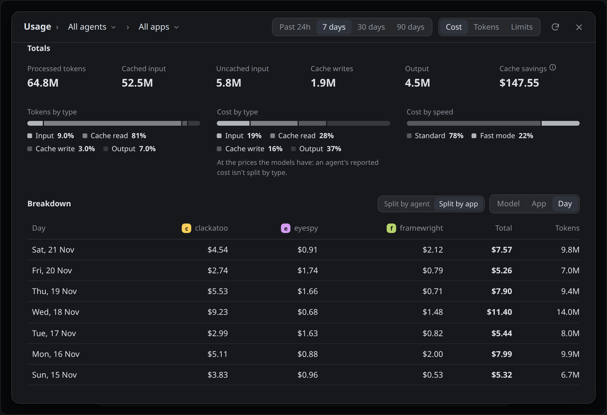

**Split by agent** or **Split by app** switches the columns.

### Limits

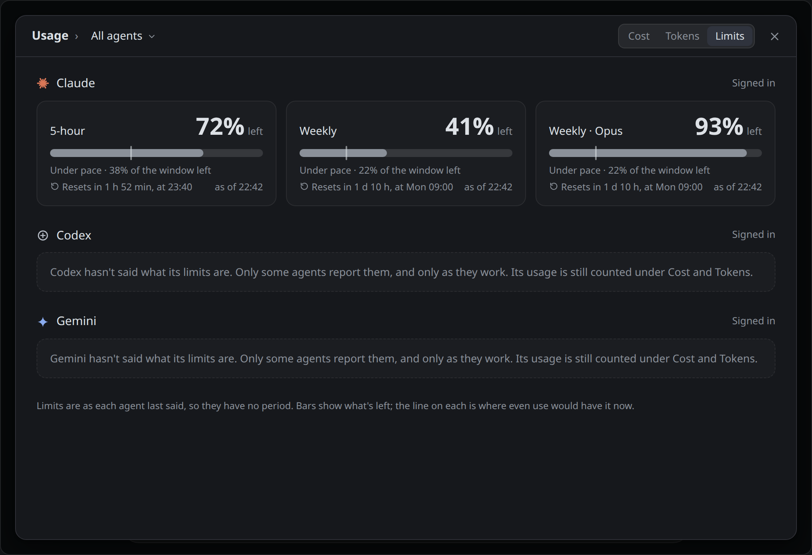

**Limits** shows the agents picked in the *All agents* menu (all of them, at
first), each with its mark, name and whether it's signed in, and the
account's limits as the agent last said them. The *All apps* menu and the
period go, as limits belong to neither. There's no Refresh: limits come only
as the agent works, and CAF can't ask for them. A card per window:

- **the label**, and **what's left**, large: *72% left*;
- **a bar of what's left**, with the pace's line;
- the agent's own word, if it has one: *Near the limit*, *Refused until it
  resets*;
- **the pace**: *Under pace · 38% of the window left*;
- **when it resets**, and **when it was heard**: *Resets in 1 h 52 min, at
  23:40*, and *as of 22:42*.

A fine window's bar is muted, so low and out stand out.

An agent with no limits heard says so plainly:
*Codex hasn't said what its limits are. Only some agents report them, and
only as they work. Its usage is still counted under Cost and Tokens.* At the
foot: *Limits are as each agent last said, so they have no period. Bars show
what's left; the line on each is where even use would have it now.*

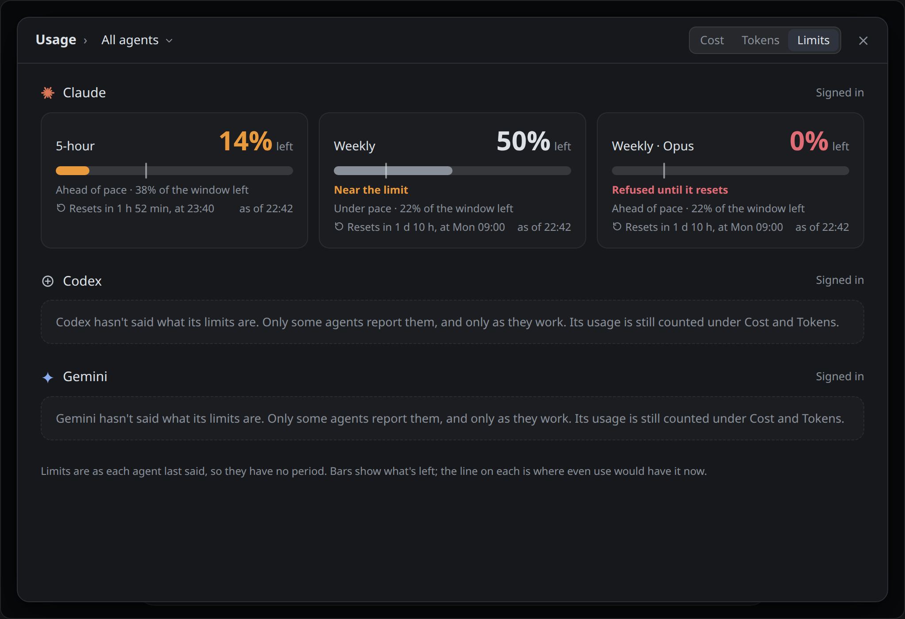

**Low and out** take the same colours as in the popover, and *Extra usage in
use*, in the caution colour, goes in the agent's heading when it is.

The limits here are the same as in the popover: a viewer without the `usage`
right, who has no usage page, still sees them in the chat.

## The page's states

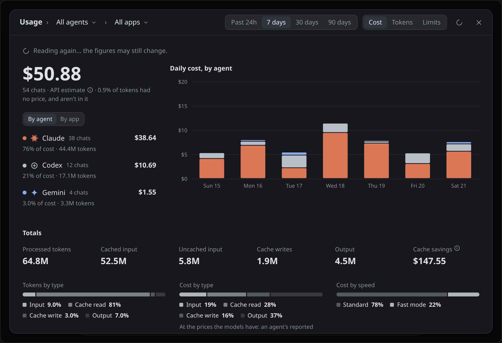

**Reading.** The first time, the page says *Reading usage…*. Read again, by
Refresh or a new period, the last figures stay up, with
*Reading again… the figures may still change.* and a spinning Refresh.

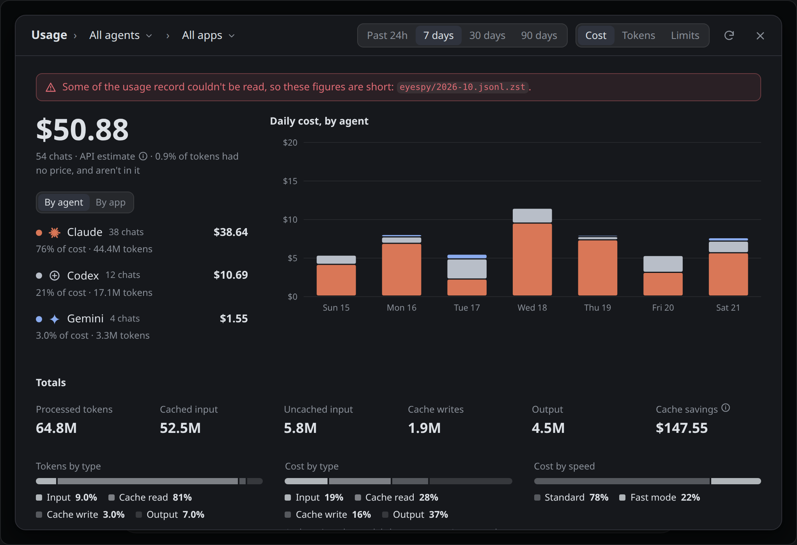

**Partly unreadable.** If any file of the usage record couldn't be read, the
figures are shown, and above them, in the warning colour:
*Some of the usage record couldn't be read, so these figures are short:
eyespy/2026-10.jsonl.zst.*, naming each file. If CAF names `.`, the record's
folder itself couldn't be read, and it says instead *The usage record's
folder couldn't be read, so these figures are short.* The page is never
quietly short.

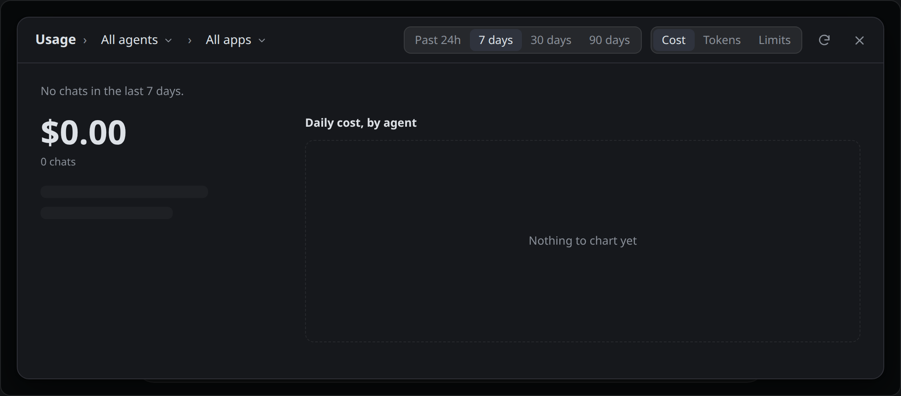

**Nothing yet.** A period with no turns in it says
*No chats in the last 7 days.* (or *the past 24 hours*), with *$0.00*,
*0 chats*, and *Nothing to chart yet* where the chart goes. That includes a
computer with no usage record yet at all: CAF reads a missing record as
nothing used.

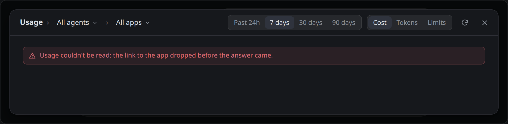

**Couldn't read.** If the summary can't be made at all, the page shows only
why, in the warning colour, starting *Usage couldn't be read:*

| CAF answers | It says |
| --- | --- |
| The link dropped before the answer | *Usage couldn't be read: the link to the app dropped before the answer came.* |
| `Gone` | *Usage couldn't be read: the app has shut down.* |
| `BadQuery::Zone` | *Usage couldn't be read: the time zone Europe/Lndn isn't one the app knows, so it can't say where days begin.* |
| `BadQuery::Period` | *Usage couldn't be read: it can't be summed up over that period.* |
| `NotAllowed` | *Usage couldn't be read: you may not see usage here.* |

The periods above never give `BadQuery::Period`, and a viewer without the
`usage` right has no page to get `NotAllowed` on, but the words are there for
an app that strays. An app that keeps no usage record (`NoLedger`) isn't
failing: it says, muted, *This app keeps no record of usage, so there's
nothing to show here.*

## In an app not written in TypeScript

The helpers this page names are the TypeScript SDK's. caf-core, in Rust,
has `LimitWindow::pace`, `WindowKind::length`, `Tokens::total`, `Tokens::add`
and `Spend::cost`, and no more. An app that draws natively, in Rust or
anything else, does the rest itself, by these rules, so it says exactly what
every other app says:

| Helper | The rule |
| --- | --- |
| `left` | What's left of a window, as a whole percent: 0 if `Refused`, else 100 less `used`. |
| `lowness` | *out* at 10% left or less (`OUT_LEFT`), *low* at 20% left or less (`LOW_LEFT`), *fine* otherwise. So a refused window is always out. |
| `lowest` | The window with the least left; on a tie, the first of them in the order CAF gives the windows. None if there are none. |
| `label` | `FiveHours`: *5-hour*. `Week`: *Weekly*. `ModelWeek`: *Weekly ·* and the model's name with its first letter made a capital, *Weekly · Opus*. `ExtraWeek`: *Weekly · extra included*. `Other`: the agent's own name for it, as it comes. A kind newer than the app knows: the kind's own name, as CAF sends it. |
| `pace`, `length` | Use caf-core's `LimitWindow::pace` and `WindowKind::length`: a whole percent of the window gone by, rounded half up; none with no reset or no length. |
| `total` | Every token: input, cache read, cache write and output. Thinking is part of output, so isn't counted again (`Tokens::total`). |
| `cost` | Reported and estimated cost added up (`Spend::cost`, or a bucket's `reported` plus `estimated`). |
| `totals` | Every bucket's tokens, reported and estimated cost, unpriced tokens and turns, added up. |
| `group` | The buckets by app, agent, model or fast mode (*fast* or *standard*), each group's figures added up. Biggest first by the measure shown (cost, or tokens); on a tie, by the other measure; then by key, compared character code by character code, whatever the locale. By period: every period of the query, in time order, empty ones too. |
| `split` | Every period of the query, in time order, empty ones too, each with its buckets grouped as `group` does, by cost. |
| `price` | A model's price in a summary: the entry `Summary.matched` pairs with the agent's id for the model, found by name in `Summary.prices`; none if either is missing. |
| `modelName` | A model's name to show: the name `Summary.names` pairs with the agent's id for it, else the id itself. |
| `costByKind`, `cacheSavings` | As [Cost and Tokens](#cost-and-tokens) says: per bucket, at its model's `price`, times the price's `fast` multiplier if the bucket's `fast` is on; buckets with no price left out. `costByKind` is none if nothing was priced; `cacheSavings` is none if nothing priced was read from the cache. |

A period starts where the query's zone says it does: an hour at the top of
the zone's hour, a day at the first moment of its date there, which is
midnight unless the clocks skip it, so a day is 23 or 25 hours across a
change of clocks. A bucket belongs to the last period starting at or before
its `start`.

## What CAF tells the app

| What's shown | Where it comes from |
| --- | --- |
| The ring and the context row | `Usage.used` of `Usage.size`, on the chat. |
| *Cost so far* and its line | The chat's `spend` (`Spend`): `cost()`, `reported`, `estimated`, `unpriced` and `turns`, sent again (`Change::Spend`) whenever it changes. |
| *Tokens processed* | `Spend.tokens`, added up with the TypeScript SDK's `total`. |
| The limits | `AgentStatus.limits` (`AccountLimits`): each `LimitWindow`'s `kind`, `used`, `resets`, `state` (`Fine`, `Warning`, `Refused`) and `heard`. |
| A window's name | The TypeScript SDK's `label`. |
| What's left, low, out | The TypeScript SDK's `left` and `lowness`, at `LOW_LEFT` (20) and `OUT_LEFT` (10). |
| The ring's dot | `lowness` of the TypeScript SDK's `lowest`. |
| Pace | The TypeScript SDK's `pace` (caf-core's `LimitWindow::pace`), and `length`. |
| *Extra usage in use* | `AccountLimits.extra_usage`: `in_use`, `heard`. |
| *Open usage*, the page, prices | The viewer's `usage` right (`Rights::usage`, given with `ViewerRules::usage`). |
| The page's figures | A `Summary` for a `UsageQuery` (`since`, `until`, `zone`, `by`: `Day` or `Hour`; `apps`, `agents`), asked for with `FromViewer::Usage`. |
| Totals, shares, the chart, the breakdown | The summary's `buckets`, summed by the TypeScript SDK's `totals`, `group` (by `app`, `agent`, `model`, `period`, `fast`), `split`, `cost` and `total`. |
| *Cost by type*, *Cache savings* | The TypeScript SDK's `costByKind` and `cacheSavings`, at the prices the summary used. |
| Chats | `Summary.chats`: `all`, `by_app`, `by_agent`. |
| A model's name | The TypeScript SDK's `modelName`, from `Summary.names`: the name each model's lines were recorded with, or the one its agent's profile gives now. A turn's own record names its models too (`TurnUsage.models`' `ModelTokens.name`). |
| A model's price | The TypeScript SDK's `price`, from `Summary.prices` and `matched`: a `PricedModel`'s `price` (`ModelPrice`) and `layer` (`Own`, `Fetched`, `Bundled`), and `Summary.fetched`. |
| Setting a price | `FromViewer::SetPrice`, answered `Done`, `PriceNotSet`, `NoLedger`, `NotAllowed` or `Gone`. |
| *Some of the usage record couldn't be read* | `Summary.unreadable`: file names, or `.` for the folder. |
| *Usage couldn't be read* | `Outcome::Gone`, `BadQuery` (`Zone`, `Period`) or `NotAllowed`, or the link dropping. |
| *This app keeps no record of usage* | `Outcome::NoLedger`. |
